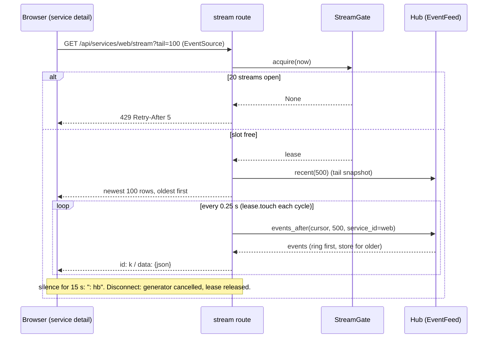
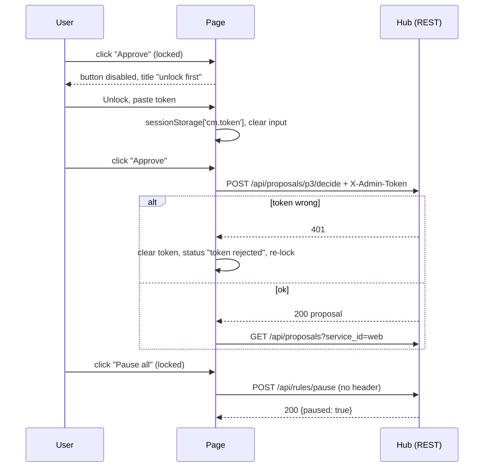

# Design: dashboard (V1)

Requirements: [requirements.md](requirements.md). Capability map: [docs/v1-capability-map.md](../../../docs/v1-capability-map.md) (module `dashboard`, D1, D3, B4, B16, B19, M2, L6). Interfaces used from approved designs: [store](../store/design.md), [services](../services/design.md), [connectors](../connectors/design.md), [discovery](../discovery/design.md), [auto-approval](../auto-approval/design.md). Baseline: [legacy-mesh](../legacy-mesh/design.md) (R5, R8, R9). `agent-loop` is being designed in parallel; what this module needs from it is under "Needs from agent-loop".

## Overview

The dashboard stays one static file, `src/chimericmesh/web/index.html`, and gains four views next to the existing page: **Services** (cards, add and edit form, one detail view per service with a live log, incidents, proposals and the Kiro permissions text), **Discovery** (scan, review, accept, dismiss), **Rules** (rules, pause banner, audit table) and the existing page, which becomes the **Overview** tab with every current element id kept. The only new server code is the per-service SSE route and the helpers behind it (`web/sse.py`, `web/feed.py`, `web/stream.py`), plus small edits in `api.py`: include the router, add two headers to `/`, and add the read-only `GET /api/ui-config` route (owner `dashboard`, see "ui-config route").

Eight decisions shape everything else:

1. **The page only calls REST and SSE routes; no Python module is imported by it, and no Python module of this package imports another module's code.** `web/*` imports `core` (the `Event` type) and nothing else. The SSE route receives its data through two injected callables (`EventFeed`, `service_exists`), so it runs against a plain `Hub()` and against the store-backed hub with the same code (resolves M2, see "Injected interfaces").
2. **The stream is a cursor over `StateView.events_after`, polled every 250 ms by the stream's own coroutine.** No new hub hook, no queue shared with ingest. The 1 second delivery bound (R5.4) is met with a 0.25 s poll. Rejected: a push hook on `Hub.ingest` (an edit to wiring code that the store, services and connectors designs already rewrite, and it needs per-stream queues that the hub must bound); a thread (nothing blocks).
3. **Safety is enforced in three layers: a code rule, a static test and the hook.** All dynamic strings enter the DOM through `el(tag, cls, text)` and `textContent`. `setAttribute` is limited to a fixed list of literal, non-URL attribute names. The existing `guard-innerhtml` hook is widened (it misses `+=` and bracket access today) and a pytest scan of `index.html` repeats the same rules, so a sink fails in the editor and in CI.
4. **The token never leaves one function.** `authHeaders()` is the only place that reads it; it is added to a request only when `needsToken(method, path)` says the route is privileged, and it is never put in a URL, the DOM text, a log call or `localStorage`. The server stays the authority: a disabled button is a convenience, and every privileged route checks the token itself (`services` R6).
5. **Pure logic is separated from DOM code and self-tested in the browser.** About 20 small functions (sorting, relative time, error text, filters, routing, the token-needed table, audit merge) live between `/* PURE:begin */` and `/* PURE:end */` and touch no `document`, `fetch` or storage. A built-in `#selftest` mode runs a case table over them and writes `SELFTEST PASS` or the failures with `textContent`, no fetch. This is checked by headless Edge in a Manual step, not by a JS test runner (none is allowed). The self-test is accepted as a Manual check only (O1); `SELFTEST_CASES` stays under 200 lines so the production file does not grow without bound. The exact banner strings are fixed once (see "Script sections"). Python tests check that every function in the block has at least one case, that the block references no browser global, and the page behaviour that can be read from source.
6. **One scheduler, one poll interval table.** A single 1 second `setInterval` runs tasks whose `every` has elapsed, only for the visible tab and the active view (a task with view `'*'` runs on every view). The tick is 1 s, so a task runs on the first tick at or after its `every`: the Overview's 2.5 s period becomes 3 s in practice (accepted; the existing page used two timers, 2500 ms and 1000 ms). `fetchChat` becomes a scheduler task that runs only while the Overview is active (today it runs on every visible tick), which is a deliberate change of baseline behaviour: the transcript is only visible there. The Services list and Rules and Audit refresh every 5 s (R3.3, R7.7), a running scan every 1 s (R4.2), `approvals-status` every 5 s on every view (the paused banner and the rule-form bounds need it everywhere, M2). `dueTasks()` is pure.
7. **Reduce actions work while locked, widen actions do not, and the lock is driven by one registry.** `ACTIONS` lists each action id with `token: true | false`. A button is built with `actionButton(id, label, handler)`, which sets `data-action`, `disabled` and the title "unlock first" from the registry. The static test compares the registry with D3 (pause all, per-rule pause, revoke, withdraw are token-free; create, edit, enable, resume, add service, accept, scan, decide are not; the terminal is a third, conditional class).
8. **The page asks the hub whether access control is on.** With `enforce_access` off (every existing test, a bare hub) nothing is locked and no token is asked for. The flag comes from `GET /api/ui-config`, a route this module adds to `api.py` (see "ui-config route"; it is a wiring edit, owner `dashboard`, not a `services` change). Fallback when the route fails (404 or network error) while `GET /api/stats` works: the lock state is **unknown**. The page then leaves the controls enabled, shows "access mode unknown" in the status line, and still sends the token when one is stored; the server stays the authority (D3) and answers 401 where it enforces. Rejected: assuming enforcement, which would lock every control permanently on a hub with enforcement off.

Technology stack (locked on approval): Python 3.11+, stdlib (`asyncio`, `json`, `dataclasses`, `collections.deque`, `re`), FastAPI and Starlette only in `web/stream.py`, pytest and Hypothesis. Browser side: one HTML file with inline CSS and one inline script (ES2020, no modules, no framework, no build step), native `fetch` and `EventSource`, `sessionStorage`, `navigator.clipboard`. No new Python or JavaScript dependency, no external origin.

Alternatives rejected, briefly. *WebSocket*: a second protocol and an upgrade path that `HostGuard` and the same-origin middleware do not cover; SSE with `Last-Event-ID` is what R5 asks for. *`sse-starlette`*: a new dependency for 40 lines. *Native `EventSource` reconnect*: the delay is browser-chosen, it stops on any non-200 answer, and R5.6 asks for 1 to 30 s backoff; the page closes the source on error and reconnects itself with `?after=<last id>`. *A JS test runner*: not allowed. *Inline `<script nonce>` CSP*: out of scope (R1 threat model).

## Architecture

### Where `dashboard` sits

```
core (events, diagnostics, parsers, __init__)
  ^
store -> services -> connectors, discovery, auto-approval -> agent-loop
  ^
dashboard (web/*)                         <- this spec; runtime links are REST and SSE only
  ^
wiring (api.py includes the router and serves the page)
```

`web/*` may import `core` and the standard library. `web/stream.py` is the only file that may import `fastapi` or `starlette`. It imports no `store`, `services`, `connectors`, `discovery`, `approvals`, `agent`, `hub`, `api`, `commands`, `listeners` or `mcp_server`. The map's "no module imports `dashboard`" holds for Python: only `api.py` (wiring) does.

### File-to-group rows added by this module (resolves M1 for `dashboard`)

| File | Group | Notes |
|---|---|---|
| `web/__init__.py` | `dashboard` | Docstring only. Imports nothing from `chimericmesh`. New file: `web/` has had no `__init__.py`; `package-data` (`web/*.html`) is unchanged and `FileResponse(WEB_DIR / "index.html")` still works because `WEB_DIR` is `Path(__file__).parent / "web"`. |
| `web/sse.py` | `dashboard` | Pure functions, stdlib and `core` only. |
| `web/feed.py` | `dashboard` | `EventFeed` protocol, `StreamConfig`, `StreamGate`, `stream_frames`. Stdlib and `core` only. No web framework. |
| `web/stream.py` | `dashboard` | The only file that may import `fastapi` or `starlette`. |
| `web/index.html` | `dashboard` (data) | Not Python; the dependency test scans `.py` files only. A test asserts that `web/` holds no other `.py` file than the four above. |

The dependency test (store task 1.3, extended by earlier modules) gets these rows in task 1.1, plus the per-file rules: `fastapi` and `starlette` only in `stream.py`; no `socket`, `subprocess`, `os.system`, `open` in `web/*.py`; no `time.time` in `web/*.py` (clocks are injected; the stream uses `time.monotonic` passed from wiring).

### Package layout

```
src/chimericmesh/web/
  __init__.py   docstring only
  index.html    the page (HTML, CSS, one script)
  sse.py        MAX_MESSAGE_CHARS, event_payload, frame_event, frame_named, frame_comment,
                parse_last_event_id, parse_after
  feed.py       EventFeed, StreamConfig, StreamGate, Lease, stream_frames
  stream.py     build_stream_router (GET /api/services/{service_id}/stream)
```

(`GET /api/ui-config` lives in `api.py`, not in `web/`, so `web/*` stays framework-free apart from `stream.py`.)

Wiring changes (all in `api.py`, small): `create_app` builds `StreamGate(lease_grace=10.0)`, includes `build_stream_router(hub, service_exists=..., gate=..., clock=time.monotonic)`, `index()` returns `FileResponse` with `X-Content-Type-Options: nosniff` and `Referrer-Policy: no-referrer`, and a new route `GET /api/ui-config` is added. `tests/unit/route_owners.py` gets two rows: `GET /api/services/{id}/stream` owner `dashboard` (no MCP tool) and `GET /api/ui-config` owner `dashboard` (no MCP tool); `agent-loop` task 8.2 fails on any unlisted route, so the dashboard adds its own rows (that file is a test helper owned by `agent-loop`; this module only appends two rows). `README.md` gets a "Dashboard" section. `.kiro/hooks/guard_innerhtml.py` gets a wider regex. No change to `hub.py`, `commands.py`, `listeners.py`, `mcp_server.py` or `pyproject.toml`.

#### ui-config route (resolves H1)

`GET /api/ui-config`, no token, read-only, `async def`, written in `api.py` (not in a `services` file). Response `200` JSON `{"enforce_access": bool, "token_file": str | null, "formats": [str, ...], "protocols": [str, ...]}`: `enforce_access` from `app.state.access` (the same flag the privileged routes read), `token_file` from the access module's `resolve_token_path` result or `null` when enforcement is off, `formats` from the connector registry's known formats, `protocols` from `KNOWN_PROTOCOLS`. It never returns the token, a secret or file contents, and has no side effect. If an import it needs is not present in a bare `Hub()` app, it returns the documented defaults (`enforce_access: false`, `token_file: null`, the `services` default lists). Test file `tests/unit/test_dashboard_ui_config.py`.

### Injected interfaces (resolves M2)

```python
class EventFeed(Protocol):                      # the hub implements this in both modes (store's StateView)
    async def events_after(self, after_id: int, limit: int = 100, *, source: str | None = None,
                           service_id: str | None = None) -> list[Event]: ...     # oldest first; "unassigned" selects service_id NULL
    def recent(self, limit: int = 50, source: str | None = None) -> list[Event]: ...   # newest first
```

| Parameter of `build_stream_router` | Type | Source | Used for |
|---|---|---|---|
| `feed` | `EventFeed` | the hub (`StateView.events_after`, `StateView.recent`) | Events after a cursor; the newest id for a fresh stream. In a bare `Hub()` the ring serves everything; in the store-backed hub the hub serves ids still in the ring from memory and older ones from the store (store design, `events_after` stitching), so this module never touches SQLite. |
| `service_exists` | `Callable[[str], bool]` | `create_app`: `lambda sid: sid == "unassigned" or registry.get(sid) is not None` | 404 for an unknown or deleted service (R5.1); also checked every cycle to end the stream with `closed: service_deleted`. Synchronous, in-memory. |
| `gate` | `StreamGate` | `create_app` | At most 20 concurrent streams. |
| `config` | `StreamConfig` | defaults | Poll interval, heartbeat, queue, page size, maximum stream age. |
| `clock` | `Callable[[], float]` | `time.monotonic` | Heartbeats, lease expiry, maximum age. |

Task 3.2 runs one parametrized module over `mode in ("bare", "store")` (a plain `Hub()` through `create_app(hub)`, and `create_app(store=...)` with a temporary database): the same stream test, the same assertions (the criterion M2 asks for).

## Components and Interfaces

### SSE helpers (`web/sse.py`, pure and total)

```python
MAX_MESSAGE_CHARS = 4096
def event_payload(event: Event) -> str
def frame_event(event_id: int, payload: str) -> str
def frame_named(name: Literal["dropped", "closed"], payload: str) -> str
def frame_comment(text: str = "hb") -> str
def parse_last_event_id(header: str | None) -> int | None      # total: never raises
def parse_after(value: str | None) -> int | None               # None for None; ValueError for a bad value
```

`event_payload` returns `json.dumps(obj, ensure_ascii=True, separators=(",", ":"))` where `obj` has exactly `id, ts, source, host, app, severity, severity_name, message, service_id, log_source_id`. `raw` is never sent. `message`, `host` and `app` are cut to 4096, 255 and 255 characters, and lone surrogates are replaced before encoding (`encode("utf-8","replace").decode()`), so `json.dumps` cannot raise. `ensure_ascii=True` escapes `\n`, `\r`, U+2028, U+2029 and every control character, so **the payload contains no raw line break**. `frame_event` writes `id: <int>\ndata: <payload>\n\n` and nothing else, so a message holding `\n` or `data:` stays inside the JSON string and cannot forge a field (R5.2, Success Criterion 3). `frame_named` allows only the two fixed names. `frame_comment` takes a constant text from the caller and strips CR and LF.

`parse_last_event_id` returns an integer from 0 to 2^53 for a string of 1 to 16 ASCII digits and `None` for anything else (browsers set the header themselves, so a bad value is ignored, as the EventSource specification says). `parse_after` applies the same rule to the `?after=` query and raises `ValueError` for a bad value (the route answers 422). When both are present the header wins, because the browser sets it on its own reconnect.

### Stream configuration, gate and frame generator (`web/feed.py`)

```python
MAX_STREAMS = 20
@dataclass(frozen=True, slots=True)
class StreamConfig:
    poll_interval: float = 0.25
    heartbeat: float = 15.0
    queue_max: int = 1000          # R5.4
    page: int = 500                # events_after limit per call
    max_pages_per_cycle: int = 20
    max_seconds: float = 3600.0    # the browser reconnects with Last-Event-ID
    max_feed_failures: int = 5
    # lease_grace and stall_after live in StreamGate only (L5)

class Lease:  def start(self, now: float) -> None; def touch(self, now: float) -> None; def release(self) -> None   # release is idempotent
class StreamGate:                                                      # loop thread only, no lock
    def __init__(self, max_streams: int = MAX_STREAMS, *, lease_grace: float = 10.0,
                 stall_after: float = 10.0) -> None                    # stall_after: see "Gate"
    def acquire(self, now: float) -> Lease | None
    @property
    def active(self) -> int

async def stream_frames(feed: EventFeed, service_id: str, *, after: int | None, tail: int = 0, min_severity: int,
                        config: StreamConfig, clock: Callable[[], float], sleep: Callable[[float], Awaitable[None]],
                        service_exists: Callable[[str], bool], lease: Lease | None = None) -> AsyncIterator[str]
```

**Gate (resolves H4).** `acquire` first reclaims two kinds of stale lease. (a) A lease that was never `start`ed and is older than `lease_grace` (Starlette never runs a generator whose client left before the first iteration, so its `finally` cannot be the only release). (b) A started lease whose last `touch` is older than `stall_after` on the injected clock. The generator calls `lease.touch(clock())` at the top of every cycle, and a cycle is at most `poll_interval` plus one `events_after` call, so a healthy stream touches about every 0.25 s; the default `stall_after` is 10 s, well above `heartbeat`-free cycle time and well below the one-hour age limit. This makes the slot recoverable even if a framework never cancels the generator after a disconnect. `acquire` returns `None` when `active == max_streams` after the reclaim. `Lease.release` frees exactly one slot once. The generator calls `lease.start(clock())` in its first step and `lease.release()` in `finally`, so cancellation on disconnect frees the slot at once (R5.3: within 5 seconds, the real delay is under one poll). A reclaimed lease marks itself released, so a late `finally` is a no-op and cannot free a slot twice.

**Test of the real disconnect path.** Whether Starlette 1.0.0 (FastAPI 0.136.1) cancels a `StreamingResponse` generator through the `BaseHTTPMiddleware` stack on `http.disconnect` is not assumed. Task 3.2 drives the real `create_app` through a hand-written ASGI call (no socket): send the request, read the first body message, deliver `{"type": "http.disconnect"}` through `receive`, and assert `gate.active == 0` within 5 s of real time. If that test shows the generator is not cancelled, the gate's `stall_after` reclaim still frees the slot within about 10 s of the generator's last `touch`, and the fix is recorded for the wiring owner (make the middleware pure ASGI) instead of left as an unproven hope.

**Generator.** In order:

1. Yield `: open\n\n` so the client sees the connection open.
2. Cursor and tail (resolves H3). When `after` is given the cursor is `after` and `tail` is ignored. Otherwise, when `tail > 0` (0 to 100), the generator reads `feed.recent(500)` (newest first), keeps the events with the stream's `service_id` (`unassigned` selects `service_id is None`) and `severity <= min_severity`, takes the newest `tail` of them, yields them oldest first as normal `id:` frames, and sets the cursor to the newest id seen in the whole `recent` window for that service (or to the newest id of `recent(1)` when nothing matched, or 0 when the feed is empty). With neither `after` nor `tail` the stream starts live at the newest id. The page therefore needs no REST backlog call: one request gives the newest 100 rows, then the live rows, with no gap and no duplicate because the cursor is taken from the same snapshot. The backlog comes from the ring only (the in-memory recent window); a bare hub and a store-backed hub behave the same, and rows older than the ring are not shown (a live log is about now; the incident and audit views reach older data).
3. Loop until the end condition. One cycle starts with `lease.touch(clock())` when a lease was given:
   - If `clock() - started >= max_seconds`: yield `closed` with `{"reason":"max_age"}` and return.
   - If `not service_exists(service_id)`: yield `closed` with `{"reason":"service_deleted"}` and return.
   - **Collect.** Up to `max_pages_per_cycle` calls of `feed.events_after(cursor, page, service_id=service_id)`. Each returned event moves `cursor` to `max(cursor, event.id)` whether or not it passes the filter. Events with `severity <= min_severity` go into a `deque(maxlen=queue_max)`; when the deque is full the oldest is discarded and `dropped += 1`. A page shorter than `page` ends the collect; `await sleep(0)` between pages lets other coroutines run.
   - If `dropped`: yield `event: dropped` with `{"count": dropped}`. No `id:` line, so `Last-Event-ID` does not move.
   - Yield one `frame_event` per queued event, oldest first. A client that stops reading blocks the generator inside the framework's send, so it stops calling `touch`; `acquire` reclaims that lease after `stall_after` (L8). The blocked generator itself ends when the server closes the socket; the held socket is an accepted local-only risk (O16), and the slot is not held past `stall_after`. The generator also calls `lease.touch(clock())` right after each yield returns.
   - If nothing was yielded this cycle and `clock() - last_frame >= heartbeat`: yield `: hb`.
   - `await sleep(poll_interval)`.
4. `feed` failure: any `Exception` from `events_after` (a `StoreError`, for example) is counted, logged once a minute at WARNING (no event text), and the cycle continues after `sleep(min(5, 0.5 * failures))`. After `max_feed_failures` consecutive failures the generator yields `closed` with `{"reason":"feed_error"}` and returns. One good call resets the count. `asyncio.CancelledError` is never caught.

`min_severity` means "this severe or more severe": an event passes when `event.severity <= min_severity` (syslog numbering, 0 is most severe). The page's severity filter is client-side; the server parameter exists for scripts and for `agent-loop` parity (Open item O3).

### Stream route (`web/stream.py`)

```python
def build_stream_router(feed: EventFeed, *, service_exists: Callable[[str], bool], gate: StreamGate | None = None,
                        config: StreamConfig | None = None, clock: Callable[[], float] = time.monotonic) -> APIRouter
```

`GET /api/services/{service_id}/stream?after=<str>&tail=<0..100>&min_severity=<int>`, `async def`, no token (a read route like `GET /api/events`; the data is the same). `after` and `min_severity` and `tail` are plain parameters (`after: str | None`, `min_severity: int = 7`, `tail: int = 0`), so the handler, not FastAPI, validates them and the order of checks is exactly this (resolves L6): (1) `service_exists(service_id)` false gives 404 `{"detail":"service not found"}` (also for an id that fails the slug rule, without a lookup); (2) a bad `after` gives 422 `{"detail": "...", "field": "after"}`; (3) `min_severity` outside 0 to 7 gives 422 with `field` `min_severity`; (4) `tail` outside 0 to 100 gives 422 with `field` `tail`; (5) `gate.acquire(clock())` returning `None` gives 429 with `Retry-After: 5`. A non-integer for `min_severity` or `tail` (FastAPI's type conversion of an `int` annotation) is still rejected by FastAPI with its own 422 before the handler; the test accepts 422 for that case, and the 404-before-422 order is tested only with out-of-range integers. The route does not need to be registered after the services router (`{service_id}` does not match a path with a slash). Otherwise a `StreamingResponse` over `stream_frames` with `media_type="text/event-stream"` and headers `Cache-Control: no-cache` and `X-Accel-Buffering: no`. The route adds no `Access-Control-*` header (same origin only; `HostGuard` already limits the Host).

`GET /api/events` is not touched (R5.7). `GET /api/services/{id}/stream` and `GET /api/ui-config` are added by this module to `tests/unit/route_owners.py` (see "Wiring changes").

### The page (`web/index.html`)

**Layout.** The existing `<main>` content moves into `<div id="view-overview" data-view="overview">`, unchanged except the proposal buttons (below). New siblings: `view-services` (list, form, detail), `view-discovery`, `view-rules`. A `<nav aria-label="Views">` of four buttons toggles them with `hidden` (hash routes `#/`, `#/services`, `#/services/<id>`, `#/discovery`, `#/rules`). The header gains the Unlock control, the `#status` line (`role="status"`, `aria-live="polite"`) and, under the header, `#pausedBanner` (hidden unless auto-approval is paused). The existing `#toast` stays.

**Existing element ids kept** (R1.5, a test lists them): `stats, guide, guideToggle, guideProgress, guideBar, guideFill, guideSteps, guideStatus, incPanel, incidents, propPanel, propNote, proposals, termPanel, transcript, newMsgs, termForm, termInput, termClear, chips, identity, evPanel, events, ev-h, sendForm, source, line, storm, toast`.

**Script sections** (top to bottom, each a comment banner so a test can find it). The banner format is exactly `/* ==== NAME ==== */` with `NAME` one of `PURE`, `SELFTEST`, `DOM helpers`, `API`, `STATE`, `SCHEDULER`, `VIEWS`, `INIT` (L4; tasks 1.3 and 4.1 quote this once). The pure block is also delimited by the exact markers `/* PURE:begin */` and `/* PURE:end */` inside the `PURE` section. `PURE` holds functions and constants with no browser globals, `SELFTEST` the case table and runner, `DOM helpers` (`el`, `field`, `actionButton`, `setStatus`, `toast`), `API` (`request`, `authHeaders`, `handle401`, `errorFromResponse`), `STATE`, `SCHEDULER`, `VIEWS` (one render function group per view), `INIT` (wiring, first fetch of `ui-config`, `#selftest` early return).

**Pure block (names are the test contract).**

| Function | Purpose | Requirement |
|---|---|---|
| `capText(s, n)` | cut to `n` characters, add an ellipsis mark | 1.4 |
| `relTime(ts, now)` | "just now", "12 s ago", "3 min ago", "2 h ago", "never" for `null` | 3.1 |
| `countdown(ts, now)` | "2 d 3 h", "45 min", "expired" | 7.1 |
| `stateLabel(kind, value)` | text label for service state, source status, rule status, proposal status | 8.2 |
| `sortServices(list)` | open incidents above none, then `error_rate` desc, then name; built-in `unassigned` last on ties | 3.4 |
| `rowMatches(ev, minSev, text)` | client-side severity and text filter for stream rows | 5.6 |
| `nextBackoff(n)` | 1, 2, 4, 8, 16, 30, 30, ... seconds | 5.6 |
| `errorText(status, body)` | server `detail` as text: string as is, list joined `loc: msg`, else `HTTP <status>`; with `field` prefixed | 3.5, 4.4 |
| `parseRoute(hash)` | `{view, id}`; unknown hash goes to `overview` | nav |
| `needsToken(method, path)` | true for the privileged table | 2.2 |
| `actionNeedsToken(id)` | from `ACTIONS` | 2.4 |
| `approvalText(p)` | "approved by <nick>", "auto-approved by rule r1 (rule active)" or "" | 6.2 |
| `canMakeRule(p)` | `approval.by === 'user'` and (`approved`, or `done` with `verification_result === 'passed'`) | 6.4 |
| `mergeAudit(existing, incoming)` | union by `id`, newest first, no duplicates | 7.5, 7.7 |
| `boundOf(bounds, key, fallback)` | read `{min,max,default}` defensively | 7.3 |
| `clampInt(v, lo, hi)` | integer or `null` | 7.3 |
| `buildAcceptBody(form)` | discovery accept body: `{"id","name","log_paths":[{"path","format"}]}` plus `code_folder` and `app_names` only when non-empty; checked, non-`watched_by` rows only | 4.4 |
| `diffSources(oldList, newList)` | `{add, update, remove}` for the service form | 3.5 |
| `sevFloorText(n)` | "err (3) or more urgent" and so on; also the single table that `sevName(n)` uses | 7.1 |
| `sevName(n)` | label from a numeric severity, for rows that have no `severity_name` (REST rows) | 5.6 |
| `dueTasks(tasks, now, view, visible)` | which scheduler tasks run now (view `'*'` runs on every view) | 3.3, 7.7 |
| `expiryFromDays(serverExpiryDefault, n)` | `serverExpiryDefault + (n - 7) * 86400`, `n` clamped 1 to 29, `null` for a bad `n` | 7.3 |
| `lockState(uiConfig, hasToken)` | `{locked, mode}`: `mode` is `enforced`, `off` or `unknown`; pure so it has cases | 2.4 |
| `afterAuthFailure(status, hadToken)` | `{clearToken, text}` for 401, 403, 429 | 2.3 |
| `isNewer(id, lastId)` | row de-duplication: true only when `id > lastId` | 5.6 |

**API helper.** `request(method, path, body)` builds `fetch(path, {method, headers, body})` with a path that must start with `/api/` or be `/` (a guard throws otherwise, so no absolute URL can be fetched). `authHeaders(method, path)` adds `X-Admin-Token` only when `needsToken` is true and a token exists. A non-2xx answer becomes a rejected `ApiError {status, body, retryAfter}`. `handle401(path)`: when a token is stored, clear it and show "token rejected"; when none is stored show "unlock first". 403 shows "blocked by the hub: open this page at the address the hub printed" (Host or origin check). 429 shows "too many requests, try again in N s" from `Retry-After`. Network failure shows "Could not reach the mesh" (today's text).

**Privileged table (`PRIVILEGED`, method and path regex).** Taken from the route tables of the approved designs; `permissions-snippet` is listed separately as "send if present".

| Route | Source design |
|---|---|
| `POST /api/services`, `PATCH` and `DELETE /api/services/{id}`, `POST /api/services/{id}/log-sources`, `PATCH` and `DELETE .../log-sources/{sid}` | services |
| `POST /api/discovery/scan`, `GET /api/discovery/scans/{id}`, `POST /api/discovery/suggestions/{id}/accept` and `/dismiss`, `GET` and `DELETE /api/discovery/dismissals` | discovery (O1 makes the scan `GET` privileged) |
| `POST /api/rules`, `PATCH /api/rules/{id}`, `POST /api/rules/{id}/enable`, `POST /api/rules/resume`, `POST /api/proposals/{id}/rule` | auto-approval |
| `POST /api/proposals/{id}/decide` | services (B4) |
| `POST /api/terminal` (conditional: 401 only for `!approve` and `!deny`; the page sends the header whenever a token is stored) | services (B4) |

Not in the table, so never sent with a token: every `GET` of services, incidents, proposals, rules, audit, stats, events, workflow; `POST /api/rules/{id}/revoke`, `POST /api/rules/{id}/pause`, `POST /api/rules/pause`, `POST /api/proposals/{id}/withdraw`; the stream; `POST /api/ingest` and `/api/demo/storm` (baseline, unchanged). `GET /api/services/{id}/permissions-snippet` gets the header only when a token exists (harmless if the route is open, needed if agent-loop decides otherwise).

**Lock registry (`ACTIONS`).**

| Action id | Token | Where |
|---|---|---|
| `svc-save`, `svc-source-edit`, `scan-start`, `suggestion-accept`, `suggestion-dismiss`, `dismissals-clear`, `proposal-approve`, `proposal-deny`, `rule-create`, `rule-edit`, `rule-enable`, `rules-resume`, `rule-from-proposal` | yes | disabled while locked, title "unlock first" |
| `rules-pause-all`, `rule-pause`, `rule-revoke`, `proposal-withdraw` | no | always enabled |
| `terminal-send` | conditional | never disabled; the header is sent when a token is stored |

`terminal-send` is the third class (resolves M1): `services` calls `require_admin` on `POST /api/terminal` only for the `!approve` and `!deny` commands, every other command runs without a token. The send button therefore stays enabled while locked; when a token is stored the header is sent (`needsToken('POST', '/api/terminal')` is true, `terminal-send` is the only conditional action); a 401 for `!approve` or `!deny` shows "unlock first" (R6.5), and any other command never gets a 401. The registry test asserts: the "token: yes" set is exactly the thirteen actions above, the token-free set is exactly the four, the conditional set is exactly `terminal-send`.

The lock applies only when `lockState(uiConfig, hasToken).locked` is true: `uiConfig.enforce_access === true` and no token is stored. `mode` is `unknown` when `ui-config` could not be read; then nothing is locked (see decision 8).

**Token UI (R2).** Header button "Unlock" opens a small form: one `type="password"` input (`autocomplete="off"`, `aria-label="Admin token"`), Save, Cancel, and the text "The token is in the file <token_file>" (from `ui-config`, text only). Save trims the value, accepts `[\x21-\x7e]{1,200}`, writes `sessionStorage['cm.token']`, clears the input and re-applies the lock. If `sessionStorage` throws (storage disabled), the token is kept in a closure variable only and the status says "token kept for this tab only". The token is never shown again: the header shows "Unlocked" and a "Lock" button that removes it. The `localStorage` use that exists today (`cm.guide.pref`, a UI preference) stays; the test allows exactly that key.

**Views.**

*Services (R3).* `GET /api/services` every 5 s while the tab is visible. A card per service: name, id, a `stateLabel` text ("active", "idle", "never seen") with a CSS class, "last seen" via `relTime`, `error_rate` per minute, open incidents, and a source list (`path`, `format`, status text `running | missing | unreadable | error | stopped | unknown`, `lines_dropped`, `last_error` as text). The built-in card (`builtin: true`, id `unassigned`, name "Unassigned") carries the text "built in" and has no Edit button. Empty list (no non-built-in service): the text "No services yet. Run discovery or add one." with two buttons. The add/edit form has fields id (create only), name, hosts and app names (comma separated, trimmed, empty entries dropped), protocols (checkboxes from `ui-config.protocols`), code folder (empty on edit sends JSON `null`, which `services` maps to clear), and a log-source table (path, format select from `ui-config.formats`, enabled, remove). Save runs sequentially: `POST /api/services` (or `PATCH` with the changed fields only), then the `diffSources` operations in order (`POST`, `PATCH`, `DELETE`). The first failing step stops the run, shows `errorText` verbatim in the status area next to the form, and keeps what was already created; the form switches to edit mode so a retry does not re-create. Server messages are shown as text only.

*Kiro permissions panel (R3.7).* In the service detail: a collapsed panel that fetches `GET /api/services/{id}/permissions-snippet` on first open (text, shown in a `<pre>` through `textContent`), a Copy button (`navigator.clipboard.writeText`; on failure the text is selected and the status says "press Ctrl+C"), and the fixed sentence "ChimericMesh never writes this file; paste it yourself." plus a link-free hint to the prompt mode and autonomous mode sections of the text.

*Service detail and live log (R5.6, R6.1).* Route `#/services/<id>`. Header with the status fields, then proposals, incidents, the live log and the permissions panel (order changed 2026-11-28, UX-02: the decision comes before the log; earlier order was header, permissions, live log, incidents, proposals). **Live log:** on open, one `new EventSource('/api/services/<id>/stream?tail=100')` (no REST backlog call; the stream route sends the newest 100 matching rows first, oldest first, then live rows, from one snapshot). Every later open of the same view session (a reconnect) uses `?after=<lastId>` instead. A message whose id is not greater than `lastId` is ignored (`isNewer`), so a duplicate from a double reconnect cannot show twice. Each message is parsed with `JSON.parse` in a `try`; a row is a `div.row` with time, severity label text, host, and a message span whose CSS is `white-space: nowrap; overflow: hidden; text-overflow: ellipsis`. The message is `capText(message, 500)`; a "show more" button swaps in `capText(message, 4096)` (still `textContent`). At most 500 rows are kept (`while (box.childElementCount > 500) box.firstElementChild.remove()`). Controls: Pause/Resume (while paused, incoming events queue in memory, at most 500, oldest dropped, and a counter "N new" shows; Resume flushes), Auto-scroll toggle (a checkbox), minimum severity select, text filter input (both use `rowMatches` on stored event data, the row is hidden with the `hidden` attribute). `dropped` events insert a system row "N events were skipped". On every `closed` message and on every `error` the page calls `source.close()` first (the server ends the response after a `closed` frame and a native `EventSource` would otherwise reconnect on its own, in parallel with the page's reconnect, taking two slots), then decides: `service_deleted` stops and says so; `max_age` reopens at once with `?after=<last id>`; anything else (error event, `closed: feed_error`, a dropped connection) reopens after `nextBackoff(n)` seconds with `?after=<last id>`; the counter resets after the first message of a connection. With more than about five visible dashboard tabs the browser's per-origin connection limit (about six for HTTP/1.1) applies and later requests queue in the browser; that is a browser limit, not a hub limit, so the page's "too many live logs" text (hub 429) is verified only with a scripted client (task 7.1 and 10.3). Leaving the view or the tab closes the source (`visibilitychange` also closes and reopens, so a hidden tab holds no slot). The 20-stream limit is per hub; the status line shows "too many live logs open (limit 20)" when reconnects keep failing while visible.

*Incidents and proposals per service (R6.1 to R6.4).* Every 5 s: `GET /api/incidents?service_id=<id>&limit=100` (the store design applies no limit when absent, so the page always sends one) and `GET /api/proposals?service_id=<id>` (the hub filters before the limit; the page never filters by service itself). Incidents reuse the existing card renderer. Proposals are shown newest first (the list arrives oldest first; the page reverses it). One shared `renderProposalCard(p)` is used in the Overview and in the service detail: pill with `stateLabel`, id, linked incident, action, files (first 5, "+N more"), `verification`, `estimated_lines`, completion fields when present, and the line from `approvalText(p)`. An auto-approved proposal shows a badge with the text "AUTO-APPROVED" (not colour alone). Buttons for `pending`: Approve and Deny (`POST /api/proposals/{id}/decide` with `{approve, by: "dashboard"}` and the token; the result or `errorText` is shown in the card), Withdraw (token-free, `POST .../withdraw`). When `canMakeRule(p)`: the button "Always approve fixes like this". It calls `GET /api/proposals/{id}/rule-defaults`: 200 opens the rule form below; 409 shows the server's reason; 422 shows "this service has no code folder" (the server's text). The form is pre-filled, its number inputs get `min`, `max` and `value` from `boundOf(bounds, ...)` (bounds from `STATE.approvalStatus.bounds`, filled by the view-independent `approvals-status` task; when it is still empty the form fetches `GET /api/approvals/status` once before rendering), shows what the rule will cover in plain words (service, "signature <text>" or "category <name>", severity floor, expiry, limits), and only on Confirm sends `POST /api/proposals/{id}/rule` with the fields that differ from the defaults. Creation never happens on open (R6.4).

*Expiry in the rule form (resolves M8).* The server takes an absolute `expires_at` (epoch seconds, greater than its own now, at most `created_at + 30 days`). The form shows days, a UI-only bound that is never sent. From a proposal the default is the server's `rule-defaults.expires_at` and a user-chosen N days sends `expires_at = defaults.expires_at + (N - 7) * 86400` (`expiryFromDays`), computed from the server value, never from `Date.now()`, so browser and hub clock skew cannot push the value into the past or beyond the cap. For a rule created from scratch the page uses `approvals/status` `now` (and `bounds.expires_in_days.default` as the base N); if `now` is absent it uses the HTTP `Date` header of that response; N is capped at 29 so a few seconds of delay cannot pass 30 days. The server's 422 stays the authority and is shown verbatim.

*Discovery (R4).* A "Discover local apps" button next to the one-sentence explanation (constant `DISCOVERY_EXPLAINER`: "Lists running processes and listening ports on this machine. It never reads log contents, and nothing leaves this machine."). Click (never on load) sends `POST /api/discovery/scan`; `202` gives `scan_id`; `409` carries the running `scan_id`, which the page adopts; `503` shows the server text. Polling `GET /api/discovery/scans/{id}` every second shows "Scanning... N s" until `state` is `done` or `failed` or 45 s pass ("scan is taking too long; check again"). When `limited` is true the text "some processes were not visible without admin rights" appears. Each suggestion is a card: name, confidence text ("high" or "low"), evidence (process name, pid, process count, ports) as text, and a form: id (default `app_id`), name, a checklist of candidate paths (checkbox checked when `exists`, path input, format select, "exists", "not found" or "not readable" text, size), an optional code folder with the help text "Auto-approved fixes may only change files in this folder. You can also set it later." The scan's candidate list is the field `candidate_log_paths`, each `{path, format, kind, exists, readable, size_bytes, watched_by}`. A row with a non-null `watched_by` shows "already watched by <service id>" (text), is rendered unchecked with its checkbox disabled, and is never sent. Accept sends `buildAcceptBody` to `.../accept` with exactly `{"id": ..., "name": ..., "log_paths": [{"path": ..., "format": ...}, ...]}` plus `"code_folder"` and `"app_names"` only when non-empty (the accept model rejects unknown fields with 422, so no other key is sent); `201` shows the created service with a button to its detail; 422 shows `errorText` with the field; 409 (suggestion already accepted, or the id exists) shows the server text and refreshes the scan; a 404 on the scan poll (scan expired after one hour, or the hub restarted) stops polling and shows "scan expired, run it again". Dismiss calls `.../dismiss` and removes the card. A "Show dismissed apps again" link calls `DELETE /api/discovery/dismissals`. Suggestions already `accepted` show the service link instead of the form.

*Rules and audit (R7).* Every 5 s while the Rules view is active: `GET /api/rules`, `GET /api/audit?limit=100`. Every 5 s on every view (scheduler view `'*'`, visible tab only): `GET /api/approvals/status`, written to `STATE.approvalStatus` (the paused banner and the rule-form bounds read it; resolves M2). `#pausedBanner` (all views) says "Auto-approval is paused. No rule approves anything." with the actor and time, and a Resume button (token). The rules table has the columns of R7.1; the status is text (`active`, `suspended`, `revoked`, `expired`), and a `suspended` rule shows its `status_reason`. Per row: Pause (active), Revoke (active or suspended), Re-enable (suspended, token), Edit (active or suspended, token). Pause all is always visible. Pause and Revoke ask one `window.confirm` first. Create rule form (token): service select (services with a code folder), match type, value (free text for `signature`, a select of `bounds.categories` for `category`), severity floor, expiry, limits. Edit sends only changed fields in a `PATCH`. The audit table has time, actor, action, subject, detail; filters by service (select) and rule id (input) apply on the server (`service_id`, `rule_id` query), newest first; "Load more" asks for `before=<smallest id shown>` and appends; the 5 s refresh asks for the newest page and merges with `mergeAudit` so rows already loaded stay. Detail text is `textContent` and capped at 300 characters with the same "show more" pattern.

*Overview, terminal, guide (R1.5, R6.5, R6.6).* Unchanged markup and behaviour except: the proposals panel uses `renderProposalCard` (Approve and Deny call `/decide`, not `!approve`), the `identity` line shows "unlocked" or "locked (unlock to approve)" instead of the IRC operator text (resolves the services review 13 note: with enforcement on, `workflow().you.operator` is derived from IRC operators and can say `false` while the token allows approval), and `post()` sends the token only through `authHeaders`. The guided workflow code is not changed; it reads `/api/workflow` (six steps, per-run flags from the hub, B16).

**Accessibility and layout (R8).** All controls are native `button`, `input`, `select`, `summary`. `field(labelText, input)` creates a visible `<label for>`; `actionButton` requires a text or an `aria-label`; the existing `:focus-visible` outline stays and no rule removes an outline. Status is always text. At 360 px the services list is one column (`grid-template-columns: repeat(auto-fill, minmax(min(100%, 280px), 1fr))`), long strings use `overflow-wrap: anywhere`, tables sit in a `div` with `overflow-x: auto` (only the rules and audit tables may scroll sideways, which R8.3 allows because it names the services list). Mobile support is extended (2026-11-28, UX-06/UX-07, approved) to 390 px phones and below 640 px the Rules and Audit rows stack as labelled cards, so no page scrolls sideways at 320, 360 or 390 px. Also 2026-11-28 (UX-01, UX-05, UX-20): a decide strip above the guide and a lock note with an Unlock button near the proposals on both pages (Approve and Deny stay `disabled` while locked, R2.4), and a skip link.

### Hook and header changes

`.kiro/hooks/guard_innerhtml.py` SINK becomes `\.(innerHTML|outerHTML)\s*(\+|\|\|)?=|\[\s*['"](innerHTML|outerHTML)['"]\s*\]|insertAdjacentHTML\s*\(|document\.write(ln)?\s*\(|createContextualFragment\s*\(|\.srcdoc\s*=|new\s+DOMParser\s*\(`. The new alternatives are anchored to call or assignment forms so a comment or a string that only names a sink (a note in the page, a sample in the self-test table) is not blocked. The hook is an editor convenience, not the gate: it reads only the `text` and `newStr` fields, so a write through another tool field bypasses it. The gate is the static test in task 1.3, which strips `//` and `/* */` comments from the script before matching and applies the same patterns plus the bare words (`DOMParser`, `srcdoc`, `createContextualFragment`) to the code outside comments and string literals of `SELFTEST_CASES`; hostile samples inside `SELFTEST_CASES` are built with `String.fromCharCode` or live in the Python tests only. Existing `test_guard_hook.py` cases still pass (not edited); new cases go in `test_guard_hook_extended.py`, including one allowed non-call mention for each new alternative.

## Data Models

**Client state (`STATE`).** `{token: string | null, uiConfig, route, services[], serviceDetail{id, status, incidents[], proposals[], lastEventId, paused, queue[]}, scan{id, state, limited, suggestions[]}, rules[], approvalStatus, audit{rows[], oldest, filter}, incidents[], proposals[], workflow, chatCursor, history[]}`. Every value came from a server JSON answer or a user form and is rendered only through `textContent`.

**`ui-config` (route owned by this module).** `{enforce_access: bool, token_file: string | null, formats: string[], protocols: string[]}`. Fallback when the route fails (404 or network error): `{enforce_access: null, token_file: null, formats: ["syslog-text","ncsa","w3c","xferlog","plain"], protocols: ["syslog-udp","syslog-tcp","telnet","irc","file"]}` (the `services` defaults); `null` means "unknown" (decision 8): controls enabled, status line "access mode unknown".

**Severity labels.** REST rows carry only `severity`; the page computes the label with `sevName(severity)` from the same table as `sevFloorText`. Stream rows carry `severity_name`, which is used as sent.

**Numbers shown in the rule form** (defaults / ranges of the approved `auto-approval` design, written once here; `GET /api/approvals/status` `bounds` overrides them when present): `most_urgent_severity` default 3, range 3 to 4; `max_per_hour` default 3, range 1 to `MAX_PROPOSALS_PER_SERVICE_HOUR` (the value is not stated in the approved design; the page's fallback is 10 and the server's 422 is the authority; check the constant before the build and copy it); `max_per_incident` default 1, range 1 to 3; `max_files` default 5, range 1 to 20; `max_lines` default 100, range 1 to 500; expiry default 7 days (UI-only, see "Expiry in the rule form"). "Fallbacks" in tasks 7.3 and 8.2 means these numbers (not the dashboard's own R1.4, which is the row cap).

**Stream message** (`data:` JSON): `{id, ts, source, host, app, severity, severity_name, message, service_id, log_source_id}`. Named events: `dropped {count}`, `closed {reason: "max_age" | "service_deleted" | "feed_error"}`.

**Constants.** Rows 500, message 500 and 4096, queue 1000, streams 20, heartbeat 15 s, poll 0.25 s, list refresh 5 s, scan poll 1 s, scan give-up 45 s, audit page 100, backoff 1 to 30 s, `sessionStorage` key `cm.token`.

**Proposal and rule fields used** (from the approved designs, no new fields): proposal view `id, incident_id, action, status, created, decided_by, result_note, kind, files, estimated_lines, verification, files_changed, lines_changed, verification_result, approval {by, rule_id, rule_status_now, approved_at}`; rule `id, service_id, match_type, match_value, most_urgent_severity, expires_at, max_per_hour, max_per_incident, max_files, max_lines, status, status_reason, source_proposal_id, note, use_count, uses_last_hour, remaining_this_hour`; audit row `id, ts, actor, action, subject, detail, service_id, rule_id, proposal_id`; service status as in `services` R5.1 (including `builtin`); scan and suggestion as in `Scan.to_dict()` of `discovery`.

## Sequence diagrams





## Error Handling

| Operation | Failure | Recoverable | Caller receives | Logged |
|---|---|---|---|---|
| Stream: unknown or deleted service, bad slug | caller error | yes | 404 `{"detail"}` | none |
| Stream: bad `after`, non-integer `min_severity` or `tail` | caller error | yes | 422 (`field` for `after`; FastAPI's own 422 for a non-integer) | none |
| Stream: 20 streams open | limit | yes | 429, `Retry-After: 5` | none |
| Stream: client disconnects | normal | | generator cancelled, slot freed; if a framework never cancels it, the lease is reclaimed after 10 s without `touch` | none |
| Stream: `tail` outside 0 to 100, `min_severity` outside 0 to 7 | caller error | yes | 422 with `field` | none |
| `GET /api/ui-config` fails | route missing or hub error | yes | page shows "access mode unknown", controls enabled | none |
| Page: scan poll 404 | scan expired or hub restarted | yes | "scan expired, run it again", polling stops | none |
| Page: accept 409 | suggestion already accepted, or id exists | yes | server text, scan refreshed | none |
| Stream: `events_after` raises | store or hub error | yes, up to 5 in a row | comment frames, then `closed: feed_error` | WARNING once a minute, no event text |
| Stream: service deleted while open | normal | | `closed: service_deleted` | none |
| Stream: age over 1 hour | normal | | `closed: max_age`, client reconnects | none |
| Page: network failure | | yes | "Could not reach the mesh", next poll retries | none |
| Page: 401 | token missing or wrong | yes | token cleared if stored; "token rejected" or "unlock first" | none |
| Page: 403 | Host or origin check | no, user action | "blocked by the hub: open this page at the address the hub printed" | none |
| Page: 404 on a service view | service deleted | | message "service no longer exists", back to the list | none |
| Page: 409, 422 | state or input | yes | `errorText` with the server's text and `field`, shown in the form or card | none |
| Page: 429 | rate limit | yes | "too many requests, try again in N s" | none |
| Page: 5xx or 503 | hub error | yes | "the hub reported an error (HTTP n)" plus the server `detail` text | none |
| Page: malformed JSON in an SSE message | bug or hostile | yes | message ignored | none |
| Page: scan stuck | | yes | after 45 s "scan is taking too long" and polling stops | none |
| Page: clipboard denied | browser | yes | text selected, "press Ctrl+C" | none |
| Page: `sessionStorage` unavailable | browser setting | yes | token kept in memory for this tab | none |

The page never throws to the user: every `await` in an event handler sits in a `try`, and failures set the status line. Server logs hold no log text from the stream.

**Validation of external input.** *Server (stream):* `service_id` is looked up, never interpolated; `after` is 1 to 16 digits; `min_severity` is an integer 0 to 7; the header `Last-Event-ID` is ignored when invalid. *Page:* the token must match `[\x21-\x7e]{1,200}` (a shape check only; the server decides validity); form fields use native `required`, `maxlength`, `min`, `max` as hints, and the server's answer is the authority, shown verbatim. Numbers from forms go through `clampInt` only to avoid sending `NaN`.

**Invariants and their owners.** (a) No untrusted text becomes markup: owned by the page code (`el`, `textContent`), enforced by the static test and the hook. (b) At most 20 streams: owned by `StreamGate` on the server. (c) A privileged action needs the token: owned by the privileged routes of `services`, `discovery` and `auto-approval`; the page's lock is a convenience. (d) A stream never repeats or reorders an event of one connection: owned by the cursor in `stream_frames`. (e) No scan or approval starts on load: owned by the page, enforced by a static scan that the start functions are referenced only from click handlers.

## Security

- **Hostile log text.** Process names, paths, messages, service names and rule notes come from untrusted sources. They reach the DOM only through `textContent`; `setAttribute` takes only fixed names (`aria-*`, `data-*`, `role`, `type`, `title`, `disabled`, `hidden`, `for`, `id`, `name`, `min`, `max`, `step`, `maxlength`, `autocomplete`, `placeholder`, `value`, `rows`); the values of `id` and `name` are string literals in the source (a service id of `toast` must not shadow an existing element; the static test checks that the second argument of `setAttribute('id'` and `setAttribute('name'` is a quoted literal); no `href`, `src`, `style` or `on*` attribute is ever set from data. No link is built from data (the "link to the service" is a button that sets `location.hash`).
- **SSE framing.** JSON-escaped one-line payloads (property 1); only fixed named events; the browser's `EventSource` parser sees one `id` and one `data` per message.
- **Token.** `sessionStorage` only, header only, never displayed after entry, never in a URL (the stream and the scan poll use no token in the query), never in `console.*` (static scan), never in the status or toast text. Residual risk, stated in the requirements: a script that runs in the page origin can read it, and V1 has no CSP. The mitigations are the no-sink rule, the absence of third-party scripts and the same-origin and Host checks.
- **No external origins.** Static test: no `http://` or `https://` text, no `<script src>`, no `<link href>` to a URL, no `@import`, no `url(` with a scheme; the `request` helper refuses any path that does not start with `/`.
- **Self-test mode.** `#selftest` runs only pure functions and fetches nothing. It writes to one element with `textContent`.
- **Tool and permission text.** The permissions panel shows text from the hub; the page does not interpret it.
- **Denial of service.** Stream: 20 streams, 1000-event queue, 4096-character messages, 1 hour maximum age, 250 ms poll, and a lease whose generator has not touched it for 10 s is reclaimed (a client that stops reading or a disconnect that is never delivered cannot keep a slot for an hour). Page: 500 rows per list, 300 transcript lines (existing), polling only while visible.

## Correctness Properties

Each is a universal statement for Hypothesis (`tests/pbt/test_dashboard_*_properties.py`, `max_examples` 50 to 100, `deadline=None`); JavaScript is not property-tested (the map limits `[PBT]` to Python). "Validates" names the requirement.

1. **Frame integrity.** *For any* event whose text fields hold arbitrary Unicode (including `\n`, `\r`, `data:`, `id:`, `event:`, U+2028 and U+2029, NUL and lone surrogates), parsing `frame_event(e.id, event_payload(e))` with a reference SSE parser (WHATWG rules, written in the test) yields exactly one message with fields `id` and `data` only, and `json.loads(data)["message"]` equals the message cut to 4096 characters. **Validates: Requirements 5.2, Success Criterion 3**
2. **Payload is one bounded line.** *For any* event, `event_payload` contains no `\n`, `\r`, U+2028 or U+2029, is pure ASCII, has exactly the ten documented keys and no `raw`, and is shorter than 16 KB. **Validates: Requirements 5.2**
3. **Resume parsing is total.** *For any* text or `None`, `parse_last_event_id` returns `None` or an integer from 0 to 2^53 and never raises; `parse_after` returns the same integer for the same valid text and raises only `ValueError` otherwise. **Validates: Requirements 5.1**
4. **No loss, no duplicates, in order.** *For any* sequence of event batches ingested between cycles (ids strictly increasing, any mix of services), the ids delivered for service S by `stream_frames` equal the ids of S's events in ingest order, each once; and resuming a new generator with `after=k` after any prefix yields exactly the events with id above `k`; and for a fresh stream with `tail=t`, the tail frames followed by the live frames contain each matching event of the snapshot's newest `t` and every later event exactly once, with no gap (the tail's last id and the live cursor come from one snapshot). **Validates: Requirements 5.1**
5. **Severity filter.** *For any* `min_severity` n and any events, every delivered event has `severity <= n`; when nothing is dropped the delivered set equals the matching set; filtered-out events still move the cursor, so a resume never replays them. **Validates: Requirements 5.5**
6. **Drop accounting.** *For any* arrival pattern with more than `queue_max` matching events pending in one cycle, `delivered + dropped` equals the number of matching events, the delivered ones are the newest `queue_max`, and exactly one `dropped` frame with that count precedes them. **Validates: Requirements 5.4**
7. **Gate invariants.** *For any* sequence of `acquire`, `start`, `touch`, `release` (twice included) and clock advances, `active` is between 0 and 20, a `release` frees exactly one slot at most once (also after the lease was reclaimed), an unstarted lease older than `lease_grace` and a started lease untouched for `stall_after` are reclaimed by the next `acquire`, a lease touched within `stall_after` is never reclaimed, and the 21st simultaneous `acquire` returns `None`. **Validates: Requirements 5.3**
8. **Heartbeat bound.** *For any* idle interval under a fake clock, the gap between two consecutive frames of one stream is at most `heartbeat + poll_interval`. **Validates: Requirements 5.1**
9. **Service isolation.** *For any* mix of events, a stream for service S never delivers an event whose `service_id` differs from S, and the stream for `unassigned` delivers exactly the events whose `service_id` is `None`. **Validates: Requirements 5.1**

Page safety is checked by example-based static tests, not by properties: no HTML sink in `index.html` (1.2), no external origin (1.1), token handling rules (2.2), registry equals D3 (2.4), no start-on-load (4.5), the existing ids (1.5). Success Criterion 7 (import direction) is the dependency test.

## Testing Strategy

**Unit (pytest, example-based):** `test_dashboard_sse.py` (framing, forging, caps, resume parsing), `test_dashboard_gate.py`, `test_dashboard_stream_frames.py` (fake feed, fake clock, fake sleep: start live, `after`, filter, drop, heartbeat, closed reasons, feed failure, cancellation frees the lease), `test_dashboard_stream_route.py` (404, 422, 429, headers, a complete short stream with `max_seconds` small through `httpx.ASGITransport`), `test_dashboard_stream_modes.py` (parametrized over bare and store-backed hub, one `GET /api/events` equality check for R5.7), `test_dashboard_headers.py`, `test_guard_hook_extended.py`, and the static page tests `test_dashboard_static.py` (safety), `test_dashboard_core.py` (token, registry, pure block, selftest coverage, scheduler), `test_dashboard_views.py` (texts and wiring per view, no start on load), `test_dashboard_a11y.py`. The helper `tests/unit/dashboard_static.py` loads the page once, parses it with `html.parser`, extracts the script and the sections between the banner comments, and splits functions by name.

**Static page checks are structural, so they are written to fail loudly:** they read the source, never execute it. They cannot prove runtime behaviour such as sort order or reconnect timing. That gap is closed by the `#selftest` cases (pure logic) and by the Manual steps below, and the effort estimate counts those steps.

**Integration (`test_dashboard_integration.py`, `httpx.ASGITransport`, fake clock via `Hub(clock=...)`):** `/` returns the page with both headers; the stream delivers a demo-storm event within the first cycles; a message with `\ndata: {"forged":1}\n\n` arrives as one message (Success Criterion 3); the page's route table (`PRIVILEGED`) equals the routes that the approved designs protect, using each module's router built with `enforce_access=True` and asserting 401 without a header for exactly those routes and success without a token for the token-free ones.

**Manual browser checks** (headless Edge `C:\Program Files (x86)\Microsoft\Edge\Application\msedge.exe` where it helps; the user starts the hub):

- *Self-test:* `msedge --headless=new --disable-gpu --virtual-time-budget=5000 --dump-dom "file:///E:/Projects/Kiroween-2026/src/chimericmesh/web/index.html#selftest"` and search the output for `SELFTEST PASS`.
- *Hostile text (SC2):* post `` through `POST /api/ingest`, create a service named `<script>x</script>`, open the Overview, Services and the service detail with `--dump-dom`, and confirm the output holds `&lt;img src=x` and no ` --window-size=1280,900` for each view and `--window-size=360,900` for Services, compared with `docs/screenshots/` for the Overview (R1.5).
- *Live checks in a visible Edge:* stream rows, pause and resume, auto-scroll, filters, a dropped connection (stop and restart the hub, or `Network > Offline` in DevTools) and the reconnect with resume, the 500-row cap, "show more", lock and unlock, the discovery flow, the rule form, the confirmation on revoke, keyboard-only use.
- *Stream limit (scripted, not a browser):* a browser holds about six connections per origin, so the 21st live log cannot be reached from tabs. The user runs a short script (documented in the README and in task 7.1): open 20 `curl -N http://127.0.0.1:8000/api/services/unassigned/stream` processes (PowerShell `Start-Process`), then a 21st request must return `429` with `Retry-After: 5`; stop one and a new request succeeds.
- *[Auto] requirements covered structurally:* the tests for the lock, 401 handling, `suspended` reason text, badges and audit paging read source text and cannot prove runtime behaviour. Task 10.3 maps each such requirement to one Manual step with its expected result (R2.3, R3.2, R3.6, R4.2, R4.4, R6.2, R6.3, R7.1 to R7.7), and the DOM-free parts of `handle401` and `applyLock` are moved into the PURE block (`afterAuthFailure`, `lockState`) with self-test cases.
- *Demo (SC5):* precondition L6 below.

## Review resolutions

| Id | Decision | Where it becomes work |
|---|---|---|
| M2 | `EventFeed` (`events_after`, `recent`) and `service_exists` are injected into `build_stream_router`; `web/*` imports only `core`; the route is included by `create_app`. One parametrized test runs the same stream assertions against a plain `Hub()` and the store-backed hub. | tasks 2.3, 3.1, 3.2 |
| L6 | The demo precondition is a Manual step, never code: the working tree's `examples/legacy_app/upstream.py` must still contain the defect before Success Criterion 5 is walked. The user decides whether to restore it (for example `git checkout -- examples/legacy_app/upstream.py`); this module never edits that file and no automated test reads it. The user's current uncommitted edit is untouched. | task 10.3 |
| services review 13 (`operator` flag) | The Overview identity line and the proposal buttons depend on the token state, not on `workflow().you.operator`. | task 7.4 |
| discovery D1 | The page consumes the discovery REST contract as written: privileged `GET` for scan polling, accept body `{id, name, log_paths, code_folder, app_names}`, `suggestion.state`, `DELETE /api/discovery/dismissals`. | tasks 6.1, 6.2 |
| services task 7.10 (interim token prompt) | `dashboard` owns the final token UX and supersedes the interim one, including its test file (Open item O7). | task 4.3 |
| auto-approval "Needs from discovery" (no code folder at accept) | Not a conflict for the page: accept already needs the token, and `AcceptRequest` allows `code_folder`. The field stays (R4.3) with an explanatory text. | task 6.2 |
| Review round 1 (H1) | `GET /api/ui-config` is owned by this module (wiring in `api.py`); an unknown access mode enables controls. | tasks 3.3, 4.2 |
| Review round 1 (H2) | The dashboard adds its two rows to `tests/unit/route_owners.py`. | tasks 3.2, 3.3, 10.3 |
| Review round 1 (H3) | The stream route has a `tail` parameter; no REST backlog call and no dependency on `agent-loop`'s `service_events`. | tasks 2.3, 3.1, 7.1 |
| Review round 1 (H4) | Disconnect test through the real `create_app` with ASGI `http.disconnect`; gate reclaims untouched started leases. | tasks 2.2, 3.2 |
| Contingency items 6 and 7 of the map | Not applied (no cuts, user decision of 2026-11-18). If the build runs late, the rule-creation form, the permissions panel, the audit table (task 8.2 form part, 5.3, 8.3) and the stream filters (7.1 filter part) can be dropped without touching other tasks; requirement text must be revised first. | listed in the effort estimate |

## Needs from services, agent-loop, auto-approval (flagged for the user; no approved design is changed)

**Needs from services:**
1. **`GET /api/ui-config`: no longer a need.** This module adds the route itself (see "ui-config route"), so `services` is unchanged. The page's fallback when it fails is "unknown", with the default format and protocol lists.
2. **`tests/unit/test_dashboard_token.py`** (services task 7.10) asserts that the token header goes only to `/api/terminal` and `/api/proposals/<id>/decide`. The final page sends it on the whole privileged table. Recommended: `dashboard` edits that one file in task 4.3 (the file is created by `services`, it is not part of the baseline suite).

**Needs from agent-loop** (its design is not final, so these are stated as the contract this page uses):
1. **Removed.** The page does not call `GET /api/services/{id}/events`; the stream's `tail` parameter gives the backlog (H3), so the approved `agent-loop` route (oldest first from `after_id=0`, 404 for `unassigned`) needs no change.
2. `GET /api/services/{id}/permissions-snippet` answers `text/plain`, needs no token, and includes the prompt mode and autonomous mode text (`agent-loop` R5.8).
3. `min_severity` keeps one meaning in both routes: an event passes when its numeric severity is at most `min_severity`.
4. **Removed.** The dashboard adds its own rows to `tests/unit/route_owners.py` (see "Wiring changes"); `agent-loop` need not list them.

**Needs from auto-approval:**
1. The `bounds` object of `GET /api/approvals/status` (keys not fixed in its design). Recommended shape: `{"most_urgent_severity": {"min":3,"max":4,"default":3}, "max_per_hour": {"min":1,"max":10,"default":3}, "max_per_incident": {"min":1,"max":3,"default":1}, "max_files": {"min":1,"max":20,"default":5}, "max_lines": {"min":1,"max":500,"default":100}, "expires_in_days": {"min":1,"max":30,"default":7}, "categories": ["memory","disk","network","security","crash","unknown"]}`. The page reads it through `boundOf(bounds, key, fallback)`; a missing key falls back to the numbers in "Numbers shown in the rule form", so this is not blocking. Expiry is not a bound the server returns in days: the page converts days to an absolute `expires_at` from the server's value (see "Expiry in the rule form"), and `expires_in_days` is a UI-only bound.
2. Nothing else. `store`, `connectors` and `discovery`: none.

## Open items for the user

Every item below is resolved: the user accepted each recommended answer on 2026-11-18, and the design is built on those answers. None changes a requirement; `requirements.md` is not edited.

| Id | Question | Resolution |
|---|---|---|
| O1 | Pure page logic is tested only by the in-page `#selftest` (headless Edge, Manual) because no JS runner is allowed. Is the self-test table in the production file accepted as a Manual check and not as a JS test runner? Add an opt-in pytest that runs Edge and greps `SELFTEST PASS`? | Resolved (accepted 2026-11-18): yes, accepted as Manual only, with `SELFTEST_CASES` capped at 200 lines. No opt-in pytest for V1: the Manual command is one line and the static tests already pin the case coverage. Revisit only if the page logic breaks twice. |
| O2 | The stream polls `events_after` every 250 ms instead of a hub push. Up to 80 in-memory reads per second at 20 streams. | Resolved (accepted 2026-11-18): poll every 250 ms. It avoids another edit of `Hub.ingest`; measured cost is small because the ring serves recent ids from memory. |
| O3 | `min_severity` means "this severe or more severe" (`severity <= n`). | Resolved (accepted 2026-11-18): `severity <= n`; keeps syslog numbering and matches `service_events` (agent-loop O7 uses the same direction; Needs from agent-loop 3). |
| O4 | `GET /api/ui-config` is added by this module in `api.py` (not in `services`). | Resolved (accepted 2026-11-18): added here. Small, read-only, no secret. |
| O5 | R2.4 lists "Withdraw" among the controls that work while locked, but R6 has no Withdraw button. The page adds Withdraw on pending proposals. | Resolved (accepted 2026-11-18): the page adds Withdraw on pending proposals. |
| O6 | The page has no "delete service" button. | Resolved (accepted 2026-11-18): no button; use `DELETE /api/services/{id}` with curl. R3.5 asks for add and edit only. |
| O7 | `dashboard` edits `tests/unit/test_dashboard_token.py` created by services task 7.10. | Resolved (accepted 2026-11-18): `dashboard` edits that file (Needs from services 2). |
| O8 | Approve and Deny in the proposals panel call `POST /decide` with `by: "dashboard"` instead of typing `!approve` in the terminal. The audit actor is the `rest:<address>` default of `services`. | Resolved (accepted 2026-11-18): the REST call, as R6.3 requires. |
| O9 | The token header is sent only on the privileged table, never on reads. | Resolved (accepted 2026-11-18): privileged table only; smaller exposure, and the hub ignores it on reads. |
| O10 | A stream ends after 1 hour (`closed: max_age`) and the page reconnects with `after`. | Resolved (accepted 2026-11-18): 1-hour streams with reconnect; it also bounds leaked connections. |
| O11 | The existing `guard-innerhtml` hook regex misses `+=` and bracket access; task 1.2 widens it and adds tests without editing `test_guard_hook.py`. | Resolved (accepted 2026-11-18): task 1.2 widens it (R1.2 asks to extend the hook). |
| O12 | The same-origin middleware in `api.py` is a `BaseHTTPMiddleware`. Task 3.2 tests the real disconnect path automatically (ASGI `http.disconnect` through `create_app`). If it shows the generator is not cancelled, the gate's `stall_after` reclaim (10 s) still frees the slot, and making that middleware pure ASGI (a `services` file) is a follow-up for its owner. | Resolved (accepted 2026-11-18): the automatic test replaces the earlier Manual check. |
| O14 | `MAX_PROPOSALS_PER_SERVICE_HOUR` is not stated in the approved `auto-approval` design; the page uses 10 as the fallback upper bound for `max_per_hour`. | Resolved (accepted 2026-11-18): 10 as the fallback; confirm the constant when building task 7.3 and copy it into the design's "Numbers shown in the rule form". |
| O15 | The live-log backlog comes from the in-memory ring only (`tail`), so rows older than the ring are not shown in the live log. | Resolved (accepted 2026-11-18): ring only; incidents and audit cover older data, and a store-backed backlog would need a new `agent-loop` contract. |
| O16 | A client that stops reading keeps its socket until the server closes it, although its slot is reclaimed after 10 s. | Resolved (accepted 2026-11-18): accepted as a local-only risk (the hub binds to 127.0.0.1). |
| O17 | The `--dump-dom` hostile-text check with `--virtual-time-budget` may dump the DOM before the page's fetches finish. | Resolved (accepted 2026-11-18): the working `--dump-dom` command is worked out during the build (run it once), recorded in the README (task 10.1), with a screenshot comparison as the fallback if needed. This stays a task. |
| O18 | The hashes of `renderGuide` and `doIt` (task 7.4) can drift when `services` task 7.10 edits the same area. | Resolved (accepted 2026-11-18): record the hashes at the start of the dashboard build (task 1.3), not at 7.4. |
| O13 | The Overview keeps the current layout inside a tab, so the screenshot comparison stays meaningful. | Resolved (accepted 2026-11-18): the current layout stays inside a tab. |

## Effort estimate

Measured velocity: the store runs about 5 to 11 minutes per top-level task and about 2.5 minutes per sub-task including tests. The Python half of this module (sub-tasks 1.1, 1.2, 2.1 to 2.5, 3.1, 3.2) is small. The page half is one growing HTML file with a long script, so those sub-tasks are budgeted at about 4 to 6 minutes each. This plan has 10 top-level tasks and 31 sub-tasks (1 optional property task).

| Part | Count | Agent build time |
|---|---|---|
| Top-level tasks (checkpoints, full-suite runs, integration wiring) | 10 | 50 to 110 min |
| Python sub-tasks (hook, SSE, gate, generator, properties, route, wiring, ui-config) at about 2.5 min | 9 | about 23 min |
| Page sub-tasks (static tests first, then HTML, CSS and script; includes README and integration) at about 5 min | 21 | about 105 min |
| Optional property task 2.5 at about 4 min | 1 | about 4 min (skippable) |
| Fix-ups after the first full-suite run and after merging with the other modules' `api.py` and `index.html` edits | | 25 to 45 min |
| **Total agent build time** | | **about 3.5 to 4.5 hours; plan 4 hours** (round 1 adds about 10 min) (map estimate 2.0 days = about 16 working hours, which included design and review) |

Human-in-the-loop work, separate from build time:

| Item | Time |
|---|---|
| Review and approve this design and `tasks.md`, answer O1 to O13 | 25 to 35 min |
| Self-test run, screenshots of five views at two widths, comparison with `docs/screenshots/` | 20 min |
| Live browser checks: stream, pause, filters, reconnect, 500-row cap, "show more" | 20 min |
| Hostile-text check (SC2) and keyboard-only pass | 15 min |
| Lock and unlock, rule form, revoke confirmation, "Always approve fixes like this" | 20 min |
| Discovery on the real machine (counts the browser check that `discovery` deferred here) | 15 min |
| Kiro permissions panel: paste the snippet into a permissions file, check the allow and prompt behaviour | 10 to 15 min |
| Demo rehearsal of Success Criterion 5 (restore the `upstream.py` defect first, L6), including one retake | 30 to 45 min |
| Merge approval after the other modules are merged | 10 min |
| **Total human time** | **about 2.5 to 3.5 hours** |

## Responses to review round 1

Every finding was addressed in this document or in `tasks.md`; none was ignored. HIGH: **H1** ui-config route added by this module (wiring, owner `dashboard`), unknown mode enables controls. **H2** two rows added to `tests/unit/route_owners.py` by tasks 3.2 and 3.3. **H3** `tail` parameter on the stream route replaces the REST backlog. **H4** ASGI disconnect test through `create_app` plus a gate reclaim of untouched started leases. MEDIUM: **M1** `terminal-send` becomes a conditional class. **M2** `approvals-status` is a view-independent scheduler task. **M3** new task 5.0 builds the detail skeleton first. **M4** the 21-stream check is scripted; the browser limit is stated. **M5** `source.close()` first on `closed` and `error`, plus `isNewer`. **M6** the accept body shape, `watched_by`, 404 and 409 are written down. **M7** a requirement-to-Manual-step table in task 10.3 and two more pure functions (`lockState`, `afterAuthFailure`). **M8** expiry is computed from the server value (`expiryFromDays`). **M9** the hook regex is anchored to call forms and the task 1.3 scan strips comments. LOW: **L1** recorded in O1 with a 200-line cap. **L2** stated in decision 6. **L3** word-boundary purity test, task 4.1. **L4** exact banners fixed once. **L5** `lease_grace` only in `StreamGate`. **L6** plain parameters validated in the handler. **L7** literals for `id` and `name`, `limit=100`, `sevName`, numbers written once. **L8** stall reclaim, residual risk in O16. New open items O14 to O18 carry the unresolved leftovers with a recommended answer.

## Implementation notes

- 2026-11-23 (blocker B1): the page reads its own address only through `const here = window.location;` (`here.hash` for routes, `#selftest` and navigation), because the interim `test_dashboard_token.py` forbids the literal `location.hash` and is not edited beyond its header assertion. A dashboard test checks that the hash is never used for the token.
