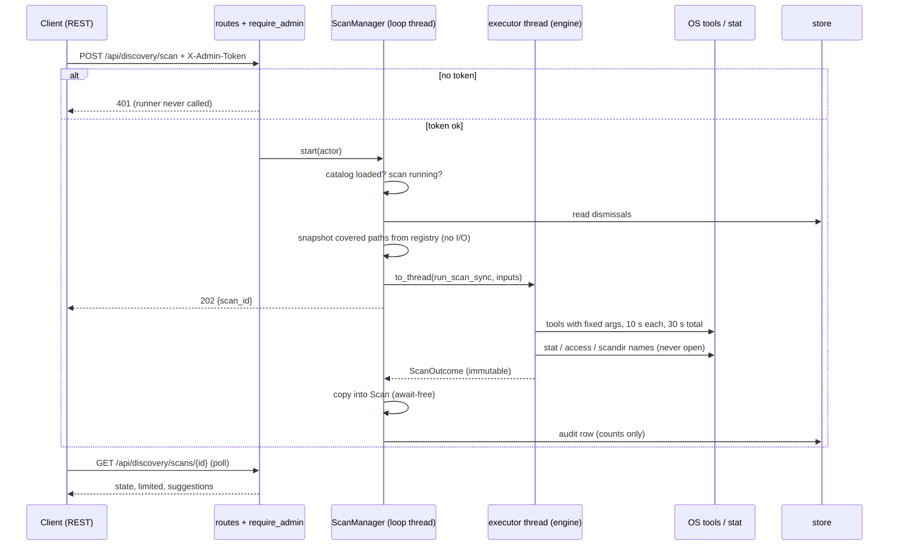

# Design: discovery (V1)

Requirements: [requirements.md](requirements.md). Capability map: [docs/v1-capability-map.md](../../../docs/v1-capability-map.md) (module `discovery`, D1, D2, B4, B12). Interfaces used from approved designs: [store](../store/design.md), [services](../services/design.md), [connectors](../connectors/design.md). Baseline: [legacy-mesh](../legacy-mesh/design.md).

## Overview

`discovery` is an opt-in, read-only scan of the local machine. The user starts it with `POST /api/discovery/scan` and the admin token. The hub runs the operating system's own process and port tools with fixed argument lists, matches what it sees against a catalog of legacy apps shipped as a JSON file, looks at the candidate log paths with `stat` only, and keeps the suggestions in memory for one hour. Nothing is watched until the user accepts a suggestion. Accepting creates a service and its log sources through the `services` registry, so every validation, cap and audit rule of `services` applies unchanged. Dismissing a suggestion is remembered in one small table so it is not offered again.

Six decisions shape everything else:

1. **A scan is a pure pipeline over injected ports.** `collect` (run tools, parse output) produces an immutable `Snapshot`; `match` (pure) turns snapshot plus catalog into suggestions; a `FsProbe` stats candidate paths. The three ports (`CommandRunner`, `ProcFs`, `FsProbe`) are injected, so every requirement about "what the scan may touch" is tested with fakes and with `open` and `socket` patched to fail.
2. **The blocking work runs on one dedicated executor thread and shares nothing.** The `ScanManager` owns a `ThreadPoolExecutor(max_workers=1, thread_name_prefix="discovery-scan")`, not the loop's default executor, so a stuck scan cannot be joined by `asyncio.run` at shutdown. `engine.run_scan_sync` receives only immutable inputs (frozen catalog, a frozenset of covered paths, a frozenset of dismissals, an environment copy) and returns an immutable `ScanOutcome`. It never touches the registry, the store or the hub. The loop thread builds the inputs and stores the result (the store design's snapshot rule, T3).
3. **Subprocess code lives in one file.** `discovery/runner.py` is the only file that imports `subprocess`. It resolves each tool to an absolute system path (never the current directory and never the user's `PATH`), runs it with `shell=False`, closed stdin, a 10 second timeout and a 2 MB output cap, and kills it on timeout, overflow or shutdown.
4. **The catalog is data.** `src/chimericmesh/catalog/legacy_apps.json` is validated by one pure function at startup and by a test in CI. An invalid or missing catalog disables discovery (`503` on scan start) and nothing else.
5. **Scans live in memory only.** At most 5 scans, each for 1 hour. The raw process list is a local variable that goes out of scope when matching ends (R2.7). The only thing written to SQLite is the list of dismissals (and audit rows with counts).
6. **Accept validates everything first, then creates.** The request is checked with the `services` validators before anything is created, so a bad path gives 422 and no service. Creation goes through a `ServiceSink` port, implemented by `RegistrySink`, which makes one call to the atomic `ServiceRegistry.create_service_with_sources` (accepted into `services` on 2026-11-18, its task 3.2a; see "Needs from services"). The earlier sequential fallback adapter is dropped: `services` is built before `discovery`, so the atomic method always exists.

Technology stack (locked on approval): Python 3.11+, stdlib (`subprocess`, `threading`, `asyncio`, `importlib.resources`, `json`, `csv`, `re`, `fnmatch`, `ntpath`, `posixpath`, `hashlib`, `os.stat`, `os.access`, `os.scandir`), FastAPI and pydantic only in `discovery/routes.py`, pytest and Hypothesis for tests. No `psutil` (a new dependency that reads more than R2.1 allows), no async subprocess API (Windows loop policy differences, no output cap), no network library.

Alternatives rejected, briefly. *psutil*: not in the R2.1 tool list and adds a dependency. *`asyncio.create_subprocess_exec`*: needs the Proactor loop on Windows and cannot cap output while streaming without extra code; a thread with `Popen` is the same size and behaves the same on three systems. *Catalog as Python*: R3.1 requires a data file. *Scan history in SQLite*: the requirements list it under "ask first".

## Architecture

### Where `discovery` sits

`discovery` is in the fourth group beside `connectors` and `auto-approval`. It may import `core`, `store` and `services` (submodules such as `chimericmesh.services.validate`, `.paths`, `.errors`, `.models`, which are stdlib-only; never `services.deps` or `services.routes`). It never imports `connectors`, `hub`, `api`, `commands`, `listeners` or `mcp_server`. Format names come from the wiring layer (see "Format names").

```
core (events, diagnostics, parsers/*)
  ^
store (store/*, fsperms.py)
  ^
services (services/*)
  ^
discovery (discovery/*; catalog/legacy_apps.json is data)          <- this spec
  ^
wiring (api.py builds it; REST only, no MCP tool)
```

### File-to-group rows added by this module (resolves M1 for `discovery`)

| File | Group | Notes |
|---|---|---|
| `discovery/__init__.py` | `discovery` | Pure re-exports (`DiscoveryService`, `load_catalog`, `register_migrations`, `discovery_registry`, errors). Imports no web framework. |
| `discovery/errors.py`, `models.py`, `text.py`, `expand.py`, `catalog.py`, `parse.py`, `collect.py`, `match.py`, `engine.py`, `manager.py`, `accept.py`, `dismissals.py`, `schema.py` | `discovery` | Stdlib, `core`, `store`, `services` (stdlib-only submodules) only. |
| `discovery/runner.py` | `discovery` | The only file that may import `subprocess`. |
| `discovery/probe.py` | `discovery` | The only file that may touch the filesystem (`os.stat`, `os.access`, `os.scandir`, and `open` of `/proc/<int>/comm`). |
| `discovery/routes.py` | `discovery` | The only file that may import `fastapi` or `pydantic`. |
| `catalog/legacy_apps.json` | `discovery` (data) | Not a Python package: no `__init__.py`. Loaded with `importlib.resources.files("chimericmesh")`. The dependency test scans `.py` files only, so the JSON has no row, and the test asserts that `catalog/` holds no `.py` file. |

The map says `catalog/*` is in group `discovery`. Because the directory holds only data, the table above is the whole assignment. The dependency test (store task 1.3, extended by `services`) gets these rows in task 1.2 here, plus the per-file third-party and stdlib rules: `subprocess` only in `runner.py`; `socket`, `ssl`, `http`, `urllib`, `httpx`, `ftplib`, `smtplib`, `telnetlib`, `xmlrpc` nowhere in `discovery/*`; `fastapi` and `pydantic` only in `routes.py`; `os` only in `probe.py` and `runner.py` (tool resolution and process start; the OS name, admin flag, own pid and environment are injected by the wiring layer, and path comparison uses `ntpath` or `posixpath` through `text.path_key`).

### Package layout

```
src/chimericmesh/discovery/
  __init__.py     pure re-exports
  errors.py       DiscoveryError, CatalogError, CatalogUnavailable, ScanBusy, SuggestionNotFound, AlreadyAccepted
  models.py       ProcEntry, Listener, Snapshot, ToolSpec, RunResult, CandidatePath, Evidence, Suggestion,
                  Scan, ScanOutcome, ScanInputs, constants
  text.py         clean_text, normalize_process_name, cap_text
  expand.py       ALLOWED_ENV, expand_leading_env, expand_pattern (env at the start, then `*` components)
  catalog.py      PathRule, CatalogEntry, Catalog, validate_catalog, load_catalog, CatalogLoad, fingerprint
  parse.py        parse_ss, parse_netstat_linux, parse_tasklist, parse_netstat_windows, parse_ps, parse_lsof
  runner.py       CommandRunner protocol, SubprocessRunner (the only subprocess import), resolve_tool
  probe.py        FsProbe, ProcFs protocols; OsFsProbe, LinuxProcFs
  collect.py      tool plans per OS, collect_snapshot, limited rules
  match.py        match_processes, port_only_matches, build_suggestions (pure)
  engine.py       run_scan_sync: collect -> match -> ScanOutcome (blocking, thread-safe by construction)
  manager.py      ScanManager: scans in memory, start/get/expire, audit row, dismissal filter input
  dismissals.py   add, list, clear, load_fingerprints (store transactions)
  accept.py       AcceptBody validation, ServiceSink protocol, RegistrySink, Acceptor
  schema.py       register_migrations, discovery_registry
  routes.py       build_router (FastAPI; the only web-framework file)
src/chimericmesh/catalog/legacy_apps.json
```

Wiring changes (all in `wiring`): `api.py` (`build_registry` adds `discovery.register_migrations`, `create_app` builds the `DiscoveryService`, includes the router, adds one lifespan step), `pyproject.toml` (`[tool.setuptools.package-data]` gets `catalog/*.json`), `README.md`. No change to `hub.py`, `listeners.py`, `commands.py` or `mcp_server.py`.

### Format names

R3.2 says the catalog is loaded with the registry's list of formats. The approved `services` registry has `set_known_formats` but no getter. The wiring layer already holds the same list: `connectors` passes `FORMAT_NAMES` (from `parsers/formats.py`, group `core`) to `registry.set_known_formats`. `create_app` passes `frozenset(FORMAT_NAMES)` to `load_catalog(known_formats=...)` and to the accept validators. `discovery` therefore imports no format code and no `connectors` code. A read-only `registry.known_formats` would be tidier and is listed in "Needs from services" as optional.

## Components and Interfaces

### Constants (`models.py`)

```python
SCAN_TOTAL_SECONDS = 30.0        # R2.6
TOOL_TIMEOUT_SECONDS = 10.0      # R2.1
MAX_TOOL_OUTPUT_BYTES = 2 * 1024 * 1024   # R2.1
MAX_NAMES_PER_PATTERN = 200      # R2.2
MAX_SUGGESTIONS = 50             # R4.8
MAX_PATHS_PER_SUGGESTION = 25    # design addition: bounds the response and fits the 20 sources per service cap
MAX_PROCESS_NAME = 64
SCAN_TTL_SECONDS = 3600.0        # R5.6
MAX_KEPT_SCANS = 5
MAX_DISMISSALS = 500
PORT_ONLY_PORTS = frozenset({21, 23, 25, 110, 143, 161, 465, 514, 587, 993, 995, 3128})
```

`PORT_ONLY_PORTS` is the code-level meaning of "protocol-specific" in R4.2. Generic ports (53, 80, 443, 8080, anything above 10000) are never enough on their own, because a resolver on 53 or any web server on 80 is not evidence of BIND or Apache. The ports of the hub's own listeners (5514, the Telnet and IRC defaults) are not in the set.

### Models (`models.py`, frozen dataclasses with `slots=True`)

```python
@dataclass(frozen=True, slots=True)
class ProcEntry:   pid: int | None; name: str                  # name already normalized
@dataclass(frozen=True, slots=True)
class Listener:    port: int; proto: Literal["tcp", "udp"]; pid: int | None; name: str | None
@dataclass(frozen=True, slots=True)
class Snapshot:    procs: tuple[ProcEntry, ...]; listeners: tuple[Listener, ...]
                   limited: bool; failed_tools: tuple[str, ...]; usable: bool   # usable = at least one tool produced data

@dataclass(frozen=True, slots=True)
class ToolSpec:    name: str; args: tuple[str, ...]            # e.g. ("ss", ("-ltnup",)); resolved to a path by the runner
@dataclass(frozen=True, slots=True)
class RunResult:   ok: bool; stdout: str; reason: Literal["", "missing", "denied", "timeout", "error", "cancelled"]
                   truncated: bool = False; returncode: int | None = None

@dataclass(frozen=True, slots=True)
class CandidatePath:  path: str; format: str; kind: str; exists: bool; readable: bool
                      size_bytes: int | None; watched_by: str | None
@dataclass(frozen=True, slots=True)
class Evidence:    process: str | None; pid: int | None; process_count: int; ports: tuple[int, ...]
@dataclass(frozen=True, slots=True)
class Suggestion:  suggestion_id: str; app_id: str; name: str; protocol_label: str
                   confidence: Literal["high", "low"]; evidence: Evidence
                   candidates: tuple[CandidatePath, ...]; fingerprint: str
                   def to_dict(self, *, state: str, service_id: str | None) -> dict: ...

@dataclass(slots=True)                                          # mutable, loop thread only
class Scan:        id: str; state: Literal["running", "done", "failed"]; started_at: float
                   finished_at: float | None; limited: bool; os: str; reason: str
                   failed_tools: tuple[str, ...]; suggestions: tuple[Suggestion, ...]
                   accepted: dict[str, str]                      # suggestion_id -> service id
                   accepting: set[str]                           # in-progress marker, loop thread only (not serialized)
                   def to_dict(self) -> dict: ...

@dataclass(frozen=True, slots=True)
class ScanInputs:  os_name: str; is_admin: bool; own_pid: int; env: Mapping[str, str]; catalog: Catalog
                   covered: Mapping[str, str]                    # normcased path -> service id
                   dismissed: frozenset[tuple[str, str]]; known_formats: frozenset[str]
@dataclass(frozen=True, slots=True)
class ScanOutcome: state: Literal["done", "failed"]; limited: bool; reason: str
                   failed_tools: tuple[str, ...]; suggestions: tuple[Suggestion, ...]
```

`Scan.to_dict()` returns `id`, `state`, `started_at`, `finished_at`, `limited`, `os`, `reason`, `failed_tools`, and `suggestions` (each `Suggestion.to_dict`, with `state` `new` or `accepted` and `service_id`). `Suggestion.to_dict` returns `suggestion_id, app_id, name, protocol_label, confidence, evidence {process, pid, process_count, ports}, candidate_log_paths [{path, format, kind, exists, readable, size_bytes, watched_by}], state, service_id`. There is no command line, no environment and no list of processes anywhere in these types (R2.7).

### Text helpers (`text.py`, pure and total)

```python
CONTROL = re.compile(r"[\x00-\x1f\x7f-\x9f]")
def clean_text(value: object, limit: int = 1024) -> str       # str() on non-str, removes CONTROL and lone surrogates, strips, cuts
def normalize_process_name(raw: object, os_name: str) -> str  # R4.1
def path_key(path: str, os_name: str) -> str                  # ntpath.normcase(normpath) for windows, posixpath.normpath otherwise
```

`normalize_process_name`: clean, take the part after the last `/` or `\`, lower-case with `casefold()`, remove one trailing `.exe`, strip, cut to 64. It never raises and is idempotent (Property 1). On Linux, `/proc/<pid>/comm` truncates names to 15 characters, so the catalog index for `linux` is keyed by `name[:15]` for both sides; macOS and Windows compare the whole name.

### Environment and wildcard expansion (`expand.py`, pure)

```python
ALLOWED_ENV = {"windows": ("ProgramData", "SystemDrive", "SystemRoot", "ProgramFiles", "ProgramFiles(x86)"),
               "linux": ("HOME",), "macos": ("HOME",)}
def expand_leading_env(pattern: str, os_name: str, env: Mapping[str, str]) -> tuple[str, str] | None
    # returns (base, rest) or None. A placeholder may appear only at the start of the pattern.
def expand_pattern(pattern: str, os_name: str, env: Mapping[str, str],
                   lister: Callable[[str, int], tuple[list[str], bool]],
                   *, max_names: int = MAX_NAMES_PER_PATTERN) -> ExpandResult
@dataclass(frozen=True, slots=True)
class ExpandResult:  paths: tuple[str, ...]; truncated: bool      # truncated: some directory had more than the limit
```

Rules (R3.2, R3.6):

- Placeholder syntax is `%NAME%` on Windows and `$NAME` on Linux and macOS, only at the start of the pattern. The name must be in `ALLOWED_ENV[os_name]` (case-insensitive on Windows). `env` is read only for those names, once each. A missing variable, a non-absolute value, a value with a control character, or a placeholder not in the list makes the pattern yield nothing (never an unexpanded string).
- **Single pass.** The expanded value is the `base` and is never re-scanned: `%` or `$` inside it stay literal, and a `*` inside it is never a wildcard. Only the pattern's own components after `base` can contain `*`.
- Path syntax uses `ntpath` for `windows` and `posixpath` otherwise, chosen by `os_name`, not by the host, so the tests run the same on every host.
- Wildcards: `*` and `?` inside one component. Components are matched with `fnmatch.fnmatchcase` (case-folded for `windows`). A directory component with a wildcard is expanded by `lister(dir, limit)`, which returns at most `limit` entry names (`probe.OsFsProbe.listdir`, `os.scandir`, names only). The total number of names listed for one pattern is at most 200 (R2.2). `lister` returns `(names, truncated)`; `truncated` is true when the directory held more entries than the limit, in which case the 200 names are an arbitrary subset (`os.scandir` order). The names read are sorted before matching, so the result is deterministic **for what was read**; no claim is made about the unread rest, and `ExpandResult.truncated` is propagated to `limited` (see Matching step 3). Names containing a path separator or a control character are skipped. The result is a list of candidate paths, not a check that they exist.

**Staleness limit (review finding 1).** Accept stores the concrete files that exist at accept time, not the pattern. For per-day logs (IIS, FileZilla) tomorrow's file is not tailed until the user adds it by hand. This is stated in the README (task 8.3) and is open item O11.

### Catalog (`catalog.py`)

```python
@dataclass(frozen=True, slots=True)
class PathRule:      path: str; format: str; kind: str
@dataclass(frozen=True, slots=True)
class CatalogEntry:  app_id: str; name: str; process_names: tuple[str, ...]; ports: tuple[int, ...]
                     protocol_label: str; justification: str | None
                     log_paths: Mapping[str, tuple[PathRule, ...]]       # keys linux, windows, macos
@dataclass(frozen=True, slots=True)
class Catalog:       entries: tuple[CatalogEntry, ...]; version: int
                     def process_index(self, os_name: str) -> Mapping[str, tuple[CatalogEntry, ...]]   # built once, cached

def validate_catalog(data: object, known_formats: frozenset[str]) -> list[str]   # errors; [] when valid; total, never raises
def load_catalog(known_formats: frozenset[str], *, text: str | None = None) -> CatalogLoad
@dataclass(frozen=True, slots=True)
class CatalogLoad:   catalog: Catalog | None; reason: str          # reason is "" when loaded
def fingerprint(entry: CatalogEntry, os_name: str) -> str          # 16 hex characters
```

`load_catalog` reads `importlib.resources.files("chimericmesh").joinpath("catalog", "legacy_apps.json").read_text("utf-8")` (or the `text` argument in tests), parses with `json.loads`, runs `validate_catalog`, and returns `CatalogLoad(None, reason)` on any error (logged once at ERROR with the reason, R3.5). It never raises. `fingerprint` is the first 16 hex characters of SHA-1 (`usedforsecurity=False`) of `os_name`, a newline, and the sorted unexpanded pattern strings of that OS, so a dismissal survives path expansion differences but not a catalog change to the offered paths.

File shape (`version: 1`):

```json
{"version": 1, "apps": [{
  "app_id": "nginx", "name": "nginx", "process_names": ["nginx"], "ports": [80, 443], "protocol_label": "http",
  "justification": null,
  "log_paths": {"linux":   [{"path": "/var/log/nginx/access*.log", "format": "ncsa",  "kind": "access"},
                            {"path": "/var/log/nginx/error*.log",  "format": "plain", "kind": "error"}],
                "windows": [{"path": "%SystemDrive%\\nginx\\logs\\access.log", "format": "ncsa", "kind": "access"}],
                "macos":   []}}]}
```

`validate_catalog` rules (each one is a test case): `version == 1`; 1 to 200 apps; `app_id` matches `[a-z0-9][a-z0-9-]{0,39}` and is unique; `name` 1 to 80 characters; `process_names`: 1 to 10 lower-case strings, 1 to 64 characters, no `.exe`, no path separator, no control characters; `ports`: 0 to 20 integers 1 to 65535; `protocol_label` 1 to 20 characters of `[a-z0-9 -]`; every OS key present and a list (may be empty), at least one OS non-empty; at most 20 rules per OS; per rule: `path` at most 512 characters, absolute for its OS (`/` first for linux and macOS; a drive letter or a leading allowed placeholder for Windows), no `..` component, no `**`, no `[`, no NUL, at most two components containing `*`, a placeholder only at the start and only from `ALLOWED_ENV[os]`, and the **last component must not end with `*`** (so rotated or compressed siblings such as `.1` and `.gz` are never matched); `format` is in `known_formats`; `kind` is one of `access`, `error`, `mail`, `ftp`, `other`; `justification` is `null` or 1 to 200 characters, and is **required** for any `app_id` outside the 15 shipped core ids (R3.4: a non-legacy app such as Mosquitto must say why). Unknown keys are errors, so a typo cannot silently disable a field.

### The shipped catalog (R3.1, R3.3 final list)

Fifteen entries. `ports` are evidence; only the ports in `PORT_ONLY_PORTS` can ever produce a port-only suggestion. Formats follow the `connectors` format table (`ncsa`, `w3c`, `xferlog`, `syslog-text`, `plain`); when the map's contingency item 2 is applied, change `w3c` and `xferlog` to `plain` in the JSON in the same change (the wiring test of task 8.1 fails loudly otherwise, because the catalog would name an unknown format).

| `app_id` | Process names | Ports | Linux paths (format, kind) | Windows paths | macOS paths |
|---|---|---|---|---|---|
| `apache` | `httpd`, `apache2` | 80, 443 | `/var/log/apache2/*access*.log` (ncsa, access), `/var/log/apache2/*error*.log` (plain, error), `/var/log/httpd/*access_log` (ncsa), `/var/log/httpd/*error_log` (plain) | `%SystemDrive%\Apache24\logs\access.log` (ncsa), `...\error.log` (plain), `%SystemDrive%\xampp\apache\logs\access.log`, `error.log` | `/var/log/apache2/access_log`, `error_log`, `/opt/homebrew/var/log/httpd/access_log`, `error_log`, `/usr/local/var/log/httpd/access_log`, `error_log` |
| `nginx` | `nginx` | 80, 443 | `/var/log/nginx/access*.log` (ncsa), `/var/log/nginx/error*.log` (plain) | `%SystemDrive%\nginx\logs\access.log`, `error.log` | `/opt/homebrew/var/log/nginx/access.log`, `error.log`, `/usr/local/var/log/nginx/access.log`, `error.log` |
| `iis` | `w3wp`, `inetinfo` | 80, 443 | none | `%SystemDrive%\inetpub\logs\LogFiles\W3SVC*\*.log` (w3c, access), `%SystemRoot%\System32\LogFiles\HTTPERR\*.log` (w3c, error) | none |
| `vsftpd` | `vsftpd` | 21 | `/var/log/vsftpd.log` (plain, ftp), `/var/log/xferlog` (xferlog, ftp) | none | none |
| `proftpd` | `proftpd` | 21 | `/var/log/proftpd/proftpd.log` (plain, ftp), `/var/log/proftpd/xferlog` (xferlog, ftp) | none | none |
| `filezilla-server` | `filezilla server`, `filezilla-server` | 21 | none | `%ProgramData%\filezilla-server\logs\*.log` (plain, ftp), `%ProgramFiles%\FileZilla Server\Logs\*.log`, `%ProgramFiles(x86)%\FileZilla Server\Logs\*.log` | none |
| `sendmail` | `sendmail` | 25, 587 | `/var/log/maillog`, `/var/log/mail.log` (syslog-text, mail) | none | `/var/log/mail.log` |
| `postfix` | `postfix`, `qmgr`, `pickup` | 25, 587 | `/var/log/mail.log`, `/var/log/maillog`, `/var/log/mail.err` (syslog-text, mail) | none | `/var/log/mail.log` |
| `exim` | `exim`, `exim4` | 25, 465, 587 | `/var/log/exim4/mainlog`, `/var/log/exim4/rejectlog`, `/var/log/exim4/paniclog`, `/var/log/exim/main.log` (plain, mail) | none | none |
| `bind` | `named` | 53 | `/var/log/named/*.log`, `/var/log/bind/*.log` (plain, other) | `%ProgramFiles%\ISC BIND 9\log\*.log` (plain, other) | none |
| `samba` | `smbd`, `nmbd` | 139, 445 | `/var/log/samba/log.smbd`, `/var/log/samba/log.nmbd` (plain, other) | none | none |
| `squid` | `squid`, `squid3` | 3128 | `/var/log/squid/access.log`, `/var/log/squid/cache.log`, `/var/log/squid3/access.log`, `/var/log/squid3/cache.log` (plain, access or other) | `%SystemDrive%\Squid\var\log\squid\*.log` (plain, other) | none |
| `inetd` | `inetd`, `xinetd`, `in.telnetd`, `telnetd`, `openbsd-inetd` | 23 | `/var/log/auth.log`, `/var/log/secure`, `/var/log/daemon.log` (syslog-text, other) | none | none |
| `syslog-daemon` | `rsyslogd`, `syslog-ng`, `syslogd` | 514 | `/var/log/syslog`, `/var/log/messages` (syslog-text, other) | none | `/var/log/system.log` |
| `snmpd` | `snmpd` | 161 | `/var/log/snmpd.log`, `/var/log/snmp/snmpd.log` (plain, other) | none | `/var/log/snmpd.log` |

Differences from the illustrative R3.3 list, each a deliberate correction: Exim's `mainlog` and the vsftpd `vsftpd.log` use `plain`, because neither is syslog-shaped or xferlog-shaped by default and `connectors` would count every line as unparsed; Samba lists `log.smbd` and `log.nmbd` instead of `log.*` so rotated and per-client files are not matched; Apache and nginx name access and error files separately so each gets its own format. Catalog paths are verified against vendor docs in the manual step (R3.3, task 8.3). Hand-added services (the demo `legacy_app`) are not in the catalog on purpose (Open Question 3).

### Output parsers (`parse.py`, pure and total)

Each function takes `str` and returns a tuple of immutable records. None raises on arbitrary text; unparseable lines are skipped. Process names are passed through `normalize_process_name`; ports must be integers 1 to 65535; pids are integers at least 0 or `None`. Every parser caps its output at 20000 records.

| Function | Input (R2.1 tool) | Rule |
|---|---|---|
| `parse_ss(text)` | `ss -ltnup` | Lines with at least 5 columns; the 5th is the local `addr:port` (port after the last `:`); `Netid` is `tcp` or `udp`; the process is read from `users:(("name",pid=N,fd=M),...)` when present, else `None` and the scan is `limited` unless the user is admin. |
| `parse_netstat_linux(text)` | `netstat -ltnup` | Lines starting with `tcp` or `udp`; local address is column 4; the last column `PID/name` when it matches `\d+/\S+`. |
| `parse_tasklist(text)` | `tasklist /fo csv /nh` | `csv.reader`; column 0 image name, column 1 pid. |
| `parse_netstat_windows(text)` | `netstat -ano` | `TCP` lines whose foreign address ends in `:0` are listening (locale independent; `LISTENING` is translated on non-English Windows); every `UDP` line counts; pid is the last column. |
| `parse_ps(text)` | `ps -axo pid=,comm=` | A pid, then the rest of the line as the command path (spaces allowed); the name is its last path component. |
| `parse_lsof(text)` | `lsof -nP -iTCP -sTCP:LISTEN -iUDP` | Columns `COMMAND PID ... NAME`; the port is the last `:(\d+)` in `NAME`; `\x20` in `COMMAND` is decoded to a space. |

### Command runner (`runner.py`)

```python
class CommandRunner(Protocol):
    def run(self, tool: ToolSpec, *, timeout: float, max_bytes: int, cancel: threading.Event) -> RunResult: ...

def resolve_tool(name: str, os_name: str, environ: Mapping[str, str]) -> str | None
class SubprocessRunner:
    def __init__(self, os_name: str, environ: Mapping[str, str]) -> None
    def run(self, tool, *, timeout, max_bytes, cancel) -> RunResult
```

`resolve_tool` returns an absolute path or `None` (reported as `missing`). On Windows it is `<SystemRoot>\System32\<name>.exe`, where `SystemRoot` is the environment value if it is an absolute existing directory, else `C:\Windows`. On Linux and macOS it is the first existing executable in `/usr/sbin`, `/usr/bin`, `/sbin`, `/bin`. It never consults the current directory or the user's `PATH`, so a planted `netstat.exe` in a workspace folder cannot be run by a scan (Windows `CreateProcess` would otherwise search the current directory first).

`run` starts `subprocess.Popen([exe, *tool.args], shell=False, stdin=DEVNULL, stdout=PIPE, stderr=DEVNULL, cwd=<directory of exe>, env={"SystemRoot": ..., "LC_ALL": "C", "PATH": <the fixed directories>}, close_fds=True)` (`creationflags=CREATE_NO_WINDOW` on Windows). A reader thread copies stdout into a bytearray capped at `max_bytes` (extra output is dropped and `truncated=True`). The calling thread waits in 50 ms slices and calls `proc.kill()` when the deadline passes (`reason="timeout"`), when `cancel` is set (`reason="cancelled"`) or when the cap is hit. `FileNotFoundError` gives `missing`, `PermissionError` gives `denied`, any other `OSError` gives `error`. The output is decoded as UTF-8 with `errors="replace"`. A non-zero exit with output is accepted (some `lsof` and `ss` builds exit 1 when some sockets are hidden); it sets `limited` in `collect`.

### Probe ports (`probe.py`)

```python
class FsProbe(Protocol):
    def stat(self, path: str) -> tuple[bool, int | None, float | None]   # (exists, size_bytes, mtime) from os.stat
    def readable(self, path: str) -> bool                          # os.access(path, os.R_OK)
    def listdir(self, directory: str, limit: int) -> tuple[list[str], bool]   # entry names only, at most `limit`; True when more existed
class ProcFs(Protocol):
    def pids(self) -> list[int]
    def comm(self, pid: int) -> str | None
```

`OsFsProbe` is the only class that calls `os.stat`, `os.access` and `os.scandir` on candidate paths; it has no method that opens or reads a file, and the test asserts `builtins.open` was never called for any candidate path (R2.2). `LinuxProcFs` lists numeric entries of `/proc` with `os.scandir` and reads `/proc/<int>/comm` with one `open` call whose path is built from an `int`, so no caller-controlled text can reach it. A `PermissionError` or `FileNotFoundError` on either is skipped. `readable` is best effort on Windows (`os.access` only checks existence there); the field means "the hub process could probably read it".

### Collect (`collect.py`)

```python
def tool_plan(os_name: str) -> tuple[ToolSpec, ...]
def collect_snapshot(os_name: str, runner: CommandRunner, procfs: ProcFs, *, is_admin: bool, own_pid: int,
                     deadline: float, cancel: threading.Event, clock: Callable[[], float] = time.monotonic) -> Snapshot
```

The tool plan is exactly the R2.1 list, as data: Linux `ss -ltnup` (fallback `netstat -ltnup` only when `ss` is missing, errors or times out) plus `/proc` comm names; Windows `tasklist /fo csv /nh` and `netstat -ano`; macOS `ps -axo pid=,comm=` and `lsof -nP -iTCP -sTCP:LISTEN -iUDP`. Each call gets `timeout = min(10, remaining)`; when `remaining <= 0` the remaining tools are recorded as failed with `timeout` and the scan ends `limited`. `limited` is set when: any tool failed, any output was truncated, a non-zero exit produced output, a Linux listener has no process info and the user is not admin, or the user is not admin on macOS (non-root `lsof` lists only the user's own sockets). `usable` is false when no tool produced any records; the engine then ends `failed` with the reason `no scan tool could run: <names>`. A scan that gets data from at least one tool ends `done` (R2.5). The hub's own pid is dropped from `procs` and `listeners` so the hub never suggests itself.

### Matching (`match.py`, pure)

```python
def build_suggestions(catalog: Catalog, snapshot: Snapshot, os_name: str, *, env: Mapping[str, str],
                      fs: FsProbe, covered: Mapping[str, str], dismissed: frozenset[tuple[str, str]],
                      next_id: Callable[[], str], deadline: float, cancel: threading.Event,
                      clock: Callable[[], float] = time.monotonic,
                      limit: int = MAX_SUGGESTIONS) -> MatchResult
@dataclass(frozen=True, slots=True)
class MatchResult:  suggestions: tuple[Suggestion, ...]; limited: bool; reason: str   # reason "" when not limited
```

Algorithm, in order:

1. **Process match (R4.1).** Index lookup by normalized name for each process. Entries are grouped, so one catalog entry yields at most one candidate suggestion (R4.5); `process` is the first name in sorted order, `pid` the lowest pid, `process_count` the number of matching processes, `ports` the sorted union of listener ports whose pid belongs to a matching process (at most 20). Confidence `high`.
2. **Port-only match (R4.2).** For an entry with no process match, the eligible ports are `entry.ports ∩ PORT_ONLY_PORTS`. A listener port counts only when it is eligible and **not already explained** by a matched process (the claimed-port rule: with `vsftpd` running on 21, ProFTPD and FileZilla are not offered for port 21). Confidence `low`, `process: null`, `pid: null`, `process_count: 0`. This claimed-port rule is a design addition that only removes suggestions, listed as open item O3.
3. **Candidates (R4.3, R4.4).** For each OS rule, `expand_pattern` produces concrete paths; duplicates (same `path_key` from two rules) keep the first rule's format and kind. Each path is checked with `fs.stat` (existence, size, mtime) and `fs.readable`. **Ordering:** rules keep catalog order. Within one wildcard rule the matches are ordered newest first by `(mtime, name)` descending (a match whose `stat` fails sorts last), so the newest daily log is the first candidate of its rule and survives the cap. Across rules, existing paths come before missing ones (a stable sort on `exists`). At most 25 paths are kept. If any directory listing was truncated (`ExpandResult.truncated`) or candidates were cut by the 25 cap, the scan is marked `limited` with reason `candidate list truncated`; the response never silently hides the cut. A literal path that does not exist stays with `exists: false`; a wildcard that matches nothing yields no path.
4. **Already covered (R4.6).** A candidate whose `path_key` is a key of `covered` gets `watched_by = <service id>`. **One rule, used everywhere:** drop the suggestion when at least one candidate is covered and every candidate with `exists: true` is covered. A suggestion with no `exists: true` candidate is dropped when any candidate is covered. A suggestion with an existing, uncovered candidate is kept (with `watched_by` on the covered ones).

   **Time limit.** `build_suggestions` receives `deadline`, `cancel` and `clock` and checks them between rules and between candidates. On expiry or cancel it stops, returns what it has built so far, and the engine marks the scan `limited` with reason `scan time limit` (finding 5).
5. **Dismissed.** `(app_id, fingerprint)` in `dismissed` drops the suggestion.
6. **Order and cap (R4.8).** High confidence first, then catalog order; at most 50 are kept; `suggestion_id`s (`sg<n>`) are assigned only to kept suggestions.

Every string put into a record goes through `clean_text` first (R4.7); wildcard-expanded names with control characters are skipped, not cleaned, because a cleaned name would name a file that does not exist.

### Engine (`engine.py`)

```python
def run_scan_sync(inputs: ScanInputs, runner: CommandRunner, procfs: ProcFs, fs: FsProbe,
                  next_id: Callable[[], str], cancel: threading.Event,
                  *, clock: Callable[[], float] = time.monotonic) -> ScanOutcome
```

It computes `deadline = clock() + 30` once and passes the same `deadline` and `cancel` to `collect_snapshot` **and** `build_suggestions`, so the 30 second cap (R2.6) covers the stat and listing phase too. Either phase ending early on the deadline gives `limited` with a reason; the scan is `done` when any data was produced. It returns the outcome (`limited` is the OR of both phases). It catches nothing itself except what `collect` records; an unexpected exception propagates to `ScanManager`, which turns it into `state: failed, reason: "internal error"` and logs it. The function reads no registry, no store and no hub: its signature is the proof, and a static test asserts `engine.py`, `match.py`, `collect.py`, `probe.py` and `runner.py` import nothing from `chimericmesh.store` or `chimericmesh.services` (M3).

### Scan manager (`manager.py`)

```python
class ScanManager:
    def __init__(self, *, load: CatalogLoad, engine: Callable[..., ScanOutcome], runner: CommandRunner, procfs: ProcFs,
                 fs: FsProbe, store: Store, registry: ServiceRegistry, known_formats: frozenset[str],
                 now: Callable[[], float], os_name: str, is_admin: bool, own_pid: int,
                 env: Mapping[str, str]) -> None            # creates no task and starts nothing
    async def start(self, *, actor: str) -> Scan            # CatalogUnavailable, ScanBusy
    def get(self, scan_id: str) -> Scan | None              # purges expired scans first
    def find(self, suggestion_id: str) -> tuple[Scan, Suggestion] | None
    async def dismiss(self, suggestion_id: str, *, actor: str) -> None      # SuggestionNotFound
    async def dismissals(self) -> list[dict]
    async def clear_dismissals(self, *, actor: str) -> int
    async def aclose(self, timeout: float = 0.2) -> None    # sets cancel, cancels the task, never raises
```

`start` (loop thread). The first block has **no await** and does, in order: raise `CatalogUnavailable(reason)` when the catalog did not load; raise `ScanBusy(scan_id)` when a scan has `state == "running"` (R1.3); otherwise create `Scan(id=f"sc{n}", state="running", ...)` and **register it in `self._scans` before the first await**, so two concurrent starts cannot both pass the busy check. The rest runs inside `try/except BaseException`: read the dismissals (`await dismissals.load_fingerprints(store)`; a `StoreError` is logged and an empty set is used), snapshot `covered` from `registry.log_sources()` (keyed with `text.path_key(src.path, os_name)`), build `ScanInputs`, and create the task `asyncio.create_task(self._run(scan, inputs))` stored in `self._task` so it is not garbage collected. If anything raises or the caller is cancelled after registration and before the task exists, the handler marks the scan `failed` (`reason="internal error"`, `finished_at=now()`), writes the audit row (best effort), and re-raises, so a scan is never left `running` without a task. `start` returns the `Scan` (REST answers 202). Nothing else in the application calls `start`, so no scan ever begins on startup, on a timer or as a side effect (R1.1).

**Ids.** The manager owns two counters, one for scans (`sc<n>`) and one for suggestions (`sg<n>`), both monotonic for the life of the process and never reset between scans. The suggestion counter is passed to the engine as `next_id` (thread-safe: `itertools.count` read under a lock, because the engine runs on the executor thread). `find(suggestion_id)` is therefore unambiguous across kept scans. A restart resets both counters, so a stale browser tab could address a different suggestion after a restart; scans do not survive a restart either, so such an id is unknown (404) unless a new scan has already reused the number. The dashboard must reload suggestions after a 404.

**Platform.** `text.os_name_from_platform(sys.platform) -> Literal["windows","linux","macos"] | None` (pure; `win32` and `cygwin` map to `windows`, any `linux*` to `linux`, `darwin` to `macos`, everything else `None`). The wiring calls it once. With `None`, `start` registers the scan and it ends `failed` with reason `unsupported platform` without calling the engine.

`_run` runs the engine with `loop.run_in_executor(self._executor, engine_call)` wrapped in `asyncio.wait_for(..., SCAN_TOTAL_SECONDS + 5)`. The thread cannot be cancelled, so the engine watches `cancel` and the deadline itself. `aclose` sets `cancel`, cancels the task, and calls `self._executor.shutdown(wait=False, cancel_futures=True)`; the single worker thread is not daemon-joined by `asyncio.run`. On success it copies the `ScanOutcome` into the `Scan` (`state`, `finished_at = now()`, `limited`, `suggestions`) in one await-free block. On `TimeoutError` it sets `cancel`, marks `failed` with reason `scan timed out`. On any other exception it marks `failed` with reason `internal error` and logs `log.exception` (the message carries no process data because none is in scope). In every case it writes one audit row: `store.audit.append(actor, "discovery_scan", scan.id, f"state={state} suggestions={n} limited={l} tools_failed={k}")`; the detail is counts only (R1.6). A failing audit write is logged and does not change the scan.

Expiry: `get` and `find` first drop scans whose `finished_at` is older than 3600 seconds (hub clock) and keep at most 5 scans (the oldest finished is dropped first; a running scan is never dropped). A suggestion from an expired or evicted scan is unknown (R5.6, 404).

### Dismissals (`dismissals.py`, `schema.py`)

Table `discovery_dismissals` (migration `discovery:300`, name `discovery:0300-dismissals`):

```sql
CREATE TABLE discovery_dismissals (
  app_id       TEXT NOT NULL CHECK (length(app_id) BETWEEN 1 AND 40),
  fingerprint  TEXT NOT NULL CHECK (length(fingerprint) = 16),
  dismissed_at REAL NOT NULL,
  PRIMARY KEY (app_id, fingerprint)
);
```

`register_migrations(registry)` registers it with `registry.register("discovery", 300, "discovery:0300-dismissals", (...,))`, inside the `discovery` block (300 to 399) of the store's `MODULE_BLOCKS`. `discovery_registry()` returns `services_registry()` plus this migration, which is what tests and `build_registry()` use. A dismissal is one `store.transact` that runs `INSERT OR IGNORE`, and only when the insert changed a row (`rowcount == 1`) trims to 500 rows (oldest `dismissed_at` first) and appends the audit row with `AuditLog.append_tx`, so the row and its audit entry commit together. A repeat dismiss changes nothing and writes **no** new audit row. Edge cases: dismissing a suggestion that is accepted or is being accepted raises `AlreadyAccepted` (409); accepting a suggestion after dismissing it in the same scan is allowed (a dismissal only hides the app from future scans). All SQL is a string literal with `?` parameters (store SQL rule). `clear_dismissals` deletes all rows and audits `discovery_dismissals_cleared` with the count.

### Accept (`accept.py`)

```python
@dataclass(frozen=True, slots=True)
class AcceptBody:
    id: str; name: str; log_paths: tuple[tuple[str, str], ...]     # (path, format), 1 to 20
    code_folder: str | None = None; app_names: tuple[str, ...] | None = None

class ServiceSink(Protocol):
    async def create_with_sources(self, fields: ServiceFields, sources: Sequence[LogSourceFields], *, actor: str
                                  ) -> tuple[Service, list[LogSource]]: ...

class RegistrySink:                                                # one call to registry.create_service_with_sources
    def __init__(self, registry: ServiceRegistry) -> None
class Acceptor:
    def __init__(self, manager: ScanManager, sink: ServiceSink, registry: ServiceRegistry, store: Store,
                 known_formats: frozenset[str]) -> None
    async def accept(self, suggestion_id: str, body: AcceptBody, *, actor: str) -> tuple[Service, list[LogSource]]
```

`accept` does, in order:

1. `manager.find(suggestion_id)`; none gives `SuggestionNotFound` (404). In one await-free block: if the suggestion is in `scan.accepted` or `scan.accepting`, raise `AlreadyAccepted` (409); otherwise add it to `scan.accepting`. The marker is removed in a `finally` after step 4 (kept in `accepted` on success, simply removed on failure), so two concurrent accepts of one suggestion cannot both create a service.
2. **Validate everything, create nothing** (R5.5). `validate_service_fields({"id", "name", "app_names", "protocols": ["file"], "code_folder"}, for_create=True)` builds `ServiceFields`; `app_names` defaults to the suggestion's `evidence.process` when it has one (so Syslog events from that app are also tagged to the service; an open item, O8). For each path: `validate_log_source_fields({"path", "format", "backfill_lines": 0}, known_formats=..., for_create=True)`, `normalize_log_path`, `inspect_log_path` (stat only; a directory or device gives 422). Duplicate paths in the request (after normalization) are a 422 with field `log_paths`. Any `ValidationFailed(field, reason)` is raised as is (422).

   **`code_folder` is only ever user-typed** (finding 3; user decision 2026-11-18, option A, shared with `auto-approval`). Scan results and suggestions never contain a `code_folder` field, and discovery never guesses or pre-fills one. `AcceptBody.code_folder` is an optional value the user types at accept time. `Acceptor` passes it unchanged to `create_service_with_sources` in `ServiceFields`; the registry is the single owner of normalization and validation (services design, O12), so discovery does no folder check of its own. A home directory, a filesystem root, a protected directory such as the data directory, a relative path or a non-directory gives the services error (422 `code_folder`) with nothing created. Like every accept, it needs the admin token.

   **Caps are pre-checked** (finding 2). Before creating, `Acceptor` checks `len(registry.log_sources()) + n <= LIMIT_SOURCES_TOTAL (200)` and `len(registry.list()) < LIMIT_SERVICES (100)` (the `services` `Limits` values, read from the registry's limits object when exposed, else these constants) and raises `ValidationFailed("log_paths", "too many log sources")` or `ValidationFailed("id", "too many services")`. The per-service cap of 20 is already covered by the 1 to 20 path rule. These deterministic cap failures therefore give 422 with nothing created and no tombstone.
3. `sink.create_with_sources(...)` with actor `discovery` and `origin="discovery"` on every log source (R5.2: the approved `services` design records `origin` on log sources, not on the service itself; see O9).
4. Mark the suggestion accepted (`scan.accepted[suggestion_id] = service.id`, in one await-free block after the commit) and append the audit row `discovery_accepted` (actor `rest:<addr>`, subject suggestion's `app_id`, detail `paths=<n>`, `service_id` reference) (R5.7).

`RegistrySink`: one `await registry.create_service_with_sources(fields, sources, actor="discovery", origin="discovery")`. That method is one store transaction (services N1, accepted 2026-11-18), so a store failure, a subscriber failure or a cap race between the pre-check and the create leaves no service, no log source and no tombstone, and the same id can be retried. R5.5 is therefore met for every failure, deterministic or not. The pre-checks above stay, because they give field-specific 422 answers before any store work.

### REST routes (`routes.py`)

```python
def build_router(service: DiscoveryService, require_admin: Callable, *,
                 audit_actor: Callable[[Request], str] = default_actor) -> APIRouter
```

`DiscoveryService` is a small dataclass `(manager, acceptor, load)` held in `app.state.discovery`. `require_admin` is the `services` callable, injected so `routes.py` imports nothing from `services.deps`. `default_actor(request)` returns `rest:<client address>`.

| Route | Auth | Success | Failures |
|---|---|---|---|
| `POST /api/discovery/scan` | admin | 202 `{"scan_id", "state": "running"}` | 401, 429, 409 (`{"detail", "scan_id"}`), 503 (`discovery is disabled: the catalog could not be loaded`) |
| `GET /api/discovery/scans/{id}` | admin (O1) | 200 `Scan.to_dict()` | 401, 429, 404 |
| `POST /api/discovery/suggestions/{id}/accept` | admin | 201 `{"suggestion_id", "service": Service.to_dict()}` (the service dict includes its log sources) | 401, 429, 404, 409, 422 (`{"detail", "field"}`), 500 (subscriber), 503 (store) |
| `POST /api/discovery/suggestions/{id}/dismiss` | admin | 200 `{"suggestion_id", "dismissed": true}` | 401, 429, 404 |
| `GET /api/discovery/dismissals` | admin | 200 `[{"app_id", "dismissed_at"}]` | 401, 429 |
| `DELETE /api/discovery/dismissals` | admin | 200 `{"cleared": n}` | 401, 429 |

The last two routes are additive (open item O4): R5.4 says dismissals stay "unless the user clears dismissals" without naming a route. Request bodies are pydantic models with `extra="forbid"`: `AcceptRequest {id: str (max 40), name: str (max 80), log_paths: list[{path: str (max 1100), format: str (max 30)}] (1 to 20), code_folder: str | None (max 1100), app_names: list[str] | None (max 20 entries)}`; the exact rules live in the `services` validators, the models only bound the size. Routes are `async def`. `StoreError` reaches the existing 503 handler of the store design. The services `HostGuard` and `BodyLimit` middlewares already cover `/api/*`.

## Data Models

Only one table is added (above). Scans and suggestions are memory-only objects. Audit rows written by this module (all with `AuditLog`, all counts or ids, never log text or process names):

| action | actor | subject | detail | refs |
|---|---|---|---|---|
| `discovery_scan` | caller (`rest:<addr>`) | scan id | `state=done suggestions=2 limited=true tools_failed=0` | none |
| `discovery_accepted` | caller | catalog `app_id` | `paths=2` | `service_id` |
| `discovery_dismissed` | caller | catalog `app_id` | `paths=3` | none |
| `discovery_dismissals_cleared` | caller | `all` | `count=<n>` | none |

The `services` module writes its own `service_created` and `log_source_added` rows for the same accept, with actor `discovery`.

## Sequence diagrams

### Scan



### Accept

```mermaid
sequenceDiagram
    participant C as Client
    participant A as Acceptor
    participant V as services validators
    participant K as ServiceSink -> ServiceRegistry
    participant S as store

    C->>A: POST .../suggestions/{id}/accept {id, name, log_paths, code_folder}
    A->>A: find suggestion (404) / already accepted (409)
    A->>V: validate service fields and every path (stat only)
    alt any path or field invalid
        V-->>C: 422 {detail, field}; nothing created
    else all valid
        A->>K: create_with_sources (origin=discovery)
        K->>S: transaction(s): service, log sources, audit rows
        K-->>A: Service + LogSources
        A->>A: mark accepted; audit discovery_accepted
        A-->>C: 201 service
    end
    Note over K: after_commit starts tailers (connectors); first appended line reaches the hub
```

## Error Handling

| Operation | Failure | Recoverable? | Caller receives | Logged |
|---|---|---|---|---|
| Scan start: no or wrong token | caller | Yes | 401 (429 after 10 wrong tokens a minute); runner and catalog untouched | `services` audit row `auth_failed` |
| Scan start: a scan is running | caller | Yes | 409 with the running scan id | none |
| Scan start: catalog missing or invalid | packaging or edit | Fatal for discovery only | 503 with a plain sentence (no path, no parser text) | error with the reason, once at startup |
| Scan start: unsupported platform (not Linux, Windows, macOS) | environment | Yes | scan ends `failed`, reason `unsupported platform` | none |
| Tool not installed | environment | Yes | recorded in `failed_tools`, scan continues, `limited` | none |
| Tool denied, times out (10 s), output over 2 MB | environment | Yes | same; truncated output is parsed and `limited` | none |
| Every tool failed | environment | Yes | `state: failed`, reason lists tools | warning |
| 30 s total reached | slow machine | Yes | remaining tools recorded as failed; `done` with `limited` if any data, else `failed` | warning |
| Unexpected exception in the engine | bug | Yes | `state: failed`, reason `internal error` | `log.exception` |
| Scan thread still alive after 35 s | bug | Yes | `failed`, reason `scan timed out`; `cancel` set so tools are killed | warning |
| Shutdown while scanning | lifespan | Yes | `cancel` set, tools killed, task cancelled within 0.2 s | none |
| Dismissal read fails at scan start | store down | Yes | scan proceeds without dismissals | warning |
| Audit write fails (scan, accept) | store down | Yes | operation result unchanged | error |
| `GET` scan, accept or dismiss: unknown or expired id | caller | Yes | 404 | none |
| Accept: invalid field, path or `code_folder`, duplicate path, over 20 paths, none selected, sources-total or services cap exceeded | bad input | Yes | 422 `{"detail", "field"}`; nothing created | none |
| Accept: service id exists or belonged to a deleted service | conflict | Yes | 409 (from `services`) | none |
| Accept: suggestion already accepted or being accepted; dismiss of an accepted one | caller | Yes | 409 | none |
| Accept: subscriber of `services` failed | bug | No | 500 naming the subscriber (from `services`); the atomic create rolls back, so nothing is created and the id stays free | error |
| Dismiss: store write fails | store down | Yes | 503 `store unavailable` (store handler) | store logs |

Input validation:

| Input | Rule | On failure |
|---|---|---|
| `X-Admin-Token` | required on every discovery route when enforcement is on | 401 or 429 |
| Accept `id`, `name`, `app_names`, `code_folder` | the `services` validators (slug, 1 to 80 characters, at most 20 names, absolute existing directory not too broad) | 422 with field |
| Accept `log_paths` | 1 to 20 entries; each path through `normalize_log_path` and `inspect_log_path`; each format in `known_formats`; no duplicate after normalization | 422 `log_paths` or `path` or `format` |
| Request body | at most 64 KB (services `BodyLimit`); pydantic `extra="forbid"` | 413 or 422 |
| Suggestion and scan ids in the URL | looked up in an in-memory dict; never used in a path or a query | 404 |
| Process names, ports and listing names from the OS | untrusted: control characters removed or the entry skipped, names cut to 64, ports 1 to 65535 | entry skipped |

Invariant ownership: "nothing is scanned unless asked" is owned by `ScanManager.start`, the only caller of the engine, and `routes.py`, the only caller of `start`. "No log content is read" is owned by `probe.py`, the only file allowed `os` and `open`, and by the static tests. "No network" is owned by the static import ban and the `socket` test. "Nothing is watched until accepted" is owned by `Acceptor`, the only code that calls the registry. Dismissal uniqueness is owned by the table's primary key. Catalog validity is owned by `validate_catalog`.

## Security

- **Sensitivity.** A scan reveals installed software. It starts only on a privileged request, results stay in memory for one hour, the only persisted facts are dismissals (catalog app ids) and audit counts, and no MCP tool exposes scans or suggestions (R1.5; `mcp_server.py` is not edited and a test lists its tools).
- **Token on reads (O1).** The scan result is also behind the admin token. It protects against other local processes and web pages; it does not stop the agent, which can read the token file (map, "Honest limits of the access model"). The dashboard already holds the token for the session.
- **Tool execution.** Fixed argument lists, `shell=False`, closed stdin, absolute system paths resolved without `PATH` or the current directory, minimal environment, 10 second timeout, 2 MB cap, kill on cancel. No elevation is ever requested; a denied tool only sets `limited`.
- **No reading, no network.** Candidate paths are only passed to `os.stat`, `os.access` and, for wildcards, `os.scandir` on their parent directory. `open` exists in one place (`/proc/<int>/comm`). No socket, HTTP or DNS code is imported.
- **Untrusted text.** Process names, directory entry names and catalog-expanded paths go through `clean_text`, the 64 and 1024 character caps and, for names, skipping. The dashboard renders them with `textContent`. Audit rows carry catalog ids and counts only.
- **Wildcard and environment expansion.** Environment values are read only for allow-listed names and are never wildcard-expanded or re-scanned, so `HOME=/tmp/*` or a value that contains `%X%` cannot widen a path.
- **No side effects on found apps.** Nothing is installed, started, stopped or modified; the `os.system`, `os.popen`, `shell=True` and `create_subprocess_shell` forms are banned by a static test.
- **Subprocess allow-list.** `discovery/runner.py` is the single allowed entry in the `agent-loop` R4.10 allow-list test (see "Needs from agent-loop").

## Correctness Properties

Each property is a universal statement for Hypothesis. Success Criterion 7 names properties 1 (name normalization), 7 (deduplication), 2 (placeholder allow-list) and 8 (control characters). Required in `tasks.md`: 1, 2, 5, 6, 7, 8, 9, 13. Optional (`*`): 3, 4, 10, 11, 12. Files are `tests/pbt/test_discovery_*_properties.py`.

1. **Name normalization.** *For any* text (including NUL, control characters, lone surrogates, path separators, `.EXE` and very long strings) and any OS name, `normalize_process_name` does not raise, returns a string of at most 64 characters with no control character, no `/` or `\`, and no trailing `.exe`, and `normalize(normalize(x)) == normalize(x)`. **Validates: Requirements 4.1, 4.7**
2. **Placeholder expansion allow-list.** *For any* pattern text and any environment mapping (arbitrary names and values, including values containing `%X%`, `$HOME`, `*` and control characters), `expand_leading_env` reads only names in `ALLOWED_ENV[os]`, returns `None` or a base that contains no control character and is absolute, and the returned `rest` equals the pattern text after the placeholder unchanged. A spy mapping records every lookup. **Validates: Requirements 3.2, 3.6**
3. **Wildcard expansion is bounded and sound.** *For any* pattern with at most two wildcard components and any fake directory tree, `expand_pattern` lists at most 200 names in total, reports `truncated` whenever a directory had more entries than were read, returns only paths whose components each match their pattern component, never lists a directory that is not literally under `base`, and never returns a name containing a separator. **Validates: Requirements 2.2**
4. **Catalog validator is total.** *For any* JSON-like value, `validate_catalog` returns a list and never raises; a value it accepts re-validates after a JSON round trip; every mutation from a fixed list of single faults applied to the shipped catalog yields at least one error. **Validates: Requirements 3.1, 3.2, 3.4, 3.5**
5. **Parser totality.** *For any* text, each of the six parsers returns a tuple without raising, with every port in 1..65535, every pid `None` or at least 0, every name normalized, and at most 20000 records. **Validates: Requirements 2.4, 4.7** (steering: parsers never raise on arbitrary input)
6. **Match soundness.** *For any* snapshot and the shipped catalog, every `high` suggestion has a process whose normalized name is in its entry's names, every `low` suggestion has no such process, a listener port in `entry.ports ∩ PORT_ONLY_PORTS`, and that port is not claimed by a matched process. **Validates: Requirements 4.1, 4.2**
7. **Deduplication and caps.** *For any* snapshot with repeated and shuffled processes, each `app_id` appears at most once, suggestion ids are unique, there are at most 50 suggestions, at most 25 candidates each, and the evidence `process_count` equals the number of matching processes. **Validates: Requirements 4.5, 4.8**
8. **Control characters never escape.** *For any* hostile process names, ports text, listing names and environment values, `json.dumps(scan.to_dict())` contains no character matching `[\x00-\x1f\x7f-\x9f]` and no process name that is not a catalog match (R2.7). **Validates: Requirements 2.7, 4.7**
9. **Covered rule.** *For any* candidate set and covered mapping, a suggestion is dropped exactly when it has at least one covered candidate and every candidate with `exists: true` is covered (vacuously true when none exists); every kept candidate with a covered path carries `watched_by`. **Validates: Requirements 4.6**
10. **Existing paths first, newest first within a wildcard.** *For any* fake file system, in each suggestion every candidate with `exists: true` precedes every candidate with `exists: false`; the relative order across rules is the catalog order; within one wildcard rule the matches are in `(mtime, name)` descending order; and when a wildcard matched more than 25 files the newest file is among the kept candidates. **Validates: Requirements 4.4**
11. **Scan state machine.** *For any* sequence of start, finish, fail, expire and shutdown operations on `ScanManager` with a fake clock, there is never more than one `running` scan, a finished scan keeps its suggestion ids until 3600 seconds after `finished_at`, and an expired id gives `None` from `find`. **Validates: Requirements 1.3, 5.6**
12. **Dismissals round trip.** *For any* sequence of dismiss, scan and clear operations on a temporary file store with restarts, a dismissed `(app_id, fingerprint)` is never suggested again until cleared, a cleared one is suggested again, and the table never exceeds 500 rows. **Validates: Requirements 5.4**
13. **Accept is all or nothing.** *For any* request whose path list contains an invalid entry at any position, `Acceptor.accept` raises a 422-class error and the fake sink and the real registry are unchanged (no service, no log source, no tombstone); the same holds when the request would exceed the sources-total or services cap and when `code_folder` is invalid; for a fully valid request the service holds exactly the requested paths in order, all with origin `discovery`. **Validates: Requirements 5.2, 5.5**

## Testing Strategy

**Unit tests (pytest, example-based), `tests/unit/`.** `test_discovery_text.py` (R4.1, R4.7), `test_discovery_static.py` (import, subprocess, `open`, network and id-format scans), `test_discovery_expand.py` (R3.2, R3.6, R2.2), `test_discovery_catalog.py` and `test_discovery_catalog_data.py` (R3.1 to R3.5, wheel layout), `test_discovery_parse.py` with fixture output of each tool, `test_discovery_runner.py` (real child process: timeout, overflow, `;` in an argument stays an argument, no shell, missing exe, cancel), `test_discovery_collect.py` (R2.1 argument lists, R2.4 to R2.7), `test_discovery_match.py` (R4), `test_discovery_engine.py` (Success Criteria 1 and 2 with `builtins.open` and `socket.socket` patched), `test_discovery_dismissals.py`, `test_discovery_manager.py` (fake clock, fake engine, `asyncio.run` inside plain tests as in the steering file), `test_discovery_accept.py` (real `ServiceRegistry` on a `:memory:` store opened with `discovery_registry()`), `test_discovery_routes.py` (`httpx.ASGITransport`, real `AccessControl` with enforcement on), `test_discovery_wiring.py`, `test_discovery_integration.py`, `test_discovery_readme.py`.

**Patching rules for the guarantees.** The `open` test patches `builtins.open` with a wrapper that raises for any path under the candidate directories and passes everything else (so `/proc` and the catalog still load); candidate directories are a temp directory reached through the `$HOME` placeholder (`env={"HOME": str(tmp_path)}`), so the real `OsFsProbe` runs against real files. The `socket` test creates the event loop first and then patches `socket.socket` while the scan runs (patching around `asyncio.run` would break the loop itself); the engine is also called directly with the patch active. Fake runner output for `nginx` and `vsftpd` comes from fixture strings, so Success Criterion 1 needs no real processes.

**Sub-criteria used by the tests (L8; `requirements.md` is not edited).**

| Id | Condition |
|---|---|
| 2.1a | Linux ports tool is exactly `ss -ltnup`. |
| 2.1b | The fallback `netstat -ltnup` runs only when `ss` is missing, fails or times out. |
| 2.1c | Linux process names come from `/proc/<pid>/comm`. |
| 2.1d | Windows tools are exactly `tasklist /fo csv /nh` and `netstat -ano`. |
| 2.1e | macOS tools are exactly `ps -axo pid=,comm=` and `lsof -nP -iTCP -sTCP:LISTEN -iUDP`. |
| 2.1f | No tool runs through a shell and none is resolved from `PATH` or the current directory. |
| 2.1g | Each tool is killed after 10 seconds. |
| 2.1h | Each tool's output is cut at 2 MB and the scan is `limited`. |
| 2.5a | A missing tool is recorded, the others run, the scan ends `done` with `limited`. |
| 2.5b | A timed-out tool is treated the same way. |
| 2.5c | When every tool fails the scan ends `failed` with a reason. |
| 4.3a | Every suggestion has `suggestion_id`, `app_id`, `name`, `confidence`, `evidence`, `candidate_log_paths`. |
| 4.3b | `confidence` is `high` when a process matched and `low` when only a port matched. |
| 4.3c | `evidence` holds process name, pid and listening ports and no command line. |
| 4.3d | Each candidate has `path`, `format`, `kind`, `exists`, `readable`, `size_bytes`. |
| 5.2a | Accept creates the service and its log sources through the `services` rules. |
| 5.2b | Every created log source has origin `discovery`. |
| 5.2c | The body names the service id, name, selected paths with formats and an optional code folder. |

**Property tests.** Properties 1 to 13 above. Settings follow the existing pbt files (`max_examples` 40 to 100, `deadline=None` for anything that opens a store or a thread).

**Existing tests that must pass unchanged.** Every file in `tests/unit` and `tests/pbt` today. This module edits no existing test. It edits one V1 file, `tests/unit/test_dependency_direction.py` (rows only), which the store created and `services` extended.

**Integration.** `test_discovery_integration.py` runs `create_app` on a temporary database with a fake runner, enters the lifespan, runs a scan, accepts a suggestion whose path is a temp file, appends a line and expects the event within 2 seconds (Success Criterion 4, using the real `connectors` manager). The 2-second window is the requirement; the connectors poll interval is 0.5 s.

## Needs from other modules

Flagged for the user. Each item is the smallest addition. N1 and the O12 owner statement were accepted on 2026-11-18 and are now in the `services` design (task 3.2a); the other items keep their stated fallback.

**Needs from services (N1, accepted 2026-11-18, added to `services` as task 3.2a).** `ServiceRegistry.create_service_with_sources(fields: ServiceFields, sources: Sequence[LogSourceFields], *, actor: str, origin: Literal["user", "discovery"] = "user") -> tuple[Service, list[LogSource]]`: one `_mutate` transaction that applies the existing create checks and the caps for the service and all its sources, inserts the rows, writes the audit rows, runs the in-transaction subscribers once per change, and fires `after_commit` after the commit. Why: R5.5 says an invalid accept creates nothing. Pre-validation covers bad input, but a store, subscriber or cap race between `create_service` and the later `add_log_source` calls leaves a created service (and a tombstone after compensation). About 0.1 day in `services`. No fallback is kept: `discovery` uses only `RegistrySink`.

**Needs from services (N2, optional).** A read-only `ServiceRegistry.known_formats -> frozenset[str]`. Why: R3.2 says the catalog uses "the registry's list". Fallback: `create_app` passes `frozenset(FORMAT_NAMES)`, the same constant `connectors` passes to `set_known_formats`.

**Needs from agent-loop (A1).** The R4.10 allow-list test should list exactly one discovery entry, `chimericmesh/discovery/runner.py` (plus `fsperms.py`), instead of the whole `discovery` module. The requirement wording ("the `discovery` module may import `subprocess`") allows this narrower rule, and this module's own static test already enforces it. **Fallback:** keep the broader wording; nothing breaks.

**Needs from agent-loop (A2).** The route-table test (R1.1, "every new route has an owner") needs the six discovery routes listed with owner `discovery`, none with an MCP tool, none accepting the admin token through an MCP path. Informational: they are in the routes table above.

**Needs from dashboard (D1).** The dashboard consumes the REST contract above. `GET scan` needs the token (O1). Accept returns `{"suggestion_id", "service"}`; the suggestion's `state` turns `accepted` in later polls. Dismissal is `POST .../dismiss`; clearing is `DELETE /api/discovery/dismissals`.

**Needs from auto-approval, store, connectors: none.** `discovery` creates services through `services`, so `connectors` reacts through its existing `after_commit` subscription; `auto-approval` sees a discovery-accepted service like any other (its `code_folder`, if given, is set at creation, which fires no `on_code_folder_changed`, and no rule exists yet).

## Review resolutions

The requirements' "Notes for design" say none of the open review findings (M1 to M4, L1 to L9) concerns this module directly. Each id is recorded here; `tasks.md` cites the ones that became work.

| Finding | Resolution |
|---|---|
| M1 (groups for `notify.py`, `__init__.py`, new files) | Resolved for this module: the file-to-group table above gives every `discovery/*` file a row and states that `catalog/` holds data only. Work: task 1.2. |
| M2 (data seam for the in-memory `Hub`) | Not applicable. Discovery reads no hub state; it reads the registry's log sources (a synchronous in-memory list) and uses the store only for dismissals and audit rows. It works the same with a bare hub plus the private `:memory:` store. Task 8.1 tests both. |
| M3 (threading and transaction model) | Resolved: the engine runs on one executor thread with immutable inputs and never touches the registry, store or hub; the loop thread builds inputs and stores results; the dismissal and audit writes use `Store.transact` and `AuditLog` from the loop thread. A static test pins the engine's imports (tasks 1.2, 4.2). |
| M4 (double announcement on reopen) | Not applicable. |
| L1 (`Event` frozen, `submit` returns tagged event) | Not applicable. Accepting only registers sources; `connectors` ingests. |
| L2 (power-docs test lists every MCP tool) | Not applicable. No MCP tool is added; a test asserts that none mentions discovery (task 7.1). |
| L3 (map table formatting) | Not applicable (map edit, outside this module). |
| L4 (public suffix and skip-dir lists) | Not applicable. |
| L5 (proposal-id static scan covers `tests/`) | Respected: scan and suggestion ids are `sc<n>` and `sg<n>`; the static test of task 1.2 asserts no `p<digits>-<tag>` pattern in `src/chimericmesh/discovery/` or `tests/**/test_discovery_*`. |
| L6 (demo precondition: restore the `upstream.py` defect) | Not applicable to discovery's criteria. Success Criterion 6 uses the demo `legacy_app` only as a hand-added service; `examples/legacy_app/upstream.py` is not touched by this module (task 8.3 states it). |
| L7 (reserved-prefix list) | Not applicable. |
| L8 (compound criteria) | Resolved for R2.1, R2.5, R4.3 and R5.2 with the sub-numbered table above; tests are named by sub id (tasks 3.3, 3.4, 4.1, 6.1). `requirements.md` is not edited. |
| L9 (profile deny globs with `~/`) | Not applicable. |

Interpretations made while designing (no requirement changed): R5.2 "with `origin: discovery`" is applied to every log source, because the approved `services` model has `origin` on log sources and no `origin` on the service (O9). R4.3 "pid" for several matching processes is the lowest pid plus `process_count`. R1.4 `limited` is true for any partial visibility, including failed tools, truncated output, and non-admin visibility limits.

## Open items for the user

Every item below is resolved: the user accepted each recommended answer on 2026-11-18, and the design is built on those answers. `requirements.md` is not edited.

| Id | Question | Resolution |
|---|---|---|
| O1 | R1.4 does not say whether `GET /api/discovery/scans/{id}` needs the admin token. Results list installed software. Require it? | Resolved (accepted 2026-11-18): yes. One dependency on the route; the dashboard already holds the token. |
| O2 | Accept needs an atomic create in `services` (N1, about 0.1 day) for a strict "create nothing" on late failures. | Resolved (accepted 2026-11-18): N1 is added to the `services` design (`create_service_with_sources`, services task 3.2a). `RegistrySink` calls it; the sequential fallback adapter is dropped because `services` is built first. |
| O3 | Port-only suggestions: claimed-port rule (an FTP daemon already matched on 21 hides the other two FTP entries) and the fixed `PORT_ONLY_PORTS` set (no 53, 80, 443). | Resolved (accepted 2026-11-18): as designed; it only removes noise, never adds a suggestion. |
| O4 | Add `GET` and `DELETE /api/discovery/dismissals` so "clear dismissals" (R5.4) has a route. | Resolved (accepted 2026-11-18): yes. |
| O5 | The shipped catalog differs from the illustrative R3.3 list (Exim `plain`, vsftpd `plain`, Samba explicit file names, split access and error patterns). | Resolved (accepted 2026-11-18): the shipped catalog stands; paths are verified in the manual step (task 8.3). |
| O6 | Hardening not in the requirements: tools resolved to absolute system paths, minimal child environment. | Resolved (accepted 2026-11-18): included; costs one small function. |
| O7 | At most 25 candidate paths per suggestion (a `services` source cap of 20 per service makes more useless). | Resolved (accepted 2026-11-18): at most 25. |
| O8 | Default `app_names` of an accepted service is the matched process name, so Syslog events from that app are also tagged. The body may override it. | Resolved (accepted 2026-11-18): default is the matched process name; the body may override it. |
| O9 | The approved `services` model has no `origin` on a service, only on log sources. R5.2 is applied to log sources. | Resolved (accepted 2026-11-18): `origin` is on log sources only; a service-level origin would be a `services` schema change with no user-visible value. |
| O10 | Accept requires at least one selected path (SC4 expects a log source). | Resolved (accepted 2026-11-18): at least one path. A service without sources is created on the `services` page. |
| O11 | Accept stores the files that exist now, not patterns. Per-day logs (IIS, FileZilla) need the next day's file added by hand. | Resolved (accepted 2026-11-18): files that exist now, for V1, documented in the README. A "watch pattern" feature would be a `connectors` change and a later spec. |
| O12 | The `services` design is inconsistent on whether the route or the registry normalizes `code_folder`. Discovery validates it itself. | Resolved (accepted 2026-11-18): `services` now states one owner (the registry normalizes; routes pass raw input). Discovery's own check stays. |
| O13 | IIS is often not detected on Windows: `w3wp` runs only after the first request and port 80 is not a port-only port. | Resolved (accepted 2026-11-18): accept the limit, say so in the README, and rely on the hand-added path. Port 80 is not added to `PORT_ONLY_PORTS`. |
| O14 | The MCP no-tool test reuses the tool-listing helper of `tests/unit/test_kiro_assets.py` and checks name prefixes `discovery_`, `scan_`, `suggest`. The `agent-loop` expected-tool-set test should list its tools exactly. | Resolved (accepted 2026-11-18): reuse the helper with those prefixes; add a note to `agent-loop` when that module is next touched. |
| O15 | Suggestion and scan ids restart at 1 after a process restart. | Resolved (accepted 2026-11-18): ids restart; the dashboard reloads on a 404. |
| O16 | The uto-approval design said discovery must never set a code folder, while accept takes an optional one. | Resolved (2026-11-18, user decision, option A): discovery never guesses or pre-fills a code folder; a user-typed one is passed unchanged to the registry, which normalizes and validates it. Task 6.1. |

## Effort estimate

Measured velocity for the approved `store` module: about 5 to 11 minutes per top-level task and about 2.5 minutes per sub-task, tests included. This module has 8 top-level tasks and 26 sub-tasks (23 required, 3 optional property tasks).

| Part | Count | Agent build time |
|---|---|---|
| Required sub-tasks (23) at 2.5 minutes, including the checkpoint | 23 | about 58 minutes |
| Cross-check by top-level tasks (8 at 5 to 11 minutes) | 8 | 40 to 88 minutes |
| Optional property tasks 2.5, 4.4, 5.3 | 3 | about 8 minutes |
| Rework allowance (failing first runs on Windows paths, fake-process fixtures, thread cleanup), 30 to 40 percent | | 20 to 30 minutes |
| **Expected total** | | **about 1.5 hours; range 1 to 2.5 hours** |

The map priced this module at 1.25 days. Measured velocity suggests the code is far smaller than that in agent time; the calendar cost is dominated by human steps and by waiting for review.

Human-in-the-loop work, separate and not parallel to the agent:

| Step | Time |
|---|---|
| Review of `design.md` and `tasks.md`, answers to O1 to O15 | 20 to 30 minutes |
| Verify catalog paths against vendor docs or sample machines (R3.3 manual) | 30 to 45 minutes |
| Manual scan on the Windows development machine, with and without a real Apache or IIS (Success Criterion 6) | 15 to 25 minutes |
| Browser check of the discovery screen once `dashboard` is built (counted there) | 0 here |
| Demo rehearsal: install nginx or Apache, scan, accept, append an error, watch the incident (Success Criterion 4 live) | 30 to 45 minutes |
| README and final review, merge decision | 15 to 20 minutes |
| **Total human time** | **about 2 to 3 hours** |

Dependencies for the schedule: build order is `store`, `services`, `connectors`, `discovery`. Tasks 1 to 7 need only `store` and `services`: the catalog tests use `services.validate.DEFAULT_FORMATS` (the same five names). Tasks 8.1 and 8.2 need `connectors` merged, because `parsers/formats.py` (`FORMAT_NAMES`) is created there and 8.1 asserts `DEFAULT_FORMATS == frozenset(FORMAT_NAMES)` so the two lists cannot drift.

## Responses to the design review (one round)

| Finding | Response |
|---|---|
| 1 HIGH wildcard staleness | Addressed: `stat` returns mtime, `listdir` returns `(names, truncated)`, wildcard matches are ordered newest first before the 25 cap, truncation sets `limited`, README states the limit, open item O11. Tasks 2.1, 3.4, 4.1, 4.4, 8.3. |
| 2 MEDIUM R5.5 default sink | Addressed: cap pre-check in `Acceptor`; N1 accepted (O2, 2026-11-18) and added to `services`; `RegistrySink` replaces the sequential fallback, so R5.5 is fully met. Task 6.1, Property 13. |
| 3 MEDIUM `code_folder` | Addressed: user decision 2026-11-18 (O16): `code_folder` is user-typed only and passed unchanged; the registry validates it (O12). Tasks 6.1, 8.1. |
| 4 MEDIUM stuck `running` | Addressed: register before the first await, `try/except BaseException` marks `failed`. Task 5.2. |
| 5 MEDIUM 30 s covers all phases | Addressed: `deadline` and `cancel` go to `build_suggestions`. Tasks 4.1, 4.2. |
| 6 MEDIUM executor | Addressed: dedicated `ThreadPoolExecutor(1)`, `run_in_executor`, `shutdown(wait=False, cancel_futures=True)`; test engines wait on `cancel`. Tasks 5.2, 8.1. |
| 7 MEDIUM build dependency | Addressed: 2.3 uses `DEFAULT_FORMATS`; 8.1 and 8.2 need `connectors`. Tasks header, 2.3, 8.1. |
| 8 LOW covered rule | Addressed: one sentence in Matching step 4; Property 9 and task 4.1 match it. |
| 9 LOW os_name | Addressed: `os_name_from_platform` in `text.py`; `None` gives a `failed` scan. Tasks 1.1, 5.2, 8.1. |
| 10 LOW edge cases | Addressed: `accepting` marker, dismiss of accepted gives 409, repeat dismiss no audit row. Tasks 5.1, 5.2, 6.1. |
| 11 LOW id counters | Addressed: monotonic manager-owned counters, restart caveat O15. Tasks 4.1, 5.2. |
| 12 LOW IIS | Backlogged to README note and manual check (O13); no catalog change. Task 8.3. |
| 13 LOW hub pid | No action beyond the retained test in 4.1. |
| 14 LOW MCP list test | Addressed: reuse the helper of `test_kiro_assets.py`, exact prefixes (O14). Task 7.1. |
| 15 LOW wheel test | Addressed: build from a temporary copy of `pyproject.toml` and `src/`, opt-in skip. Task 2.3. |

Real-machine output fixtures for `ss`, `netstat`, `lsof` and non-English `netstat -ano` are required input for task 3.1 (review "unverified" note).

## Implementation deviations (2026-11-20)

Recorded during the build on `feat/discovery`. None changes an approved requirement; each is the conservative reading. Details in `.agents/tasks/discovery-impl/blockers.md`.

| Id | Design text | As built | Why |
|---|---|---|---|
| D1 | `parse_lsof`: the port is the last `:(\d+)` in `NAME`. | The first local `:port` (a colon after an address character). | For a connected UDP socket `a:1->b:2` the last match is the remote port. Same result for `LISTEN` lines. |
| D2 | Not stated: an entry that matches but has no rules for the host OS. | Skipped (for example `w3wp` or port 21 matching FileZilla on Linux). | A suggestion with zero paths cannot be accepted (O10); this only removes noise. |
| D3 | `usable` is false when no tool produced any records. | `usable` is true when at least one tool ran successfully, even with empty output. | R2.5 fails a scan only when every tool fails. |
| D4 | The manager receives `env` (the wiring passes `os.environ`). | The manager keeps only the `ALLOWED_ENV` names (self-review finding). The runner gets only `SystemRoot`. | Tokens or keys in the environment never sit in scan objects. |
| D5 | The `socket` test patches `socket.socket` while the scan runs. | The patch is a `socket.socket` subclass that fails only on the `discovery-scan` thread. | On Windows the event loop itself creates sockets and asyncio uses `isinstance(x, socket.socket)`; a global function patch hangs the loop. The engine-level test still patches `socket.socket` globally. |
| D6 | One audit row per scan (R1.6). | A scan cancelled by shutdown is marked `failed` with reason `cancelled` but writes no audit row. | The store may be closing during shutdown; review-2 finding 1, LOW. |
| D7 | Wheel test builds with `pip wheel`. | Skipped on this machine: `setuptools` is not installed and installs were not allowed. The `pyproject.toml` package-data test runs. | Environment. |
| D8 | Windows base: `ntpath.isabs` decides whether an expanded environment value is absolute. | 2026-11-22: accepted only as a drive path (`C:\...`) or a UNC `\\server\share`; a bare `C:` only for `SystemDrive`. A malformed value such as `/\` gives no expansion, like an unset variable. | Found by property `test_only_allow_listed_names_are_read_and_base_is_clean` on main after the auto-approval merge; `ntpath.isabs` accepts `/\`. Regression tests in `tests/unit/test_discovery_expand.py`. |
