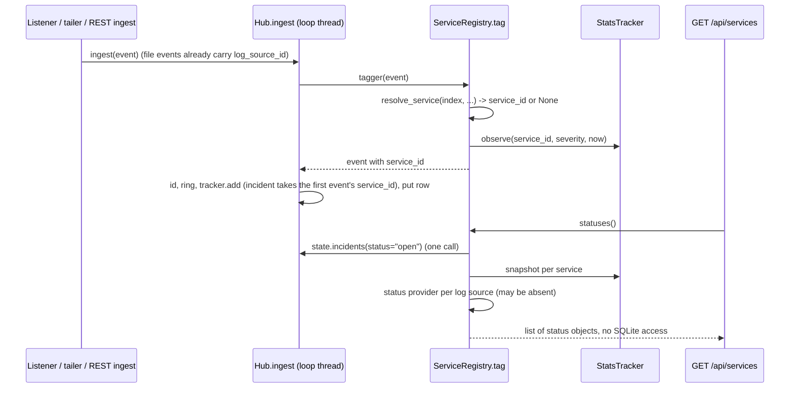
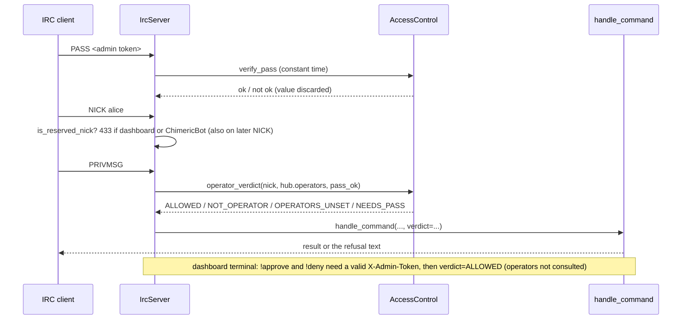

# Design: services (V1)

Requirements: [requirements.md](requirements.md). Capability map: [docs/v1-capability-map.md](../../../docs/v1-capability-map.md) (module `services`, B4, B5, B11, B12, B13). Store design (the interfaces used here): [../store/design.md](../store/design.md). Baseline: [legacy-mesh](../legacy-mesh/design.md).

## Overview

`services` adds the registry of applications ("services") that the hub watches, the pure rule that tags every event with its service, one status view per service, and the local access control that protects configuration: the admin token, the Host-header check and the IRC operator hardening. It sits in the third dependency group. It imports only `core` and `store`, never `hub`, `api`, `connectors`, `discovery`, `auto-approval`, `agent-loop` or `dashboard`. Higher modules reach it through its public functions, the `subscribe` interface, and three things the application wiring injects.

Six decisions shape everything else:

1. **The registry is a cache in front of three SQLite tables.** Services and log sources are rows created through the store's migration registry (block 100 to 199). Every change is one awaited `store.transact` that also writes its audit row and calls the in-transaction subscribers. After the commit, the loop thread replaces the in-memory index in an await-free block and runs the `after_commit` callbacks. Tagging reads only the in-memory index, so it never touches SQLite (R4.7).
2. **Tagging is a pure function plus a thin stateful wrapper.** `resolve_service(index, source, host, app, log_source_id)` is pure and total (R4.1). `ServiceRegistry.tag(event)` calls it, records the event in the per-service counters, and returns the event with `service_id` set. The hub calls `tag` through one injected hook, `Hub.tagger`, as the first statement of `Hub.ingest`, so every path that ingests (listeners, `/api/ingest`, the storm, the file tailer) is tagged without each one knowing about services. This is how `services` stays below `connectors` and still delivers Success Criterion 1 on its own.
3. **Status is computed from memory, not from SQLite.** Per-service counters (events total, last seen, a 300-second error bucket ring) are updated by `tag`. Open incidents come from one call to `StateView.incidents(status="open")`, counted by `service_id` in one pass. At start the counters are seeded by one grouped query on the stored events (trim T3, review 1), so a restart does not reset a service with stored events to `never_seen`. There is no counter table, no flush task and no thread.
4. **Access control is a framework-free object with a thin FastAPI dependency on top.** `AccessControl` (token, Host allow-list, wrong-token limiter, IRC verdicts) has no web dependency and is property-tested. `services/deps.py` turns it into the reusable `require_admin` dependency. With `enforce_access` off (every existing test) the object answers "allowed" and nothing changes.
5. **Three injected seams, nothing more.** `StateView` (from `store`) gives read access to incidents. `set_known_formats` and `set_status_provider` give format names and per-source runtime state. `subscribe` lets higher modules react to changes. `services` never calls a higher module.
6. **Every mutation follows the store's T6 pattern.** The commit and the in-memory update are one `asyncio.shield`ed unit, so a cancelled request cannot leave the cache and the database disagreeing. Mutations are serialized by one `asyncio.Lock` because they are rare, administrative, and each one runs subscribers.

Technology stack (locked on approval): Python 3.11+, stdlib (`sqlite3` through the store, `hmac`, `secrets`, `os.path`, `ipaddress`, `asyncio`, `re`), FastAPI and pydantic as today (only in `services/deps.py` and `services/routes.py`), pytest and Hypothesis for tests. No new dependency.

## Architecture

### Where `services` sits

```
core (events, diagnostics, parsers, __init__)
  ^
store (store/*, fsperms.py)
  ^
services (services/*)                     <- this spec
  ^
connectors, discovery, auto-approval -> agent-loop -> dashboard (REST/SSE only)
  ^
wiring (hub.py, api.py, commands.py, listeners.py, mcp_server.py, __main__.py ...)
```

### File-to-group rows added by this module (resolves M1 for `services`)

| File | Group | Notes |
|---|---|---|
| `services/__init__.py` | `services` | Re-exports pure names only (`ServiceRegistry`, `Service`, `LogSource`, `ServiceChange`, `resolve_service`, `path_in_code_folder`, `AccessControl`, `OperatorVerdict`, `register_migrations`, `services_registry`, errors). It does not import `deps.py` or `routes.py`, so importing `chimericmesh.services` loads no web framework. |
| `services/errors.py`, `models.py`, `validate.py`, `paths.py`, `tagging.py`, `schema.py`, `registry.py`, `status.py`, `token.py`, `access.py`, `limiter.py`, `asgi.py` | `services` | stdlib, `core` and `store` only (`asgi.py` is plain ASGI callables and imports no web framework). |
| `services/deps.py`, `services/routes.py` | `services` | The only files that may import `fastapi`, `starlette` or `pydantic`. Task 1.3 adds a per-file third-party allow-list to the dependency test. |

`services` may import `chimericmesh.fsperms` (group `store`) for the token file. It starts no process.

### Package layout

```
src/chimericmesh/services/
  __init__.py     pure re-exports (see above)
  errors.py       ServicesError and subclasses
  models.py       Service, LogSource, ServiceFields, ServicePatch, LogSourceFields, LogSourcePatch,
                  ServiceChange, SourceRuntime, StatusProvider, ServiceStatus, LogSourceStatus
  validate.py     slug, clean_text, field validators, limits, KNOWN_PROTOCOLS, DEFAULT_FORMATS
  paths.py        normalize_code_folder, is_too_broad, path_in_code_folder, normalize_log_path, inspect_log_path
  tagging.py      ServiceIndex, build_index, resolve_service
  schema.py       register_migrations, services_registry
  registry.py     ServiceRegistry: load, reads, mutations, subscribe, tag, injection points (no tasks, no threads)
  status.py       StatsTracker, compute_state, error_rate, build_statuses
  token.py        TokenStore (file or memory), resolve_token_path
  access.py       AccessControl, AdminOutcome, host_allowed, parse_allowed_hosts, is_loopback,
                  is_reserved_nick, OperatorVerdict, operator_verdict, WrongTokenLimiter, ADMIN_HEADER
  limiter.py      ReduceAuditLimiter
  asgi.py         HostGuard, BodyLimit (pure ASGI middlewares, stdlib only; review 2, 13)
  deps.py         make_require_admin (FastAPI dependency factory)
  routes.py       build_router (GET and write routes for services and log sources)
```

Wiring changes (all in the `wiring` group, none in `core` or `store`): `hub.py` (three attributes and one hook, see "Hub changes"), `commands.py` (one keyword argument), `listeners.py` (IRC hardening), `api.py` (`create_app`, middleware, token on two existing routes, router, lifespan), `__main__.py` (`token --rotate`, token path line, exit code), `README.md`, `web/index.html` (the interim token prompt, task 7.10).

### Seams for `connectors` (stated once, here; `connectors/design.md` must use exactly these)

| Seam | Direction | Exact form |
|---|---|---|
| Tagging | wiring injects into the hub | `hub.tagger = registry.tag`. `Hub.ingest` calls `event = self.tagger(event)` first. `connectors` never calls `resolve_service` or `tag`. A file tailer sets `log_source_id` with `dataclasses.replace(event, log_source_id=src.id)` and calls the injected `ingest`; `tag` then assigns the service from that id (R4.2b). `tag` ignores any `service_id` the incoming event already carries and returns the event unchanged when the computed id equals it. The value returned by `ingest` is the tagged event (store design), so `submit` returns the tagged event (L1). |
| Subscribe | `connectors` calls `services` | `registry.subscribe(on_service_changed=None, on_code_folder_changed=None, on_service_deleted=None, after_commit=None, *, name="") -> None`. Types below. There is no unsubscribe in V1 (trim T2). `connectors` registers `after_commit` to start, restart and stop tailers, and optional `on_service_changed` and `on_service_deleted` callbacks that delete its own `tail_offsets` rows inside the transaction. |
| Format names | `connectors` injects | `registry.set_known_formats(names: Iterable[str]) -> None`. Default set when never called: `syslog-text`, `ncsa`, `w3c`, `xferlog`, `plain`. |
| Runtime status | `connectors` injects | `registry.set_status_provider(fn: Callable[[str], SourceRuntime \| None] \| None) -> None`. `fn(log_source_id)` is synchronous, cheap, and called once per source per `GET /api/services` request. |
| Reading configuration | `connectors` calls `services` | `registry.log_sources(enabled_only=True) -> list[LogSource]`, `registry.get(service_id) -> Service \| None`, `registry.list() -> list[Service]`. (A `registry.version` counter was dropped in round 1, trim T2; `connectors` does not use one.) |
| Migrations | both register with the store | `services` owns versions 100 to 199, `connectors` 200 to 299. `connectors` stores offsets keyed by the text `log_source_id` and declares **no foreign key** into `services` tables (recommended: a foreign key would make `connectors` migrations fail on a registry without services migrations, and the `after_commit` repair loop already handles orphans). |

The extra code a log source id carries: `LogSource.id` has the form `ls<n>`, issued from the durable counter `log_source` and never reused (the same rule as proposal ids, store R3).

### Injected read interface (resolves M2)

`services` receives exactly one object for reading hub state, the store's `StateView` protocol (`store/ports.py`), implemented by `Hub` in both modes. It uses two members: `now() -> float` (the status clock) and `incidents(*, status="open") -> list[Incident]` (open incidents, each with `service_id`). No other member is used. The registry is built in `create_app` as `ServiceRegistry.load(store, state=hub, ...)` and runs against a plain `Hub()` (with the private `:memory:` store) and against the store-backed hub with the same code; tests exercise both (task 4.2). The map's M2 row should name `StateView` as the single read interface for `services`; recorded under "Carried to other modules".

### Hub changes (wiring, small)

`Hub.__init__` gains `enforce_access: bool = False`, and sets `self.access: AccessControl | None = None` and `self.tagger: Callable[[Event], Event] | None = None`. `Hub.ingest` begins with:

```python
if self.tagger is not None:
    try:
        event = self.tagger(event)
    except Exception:           # a tagging bug must never lose an event
        log.exception("tagger failed; ingesting untagged")   # one line per minute
```

It runs before the store design's step 0 (rehydrate) and before the event id is assigned, so the tracker, the ring, the stored row and the stream all see the same `service_id`, and a new incident takes the service of its first event (R4.5 through the store's `service_id` rule).

**Incident ownership and adoption (review 6, O9).** The store design lets an incident whose first event had no service take the service of a later event once (`service_id` rule, review 11 of the store); a non-null service is never replaced. That is the rule that applies, because the store design is fixed. Consequence: an incident that started `unassigned` and then receives an event of a registered service becomes owned by that service from that moment, and `auto-approval` treats it as owned (it may then be auto-approvable if the service has a code folder and a rule). An incident that never receives such an event stays `unassigned` and is never auto-approved (Open Question 3). Task 7.1 pins both behaviours and the "never replaced" rule with tests, so `auto-approval` can rely on them. If the user prefers that unassigned incidents never adopt, the change belongs to the store design (O9). The hook is synchronous and does no I/O (T2). `Hub.access` is set by `create_app` only when enforcement is on.

## Components and Interfaces

### Models (`services/models.py`)

```python
@dataclass(frozen=True, slots=True)
class LogSource:
    id: str                        # "ls<n>", durable, never reused
    service_id: str
    path: str                      # absolute, normalized (os.path.normpath), not symlink-resolved
    format: str
    enabled: bool
    backfill_lines: int            # 0 to 1000, default 0; used by connectors on the first attach only (connectors R3.2)
    origin: Literal["user", "discovery"]
    host: str | None
    created_at: float
    updated_at: float

@dataclass(frozen=True, slots=True)
class Service:
    id: str
    name: str
    hosts: tuple[str, ...]
    app_names: tuple[str, ...]
    protocols: tuple[str, ...]
    log_sources: tuple[LogSource, ...]       # ordered by seq
    code_folder: str | None                  # resolved, absolute
    created_at: float
    updated_at: float
    seq: int                                 # creation order; not in to_dict()
    def to_dict(self) -> dict: ...

@dataclass(frozen=True, slots=True)
class ServiceFields:                         # create input, already validated
    id: str; name: str
    hosts: tuple[str, ...] = (); app_names: tuple[str, ...] = (); protocols: tuple[str, ...] = ()
    code_folder: str | None = None

@dataclass(frozen=True, slots=True)
class ServicePatch:                          # None = unchanged; code_folder uses CLEAR to remove
    name: str | None = None
    hosts: tuple[str, ...] | None = None; app_names: tuple[str, ...] | None = None
    protocols: tuple[str, ...] | None = None
    code_folder: str | None | _Clear = None

@dataclass(frozen=True, slots=True)
class LogSourceFields:
    path: str; format: str; enabled: bool = True; host: str | None = None; backfill_lines: int = 0
@dataclass(frozen=True, slots=True)
class LogSourcePatch:
    format: str | None = None; enabled: bool | None = None; host: str | None | _Clear = None
    backfill_lines: int | None = None

ChangeKind = Literal["service_created", "service_updated", "service_deleted",
                     "log_source_added", "log_source_updated", "log_source_removed"]

@dataclass(frozen=True, slots=True)
class ServiceChange:
    kind: ChangeKind
    service_id: str
    old: Service | None                      # None for service_created
    new: Service | None                      # None for service_deleted
    log_source_id: str | None = None
    fields: tuple[str, ...] = ()             # names of changed fields, never values
    @property
    def code_folder_changed(self) -> bool: ...        # old and new differ, both sides present
    @property
    def old_code_folder(self) -> str | None: ...
    @property
    def new_code_folder(self) -> str | None: ...

@dataclass(frozen=True, slots=True)
class SourceRuntime:                          # what connectors supplies per log source
    status: Literal["running", "missing", "unreadable", "stopped", "error", "unknown"] = "unknown"
    lines_read: int = 0; events_emitted: int = 0; lines_dropped: int = 0
    bytes_read: int = 0; unparsed: int = 0; last_error: str = ""   # cut to 200 characters on read

StatusProvider = Callable[[str], SourceRuntime | None]
```

All of these are immutable snapshots, so they cross to the writer thread (T3) and into subscribers safely. `Service.to_dict()` returns `id, name, hosts, app_names, protocols, log_sources, code_folder, created_at, updated_at` (never `seq`).

### Validators (`services/validate.py`, pure, total)

```python
SLUG = re.compile(r"[a-z0-9][a-z0-9-]{0,39}")            # used with fullmatch, never with "$"
RESERVED_IDS = frozenset({"unassigned"})
KNOWN_PROTOCOLS = ("syslog-udp", "syslog-tcp", "telnet", "irc", "file")
DEFAULT_FORMATS = frozenset({"syslog-text", "ncsa", "w3c", "xferlog", "plain"})
LIMITS = Limits(name=80, list_len=20, entry=100, services=100, sources_per_service=20, sources_total=200,
                path=1024, host=100, format=30)

def clean_text(value: str) -> str                         # removes [\x00-\x1f\x7f-\x9f], lone surrogates, strips
def validate_slug(value: object) -> str                   # ValidationFailed("id", reason)
def validate_service_fields(raw: Mapping[str, object], *, for_create: bool) -> ServiceFields | ServicePatch
def validate_log_source_fields(raw: Mapping[str, object], *, known_formats: frozenset[str],
                               for_create: bool) -> LogSourceFields | LogSourcePatch
```

`re.fullmatch` is used because the requirement text writes the slug with `$`, which also matches before a trailing newline (`"abc\n"`); the test pins the newline case. Lists are cleaned, emptied entries are an error, duplicates are removed case-insensitively keeping the first, and the cap is applied after de-duplication. Every failure raises `ValidationFailed(field, reason)` with the field name (R1.3). `backfill_lines` must be an `int` from 0 to 1000 (a `bool`, a float and a string are rejected) with default 0. `validate_*` never reads the filesystem; the registry calls `paths.py` for that.

### Paths (`services/paths.py`)

```python
def normalize_code_folder(raw: str, *, protected: Sequence[str], home: str | None = None) -> str
    # absolute, no NUL, no ".." component, <= 1024 chars, existing directory; returns os.path.realpath(raw);
    # raises ValidationFailed("code_folder", ...) for a relative path, a missing path, a file, or a too-broad folder

def is_too_broad(resolved: str, *, protected: Sequence[str], home: str | None) -> str | None
    # None when fine, else the reason: filesystem root, the user's home, or overlaps a protected directory

def path_in_code_folder(code_folder: str, candidate: str, *,
                        realpath: Callable[[str], str] = os.path.realpath,
                        normcase: Callable[[str], str] = os.path.normcase) -> bool

def normalize_log_path(raw: str) -> str                  # absolute, no NUL, <= 1024, os.path.normpath; ValidationFailed("path", ...)
def inspect_log_path(path: str) -> None     # stat only; a directory, device, pipe or socket raises ValidationFailed("path", ...); a missing file and a PermissionError are accepted
```

`protected` is injected by `create_app`: the hub home directory (`resolve_home()`), the parent of the database file when it is a file database, and the parent of the token file. `home` defaults to `os.path.expanduser("~")`.

**Too broad (R2.2), stricter than the text.** A folder is rejected when, after `realpath` and `normcase`, it is a filesystem root, or equals or contains the user's home directory, or equals, contains or lies inside any protected directory. "Contains" is what makes the check useful: a folder that contains `~/.chimericmesh` could let an auto-approved write reach the admin token file. `C:\Users` and `/home` are therefore rejected as well as the home itself. This goes beyond the three cases R2.2 lists (root, home, data directory) and is listed as O5 with the literal reading as a one-line fallback.

**`path_in_code_folder` (R2.3).** Returns `True` only for a strict descendant. Steps: any NUL in either argument gives `False`. A relative `candidate` is joined to the folder. On Windows (`os.name == "nt"`), a component that ends with a space or a dot (other than the single components `.` and `..`), a drive-relative form such as `C:x`, or an alternate data stream (`:` after the drive) gives `False`, because Windows normalizes those names after the check. DOS device names (`CON`, `NUL`, ...) are not checked in V1 (trim T2); a write to one of them goes to a device and creates no file, so the residual risk is a discarded write. Then `real = normcase(realpath(joined))`, `base = normcase(realpath(code_folder))`, and the answer is `real != base and commonpath([real, base]) == base`, with `ValueError` (different drives) giving `False`. The `realpath` and `normcase` parameters exist so the property test can model symlinks and case rules without creating real links (creating symlinks needs a privilege on Windows). One example test with a real symlink is skipped when the privilege is missing. Separators of either kind are accepted on every platform. A candidate equal to the folder is `False`, because a proposal's `files` entries are files.

**Interpretation of the `..` rule (review 5, O1).** R2.1 says to resolve `..` and store the resolved path, and the Boundaries section says never to accept a path with `..` as a code folder. The two cannot both hold, and the design takes the safer reading: any input that has a `..` component (split on `/` and on `\`) is rejected with `ValidationFailed("code_folder", "parent references are not allowed")`. Symlinks, doubled and mixed separators, `.` components and (on Windows) case are still resolved, so the stored path never contains `..` and is `realpath`-normalized (R2.1's normalization and its idempotence hold for every accepted input). Listed as O1 with the alternative.

**Log paths (R3).** `normalize_log_path` uses `os.path.normpath` and does not resolve symlinks, because the tailer decides file identity (`connectors`). `inspect_log_path` calls `os.stat`: a missing file and a `PermissionError` are accepted (R3.3; `connectors` shows the status later); a directory, character or block device, FIFO or socket is a 422 (R3.4). The file is never opened (R3.2, R3.6).

### Tagging (`services/tagging.py`, pure)

```python
@dataclass(frozen=True, slots=True)
class ServiceIndex:
    by_source: Mapping[str, str]                   # log_source_id -> service_id
    by_app: Mapping[str, tuple[str, ...]]          # casefolded app name -> service ids, creation order
    by_host: Mapping[str, tuple[str, ...]]         # casefolded host -> service ids, creation order
EMPTY_INDEX: ServiceIndex

def build_index(services: Sequence[Service]) -> ServiceIndex     # sorts by seq itself
def resolve_service(index: ServiceIndex, source: str, host: str, app: str,
                    log_source_id: str | None) -> str | None
```

`resolve_service` applies R4.2 in order: a known `log_source_id`, then `app`, then `host`, else `None`. `source` is accepted for the signature in R4.1 and not used (network listeners are global). Ties take the first service in creation order because the tuples are built from services sorted by `seq`, never from dict order. It never raises for any `str` input, including `None`-like empty strings and very long text, and returns only ids present in the index or `None`.

R4.2 sub-criteria used by the tests (resolves L8 for R4.2; `requirements.md` is not edited here):

| Id | Condition |
|---|---|
| 4.2a | Network events carry no `log_source_id`, so the file rule is skipped and `app`, then `host`, decide. |
| 4.2b | WHEN the event carries a `log_source_id` that is in the registry, that source's service wins over any `app` or `host` match. |
| 4.2c | OTHERWISE, WHEN `app` equals one of a service's `app_names`, compared case-insensitively, that service is assigned. |
| 4.2d | OTHERWISE, WHEN `host` equals one of a service's `hosts`, compared case-insensitively, that service is assigned. |
| 4.2e | OTHERWISE the result is `None` (the event is stored with a null `service_id` and shown as `unassigned`). |

Sub-criteria for R10.2 are in the registry section.

### Registry (`services/registry.py`)

```python
class ServiceRegistry:
    @classmethod
    def load(cls, store: Store, *, state: StateView, protected: Sequence[str] = (),
             known_formats: Iterable[str] | None = None, clock: Callable[[], float] | None = None,
             home: str | None = None) -> "ServiceRegistry": ...
        # one store.read_sync(..., allow_blocking=True) reads services, log_sources, service_tombstones and the grouped event counts

    # ---- reads (loop thread, no I/O) ----
    def list(self) -> list[Service]
    def get(self, service_id: str) -> Service | None
    def log_sources(self, *, enabled_only: bool = False) -> list[LogSource]
    def source(self, log_source_id: str) -> LogSource | None
    def statuses(self) -> list[ServiceStatus]                    # includes the unassigned pseudo service, last
    def status_of(self, service_id: str) -> ServiceStatus | None # "unassigned" included
    def tag(self, event: Event) -> Event                         # see Tagging; records the event in the counters

    # ---- mutations (awaited; each is one transaction, shielded, serialized) ----
    async def create_service(self, fields: ServiceFields, *, actor: str) -> Service
    async def update_service(self, service_id: str, patch: ServicePatch, *, actor: str) -> Service
    async def delete_service(self, service_id: str, *, actor: str) -> None
    async def add_log_source(self, service_id: str, fields: LogSourceFields, *, actor: str,
                             origin: Literal["user", "discovery"] = "user") -> LogSource
    async def update_log_source(self, service_id: str, source_id: str, patch: LogSourcePatch, *, actor: str) -> LogSource
    async def remove_log_source(self, service_id: str, source_id: str, *, actor: str) -> None

    # ---- injection ----
    def subscribe(self, on_service_changed=None, on_code_folder_changed=None, on_service_deleted=None,
                  after_commit=None, *, name: str = "") -> None
    def set_known_formats(self, names: Iterable[str]) -> None
    def set_status_provider(self, fn: StatusProvider | None) -> None

    # ---- lifecycle ----
    # none: the registry owns no task and no thread (trim T3), so `create_app` has nothing to start or close for it
```

Callback types:

```python
InTxCallback = Callable[[Tx, ServiceChange], None]
AfterCommitCallback = Callable[[ServiceChange], Awaitable[None] | None]
```

`name` defaults to the callable's `__qualname__` and is what `SubscriberError` reports. Passing `name` is an additive keyword over R10.1.

**Which callbacks fire (R10.1, R10.2, R2.5, R10.5).**

| Change | `on_service_changed` | `on_code_folder_changed` | `on_service_deleted` | `after_commit` (`kind`) |
|---|---|---|---|---|
| create service | yes | no (a new service has no rules yet) | no | `service_created` |
| edit service, some field changed | yes | also yes when `code_folder` changed | no | `service_updated` |
| edit (service or log source) with every value equal to the stored one | no | no | no | no (nothing written, no audit row; returns the stored object; R10.5 covers log sources too) |
| add, edit or remove a log source | yes | no | no | `log_source_added`, `log_source_updated`, `log_source_removed` |
| delete service | no | no | yes | `service_deleted` (its `old` service carries the removed log sources) |

R10.2 sub-criteria used by the tests (L8):

| Id | Condition |
|---|---|
| 10.2a | In-transaction subscribers run synchronously, in registration order, inside the same store transaction as the change, with the open `tx`. |
| 10.2b | WHEN one raises, the transaction rolls back: the registry rows, the audit row and the counters are unchanged. |
| 10.2c | WHEN one raises, no `after_commit` callback is called and the in-memory index is unchanged. |
| 10.2d | WHEN one raises, the caller receives `SubscriberFailed(name)` (REST 500 naming the subscriber). |
| 10.2e | After the commit, each `after_commit` callback is called once, in registration order, on the loop thread. The callbacks of two quick changes can overlap in time (changes are serialized, their callbacks are not); callbacks must be idempotent, and the `connectors` reconcile is. |
| 10.2f | WHEN an `after_commit` callback raises or exceeds 5 seconds, it is logged, the committed change stays, and the next callback still runs. |

**Threads (resolves M3).** `on_*` callbacks run on the `store-writer` thread inside `run_callbacks(tx, ...)` (store T7). The registry's own transaction closure runs there too. The contract, repeated in the docstring and tested: an `on_*` callback may use only the `tx` it receives and the immutable `ServiceChange`. It may not `await`, call `Store.transact*`, `read*` or `AuditLog.append` (the store raises `StoreReentryError`, which makes the whole change roll back), touch hub state, take any lock, start a thread, or do network or file I/O. The store may run the transaction closure again (up to four times, store T8), so an `on_*` callback must be re-runnable and have no effect outside `tx`. The registry builds `tuple(self._in_tx)` on the loop thread before it calls `transact`, so the writer thread iterates a snapshot (a subscriber added while a change is in flight is not called for that change). `after_commit` callbacks run on the loop thread after the commit, may be coroutine functions, may touch hub state, and have a 5-second limit each (`asyncio.wait_for`). The registry holds no hub lock because the hub has none (T2).

**One mutation, step by step (T6).**

```python
async def _mutate(self, plan: Callable[[Tx], _Delta]) -> _Delta:
    task = asyncio.ensure_future(self._commit_and_apply(plan))
    task.add_done_callback(_retrieve_exception)
    return await asyncio.shield(task)

async def _commit_and_apply(self, plan):
    async with self._lock:                       # serializes mutations only; reads never take it
        delta = await self._store.transact(plan)  # plan(tx) validates against the DB, writes rows, writes the audit row,
                                                  # runs run_callbacks(tx, in_tx_callbacks, change)
        self._apply(delta)                        # no await: replace entries, rebuild the index, bump version
    for cb in self._after_commit:                 # outside the lock; each guarded and time-limited
        ...
    return delta
```

`plan` checks duplicates, caps and existence against the database inside the transaction (the database is the arbiter, as for proposals). A `UNIQUE` violation caught as `sqlite3.IntegrityError` becomes `Conflict`. `plan` must not read `self` state other than immutable inputs, because it runs on the writer thread (T3).

### Status (`services/status.py`)

```python
STATE_WINDOW = 300.0        # seconds; active when the newest event is at most this old
ERROR_WINDOW = 300          # seconds of 1-second buckets
ERROR_SEVERITY_MAX = 3

def compute_state(last_seen: float | None, now: float) -> Literal["active", "idle", "never_seen"]
def error_rate(errors_in_window: int) -> float            # round(errors_in_window / 5, 1)

class StatsTracker:
    def observe(self, service_id: str | None, severity: int, now: float) -> None   # O(1); None means unassigned
    def snapshot(self, service_id: str | None, now: float) -> StatsSnapshot        # events_total, last_seen, errors_in_window
    def seed(self, rows: Iterable[tuple[str, int, float | None]]) -> None
    def drop(self, service_id: str) -> None
```

`observe` keeps, per service, a `deque(maxlen=300)` of `[second, error_count]` (the hub's own `_buckets` pattern), an integer `events_total` and a `last_seen` float. `snapshot` sums buckets with `now - second < 300`. Buckets are whole seconds (`int(now)`), so the error window is at most 300 whole seconds and an event can leave it up to 1 second early; the tests use integer-second times at the boundaries (review 10). `last_seen` is the hub clock when the event reached the hub (not the message timestamp, which is old for replayed logs; the store uses `ingested` for the same reason). Listed as O2. `compute_state`: `active` when `now - last_seen <= 300` (a `last_seen` in the future counts as active), `idle` when older, `never_seen` when `None`. `error_rate` counts events with `severity <= 3` in the window, divided by 5, one decimal.

`statuses()` builds each `ServiceStatus` from `StatsTracker.snapshot`, one pass over `state.incidents(status="open")` counting by `service_id` (a `Counter`, `None` counted as `unassigned`), and the log source rows with the status provider's answer (R5.1). Cost: one list of at most 5000 incidents, 100 deque sums of at most 300 entries each, at most 200 provider calls. No SQLite call and no scan of events (R5.7). A provider that raises or returns the wrong type gives that source `status: "unknown"` with no counters, and one log line per minute.

**Counters at start (trim T3, replaces the durable `service_stats` table of the first draft).** `ServiceRegistry.load` seeds the tracker inside its single `read_sync(..., allow_blocking=True)` with one grouped query: `SELECT service_id, COUNT(*), MAX(ingested) FROM events GROUP BY service_id` (served by `idx_events_service`; a NULL group seeds `unassigned`). After a restart a service with stored events is therefore `idle` (not `never_seen`), `last_seen` is the newest `ingested` time (the receive time, O2) and `events_total` means **events currently retained**: it shrinks when the store's retention trims and starts at zero in a plain in-memory hub. No table, no flush task, no thread and no `aclose` are needed. The cost is one scan of the index at start (task 4.1 measures it for 100 000 rows).

### Access control (`services/token.py`, `services/access.py`, `services/limiter.py`)

```python
ADMIN_HEADER = "x-admin-token"

class TokenStore:
    @classmethod
    def open(cls, path: Path | None, *, in_memory: bool, cwd: Path | None = None) -> "TokenStore"
    path: Path | None                       # None when in memory
    def current(self) -> str                # the token read at open; no auto-reload (trim T2)
    def rotate(self) -> None                # new token, atomic replace; also used by the CLI
    def __repr__(self) -> str               # never contains the token

def resolve_token_path(environ: Mapping[str, str], home: Path) -> Path    # CHIMERICMESH_TOKEN_FILE, else home / "admin.token"

class AdminResult(Enum): OK, UNAUTHORIZED, RATE_LIMITED
@dataclass(frozen=True) class AdminOutcome: result: AdminResult; retry_after: int = 0

class AccessControl:
    enforce: bool
    token_path: Path | None
    def __init__(self, *, enforce: bool, tokens: TokenStore | None, allowed_hosts: frozenset[str],
                 audit: AuditLog | None, now: Callable[[], float] = time.time) -> None
    @classmethod
    def disabled(cls) -> "AccessControl"                    # every check answers "allowed"
    def host_allowed(self, host_header: str | None) -> bool
    def verify_token(self, presented: str | None) -> bool   # hmac.compare_digest on UTF-8 bytes; never raises
    async def check_admin(self, presented: str | None, *, client: str, operation: str) -> AdminOutcome
    def verify_pass(self, value: str | None) -> bool        # same comparison, for IRC PASS
    def operator_verdict(self, nick: str, *, operators: set[str] | None, pass_ok: bool) -> "OperatorVerdict"

def host_allowed(header: str | None, allowed: frozenset[str]) -> bool        # pure
def parse_allowed_hosts(value: str | None) -> frozenset[str]                # CHIMERICMESH_ALLOWED_HOSTS
def is_loopback(bind: str) -> bool
RESERVED_NICKS = frozenset({"dashboard", "chimericbot"})
def is_reserved_nick(nick: str) -> bool

class OperatorVerdict(Enum): ALLOWED, NOT_OPERATOR, OPERATORS_UNSET, NEEDS_PASS, BASELINE   # BASELINE: apply hub.is_operator(nick); never returned by operator_verdict
def operator_verdict(*, nick: str, operators: set[str] | None, pass_ok: bool) -> OperatorVerdict   # pure
```

**Token file (R6.1).** Path: `CHIMERICMESH_TOKEN_FILE`, else `<home>/admin.token` with `home = resolve_home()` (store). It never defaults to a path under the working directory, and a configured path under `os.getcwd()` logs one warning. Creation: make the parent with `fsperms.secure_dir` only when this call created it; create the file with `os.open(path, O_CREAT | O_EXCL | O_WRONLY, 0o600)`; write `secrets.token_urlsafe(32)` (43 characters, 256 bits) and a newline; `fsperms.secure_file(path)`. If `O_EXCL` fails because another process created the file first, read it. An existing file is read and stripped: zero bytes (a crash between create and write) is regenerated; otherwise the content must match `[\x21-\x7e]{32,200}` or startup fails with `AccessConfigError` that names the path and says to run `python -m chimericmesh token --rotate`. With `CHIMERICMESH_DB=:memory:` the token lives only in the `TokenStore` object (`app.state.access`), and nothing is written. `Store.add_redaction(token)` is called at creation, so no audit `detail` can carry it. `current()` returns the token read at open: `token --rotate` takes effect at the next hub start (trim T2, the auto-reload of the first draft is removed; the README says so). `rotate()` writes a temp file in the same directory with mode 0600, secures it, and `os.replace`s it over the target; on failure the old file stays.

**Admin check (R6.3, R6.4, R6.7).** `check_admin`: if not enforcing, `OK`. Compare the presented token in constant time. A correct token returns `OK` at once, even when the address is blocked, and is never counted. A wrong or missing token: if the address is blocked, `RATE_LIMITED` with `retry_after`; otherwise record the failure in a per-address deque, write one audit row (`auth_failed`, actor `client:<address>`, subject the operation name, empty detail) and return `UNAUTHORIZED`; the 11th failure inside 60 seconds starts a 60-second block and returns `RATE_LIMITED`. Wrong-token requests during the block get 429 with no audit row (trim T2: no `auth_blocked` row). Every 401 has its own `auth_failed` row, as R6.4 says, so audit growth is bounded by 10 rows per address per minute (O3). At most 512 addresses are tracked; the least recently used unblocked entry is evicted first. If the audit write raises, the outcome is unchanged and the error is logged (a store outage never lets a request through). The header is read from `X-Admin-Token` only; the token is never accepted in a query string, so it stays out of access logs.

**Host check (R7.2, R7.3).**

```python
_HOST = re.compile(r"(\[[0-9A-Fa-f:.]{2,45}\]|[A-Za-z0-9][A-Za-z0-9.-]{0,252})(?::[0-9]{1,5})?")
def host_allowed(header, allowed):
    if not header or len(header) > 300: return False
    m = _HOST.fullmatch(header)
    if m is None: return False                 # userinfo, spaces, backslashes, a second colon, control characters
    host = m.group(1).casefold().strip("[]")
    return host in allowed
```

`parse_allowed_hosts` applies the same normalization to each comma-separated entry (port and brackets removed, case folded), skips invalid entries with one warning, and falls back to `127.0.0.1, localhost, ::1` when nothing valid is left. `HostGuard` (a pure ASGI middleware in `services/asgi.py`, not `BaseHTTPMiddleware`, so the dashboard's SSE stream passes through unbuffered, review 13) applies it to every HTTP path that starts with `/api/` and answers `403 {"detail": "host not allowed"}`; one warning per minute is logged, no audit row (an attacker page could otherwise fill the audit log).

**Bind warning (R7.4).** `is_loopback(bind)`: `localhost` and any address `ipaddress` reports as loopback are true; `""`, `0.0.0.0`, `::` and every other name are false. `create_app` logs one warning when the bind from `CHIMERICMESH_BIND` is not loopback.

**IRC hardening (R9).** Pure pieces in `access.py`; the connection state machine stays in `listeners.py`.

| Input | Output |
|---|---|
| `is_reserved_nick(nick)` | `nick.strip().casefold() in RESERVED_NICKS`. A wiring test asserts the set equals `{WEB_NICK.lower(), BOT_NICK.lower()}`. |
| `operator_verdict(nick, operators, pass_ok)` | `OPERATORS_UNSET` when `operators` is `None` or empty; else `NOT_OPERATOR` when `nick.lower()` is not in it; else `NEEDS_PASS` when `pass_ok` is false; else `ALLOWED`. |

In `IrcServer` (enforcement on only): a `PASS <value>` before registration sets `info["pass_ok"] = access.verify_pass(value)`; the value is never stored, echoed, logged or recorded in the transcript. A wrong value is answered with numeric 464 (`Password incorrect`) and the connection stays up without privilege (O4). A `PASS` after registration is ignored. `NICK` to a reserved nick, at registration and after it, is answered with numeric 433 (`Nickname is already in use`) and the connection keeps its previous nick (or stays unregistered). Every echoed nick has CR, LF and NUL removed. For `!resolve`, `!approve` and `!deny` the listener passes `verdict=access.operator_verdict(...)` to `handle_command`; `!pause`, `!revoke`, `!withdraw` (added by `auto-approval`) ask for no verdict. With enforcement off the listener passes `None` and the baseline code path runs unchanged, including `hub.operators = None` meaning "any registered nick".

**`commands.handle_command` change (fail closed, review 4).** The signature becomes `handle_command(hub, nick, channel, cmd, *, verdict: OperatorVerdict | None = None)`. In `_run`, for `resolve`, `approve` and `deny`: with `hub.enforce_access` false the baseline applies exactly as today (`verdict=None` keeps `hub.is_operator(nick)`, so every existing four-argument call behaves as before). With `hub.enforce_access` true, `verdict=None` is treated as `NOT_OPERATOR`: the command is refused, so a caller that forgets to pass a verdict can never approve while enforcement is on. `ALLOWED` proceeds; `BASELINE` applies `hub.is_operator(nick)` (used only by the dashboard terminal for `!resolve`); the others return a refusal line: `NOT_OPERATOR` keeps the baseline text `sorry <nick>, only operators may use !<name>` (existing tests match on "only operators"); `OPERATORS_UNSET` says `operator commands are disabled: set CHIMERICMESH_OPERATORS to a comma-separated list of nicks`; `NEEDS_PASS` says `operator commands need the admin token as the server password (PASS)`. The IRC listener passes the computed verdict; the dashboard terminal passes `ALLOWED` for `!approve` and `!deny` only after a valid token (R6.9) and `BASELINE` for `!resolve`, so a terminal `!resolve` stays token-free and keeps today's operator behaviour. Task 7.2 tests the four-argument call with enforcement on.

### Reduce-operations limiter (`services/limiter.py`, R6.5)

```python
REDUCE_OPS_PER_MINUTE = 10

class ReduceAuditLimiter:
    def __init__(self, audit: AuditLog | None, now: Callable[[], float] = time.time, *,
                 per_minute: int = REDUCE_OPS_PER_MINUTE, max_keys: int = 256) -> None
    async def record(self, key: str, *, actor: str, action: str, subject: str, detail: str = "",
                     service_id: str | None = None, rule_id: str | None = None,
                     proposal_id: str | None = None) -> bool
        # True: this call got its own audit row and the caller announces it.
        # False: the call is counted in the window's coalesced row; the caller still performs the action and does NOT announce.
    async def flush_due(self) -> None       # writes reduce_ops_suppressed rows for windows that ended
    async def aclose(self) -> None          # flushes every pending window
```

The limiter never blocks or refuses the action; it only decides how many audit rows and announcements the calls get. Per key, a window starts at the first call and lasts 60 seconds. The first 10 calls in the window write their own row (through `AuditLog.append`) and return `True`; later calls add to a suppressed count and return `False`. When the first call is suppressed the limiter schedules `loop.call_later(window_end - now, ...)` to run `flush_due`; `flush_due` appends one row `reduce_ops_suppressed` (subject the key, detail `count=<n>`) for every window whose end has passed and clears it. `aclose` flushes all pending windows regardless of time, so the count is not lost at shutdown. The key table is capped at 256 keys (least recently used evicted after its pending count is flushed). The audit store being down is logged and does not change the return value. `create_app` builds one instance (`app.state.reduce_limiter`), independent of `enforce_access` (D3: token-free is the behaviour, not a switch), and hands it to `auto-approval`. The caller key is the client address for REST, the nick for IRC and `dashboard-terminal:<client address>` for the terminal (R6.5); building the key is the caller's job and a helper `reduce_key(kind, who)` in `limiter.py` fixes the format.

### HTTP layer (`services/deps.py`, `services/routes.py`)

```python
def make_require_admin(access: AccessControl) -> Callable[[Request], Awaitable[None]]
def build_router(registry: ServiceRegistry, access: AccessControl, require_admin: Callable, *,
                 audit_actor: Callable[[Request], str] = default_actor) -> APIRouter
```

`require_admin(request)` returns at once when not enforcing. Otherwise it calls `check_admin(request.headers.get("x-admin-token"), client=request.client.host or "unknown", operation=f"{request.method} {route_path_template}")` and raises `HTTPException(401, "admin token required")` or `HTTPException(429, "too many wrong tokens", headers={"Retry-After": str(n)})`. It is a plain async callable, so `api.py` can also call it directly from the terminal route. The audit actor for REST is `rest:<client address>`.

| Route | Auth | Success | Failures |
|---|---|---|---|
| `GET /api/services` | none | list of status objects, `unassigned` last | none |
| `GET /api/services/{id}` | none | one status object | 404 |
| `POST /api/services` | admin | 201 service | 401, 429, 409 (exists), 422 (`field`), 500 (subscriber) |
| `PATCH /api/services/{id}` | admin | 200 service | 401, 404, 403 (`unassigned`), 422, 500 |
| `DELETE /api/services/{id}` | admin | 200 `{"deleted": id}` | 401, 404, 403, 500 |
| `POST /api/services/{id}/log-sources` | admin | 201 log source | 401, 404, 403, 422, 500 |
| `PATCH /api/services/{id}/log-sources/{sid}` | admin | 200 log source | 401, 404, 422, 500 |
| `DELETE /api/services/{id}/log-sources/{sid}` | admin | 200 `{"deleted": sid}` | 401, 404, 500 |

Request bodies are pydantic models with `extra="forbid"` and only type constraints plus generous ceilings (lists up to 50 entries, strings up to 1100 characters; the 64 KB body cap below bounds the whole body) so a hostile body cannot allocate without bound; the exact per-field caps live in `validate.py` and produce `422 {"detail": "<reason>", "field": "<name>"}` (R1.3). A REST caller cannot send `origin`; it is always `user`. In a `PATCH` body the models use `model_fields_set`: a key that is present with JSON `null` maps to `CLEAR` for `code_folder` and `host`, a key that is absent means unchanged, and `null` for any other field is a 422 (review 13). `backfill_lines` is accepted on `POST` and `PATCH` of a log source.

**Order of checks (review 2).** Starlette parses a JSON body before it resolves dependencies, so the order for a write request is: `HostGuard` (403), `BodyLimit` (413 for a body over 64 KB, decided from `content-length` or while streaming, before any parsing, so an unauthenticated 10 MB request is not read in full), then FastAPI's JSON parse (malformed JSON gets 422 before the token is checked, which is documented and tested), then `require_admin` (401 or 429) for a body that parsed, and only then pydantic validation (422 with `field`). A valid-JSON body with a schema error from a caller without the token therefore gets 401, not 422. All routes are `async def` (T2). `StoreError` is not caught here; it reaches the exception handler the store design adds to `api.py` (503 `store unavailable`).

**Status object (R5.1).** `{id, name, builtin, hosts, app_names, protocols, code_folder, created_at, updated_at, last_seen, state, error_rate, open_incidents, events_total, log_sources: [{id, path, format, enabled, backfill_lines, origin, host, status, lines_read, events_emitted, lines_dropped, bytes_read, unparsed, last_error}]}`. Without a status provider each source has `status: "unknown"` and no counter keys. The `unassigned` object has `builtin: true`, empty lists, `code_folder: null`, `created_at: null`.

### `create_app` changes (wiring, `api.py`)

Signature: `create_app(hub=None, start_listeners=True, *, store=None, enforce_access: bool | None = None)`. Resolution of the effective flag, following R7.5 literally (review 5): an explicit `True` or `False` wins; `None` means `False` when a hub was passed and `True` when no hub was passed. The result is written to `hub.enforce_access`, so the flag on a passed hub is overwritten. When a hub built with `Hub(enforce_access=True)` is passed with `enforce_access=None`, the result is still `False` and `create_app` logs one warning that names the override and says to pass `enforce_access=True` (listed as O8).

Steps added after the store design's hub and store resolution (the store is `app.state.store`, file-backed or the private `:memory:` store):

1. `registry = ServiceRegistry.load(app.state.store, state=hub, protected=(home, db_parent, token_parent), clock=hub.now)`; `hub.tagger = registry.tag`.
2. `access`: when enforcing, `TokenStore.open(resolve_token_path(os.environ, home), in_memory=store.path == ":memory:")` and `AccessControl(enforce=True, ...)`, `store.add_redaction(token)`, `hub.access = access`; otherwise `AccessControl.disabled()`.
3. `reduce_limiter = ReduceAuditLimiter(store.audit, now=hub.now)`.
4. Two pure ASGI middlewares from `services/asgi.py` are added after the existing same-origin middleware, in this order: `BodyLimit(max_bytes=65536)` first, `HostGuard` second. Starlette runs the middleware that was added last outermost, so at request time `HostGuard` runs first, then `BodyLimit`, then the existing same-origin middleware (unchanged, R7.1). Both are plain ASGI callables, so they do not buffer the SSE stream (the existing same-origin middleware is `BaseHTTPMiddleware` and stays as it is). Task 7.5 tests the order.
5. `app.include_router(build_router(registry, access, require_admin))`.
6. `POST /api/proposals/{pid}/decide` gets `dependencies=[Depends(require_admin)]`. The terminal route parses the command first; for `approve` or `deny` it awaits `require_admin(request)` and only then calls `hub.record(WEB_NICK, text, "user")` and `handle_command(..., verdict=ALLOWED)`, so a request without the token leaves no forged `dashboard> !approve p1` line in the shared transcript (review 9); `!resolve` passes `verdict=BASELINE`; every other command runs as today.
7. Lifespan: after the store design's listener start, log the bind warning (the registry has nothing to start). At shutdown the lifespan takes `deadline = monotonic() + 5` once, when shutdown begins, and hands every step the time that remains: close the listeners, then `limiter.aclose()` within `min(0.5, remaining)`, then `hub.aclose(deadline=remaining)`, then `store.close()`. `connectors` inserts its two steps (TCP server 0.4 s, manager 0.6 s) before the limiter, so `hub.aclose` keeps at least 3 seconds for its final flush even when every earlier step uses its whole slice (review 11 of connectors).
8. `app.state.services`, `app.state.access`, `app.state.reduce_limiter` are set. `build_registry()` (in `api.py`) returns `services_registry()` today (core plus services migrations) and is the one place later modules add their `register_migrations` call. `create_app(store=s)` and `create_app(bare_hub, store=s)` require that `s` was opened with a registry that includes the services migrations; if `SELECT 1 FROM services` fails with "no such table", `ServiceRegistry.load` raises `ServicesNotMigrated` with the text `open the store with services.register_migrations`.

`__main__.py` becomes `main(argv)`: `token --rotate` rotates the file and prints its path only (exit 0; exit 1 with a message on failure); otherwise it builds the app, prints `admin token file: <path>` when enforcement created or loaded a file token (never the token), and runs uvicorn. `AccessConfigError` prints its message and exits 2 (same convention as the store's `StoreOpenError`).

## Data Models

### SQLite schema (migration `services:100`, name `services:0100-registry`)

Registered with `registry.register("services", 100, "services:0100-registry", (...statements...))` by `register_migrations(registry)`. The `migrations` table is not touched here. `services_registry()` returns `core_registry()` plus this migration.

```sql
CREATE TABLE services (
  id          TEXT PRIMARY KEY CHECK (length(id) BETWEEN 1 AND 40 AND id <> 'unassigned'),
  seq         INTEGER NOT NULL UNIQUE,              -- creation order, from counter 'service'
  name        TEXT NOT NULL CHECK (length(name) BETWEEN 1 AND 80),
  hosts       TEXT NOT NULL DEFAULT '[]',           -- JSON array, <= 20 entries
  app_names   TEXT NOT NULL DEFAULT '[]',
  protocols   TEXT NOT NULL DEFAULT '[]',
  code_folder TEXT CHECK (code_folder IS NULL OR length(code_folder) <= 1024),
  created_at  REAL NOT NULL,
  updated_at  REAL NOT NULL
);

CREATE TABLE log_sources (
  id         TEXT PRIMARY KEY,                      -- 'ls' || n, from counter 'log_source', never reused
  seq        INTEGER NOT NULL UNIQUE,               -- equals n of the id (review 13)
  service_id TEXT NOT NULL REFERENCES services(id) ON DELETE CASCADE,
  path       TEXT NOT NULL CHECK (length(path) BETWEEN 1 AND 1024),
  format     TEXT NOT NULL CHECK (length(format) BETWEEN 1 AND 30),
  enabled    INTEGER NOT NULL DEFAULT 1 CHECK (enabled IN (0, 1)),
  backfill_lines INTEGER NOT NULL DEFAULT 0 CHECK (backfill_lines BETWEEN 0 AND 1000),
  origin     TEXT NOT NULL CHECK (origin IN ('user', 'discovery')),
  host       TEXT CHECK (host IS NULL OR length(host) <= 100),
  created_at REAL NOT NULL,
  updated_at REAL NOT NULL
);
CREATE INDEX idx_log_sources_service ON log_sources (service_id, seq);

CREATE TABLE service_tombstones (                   -- ids of deleted services; an id is never reused (review 7, O10)
  id         TEXT PRIMARY KEY,
  deleted_at REAL NOT NULL
);
```

The slug pattern, list caps and the 100, 20 and 200 counts are enforced in Python inside the transaction (SQLite has no regular expressions); the `CHECK` constraints are the last line for what SQL can say. Events, incidents and proposals carry `service_id` as plain text with no foreign key (store schema), which is what lets R1.6 keep them after a delete. The cascade removes a deleted service's log sources and nothing else; the delete inserts the id into `service_tombstones` in the same transaction.

**Reuse of a deleted id (review 7, O10).** R1.6 keeps events, incidents and proposals under the deleted id, so a new service with the same id would silently inherit them and `statuses()` would count the old open incidents for it. `create_service` therefore refuses an id that is in `service_tombstones` with `Conflict` (409, text `id belonged to a deleted service; choose another id`), checked inside the transaction. The check is a stricter reading of R1.2's "unique" and the user can choose a new id at any time; the alternative (allow reuse and document the inherited history) is O10.

IDs: `tx.counter_next("service")` for `seq` with `floor = max(seq)`; `tx.counter_next("log_source", floor=max(seq))` gives `n`, the log source's `seq` is `n` and its id is `format_id("ls", n)`. Counter names satisfy the store's name rule.

### Audit rows (written with `AuditLog.append_tx` in the same transaction as the change)

| action | actor | subject | detail | refs |
|---|---|---|---|---|
| `service_created`, `service_updated`, `service_deleted` | caller (`rest:<addr>`, `dashboard-terminal:<addr>`, nick, `discovery`) | service id | `fields=name,hosts` (names only). For `code_folder` the detail also carries `code_folder=<old> -> <new>` because a scope change is what an operator audits; paths are not file contents. | `service_id` |
| `log_source_added`, `log_source_updated`, `log_source_removed` | caller | source id | `fields=path,format`, names only | `service_id` |
| `auth_failed` | `client:<addr>` | operation (`POST /api/services`) | empty | none |
| `reduce_ops_suppressed` | `limiter` | the caller key | `count=<n>` | none |

No row ever holds the token, a presented token, or log text. A canary test sends the token and a hostile service name through every operation and searches every audit row.

## Sequence diagrams

### Create a service (with a failing subscriber)

```mermaid
sequenceDiagram
    participant C as Client (REST)
    participant D as require_admin
    participant R as Router / ServiceRegistry (loop thread)
    participant W as store-writer thread
    participant S as Subscribers

    C->>D: POST /api/services + X-Admin-Token
    D->>D: Host ok? token ok? (constant time)
    alt wrong or missing token
        D->>W: audit append auth_failed (own transaction)
        D-->>C: 401 (429 after 10 failures in a minute)
    else token ok
        D-->>R: proceed
        R->>R: validate_service_fields; normalize_code_folder (stat only)
        R->>R: ensure_future(_commit_and_apply); await shield(task)
        R->>W: transact(plan)
        W->>W: BEGIN IMMEDIATE; caps and duplicate check; insert service; audit row
        W->>S: run_callbacks(tx, on_service_changed, change) in registration order
        alt a subscriber raises
            W->>W: ROLLBACK (service row, audit row, counters)
            W-->>R: SubscriberError(name)
            R-->>C: 500 naming the subscriber; index unchanged; no after_commit
        else all return
            W->>W: COMMIT
            W-->>R: delta
            R->>R: apply delta, rebuild index, version += 1 (no await)
            R->>S: after_commit(change) on the loop thread, each guarded, 5 s limit
            R-->>C: 201 service
        end
    end
```

### Tag an event and read the status



### IRC operator command with enforcement on



## Error Handling

| Operation | Failure | Recoverable? | Caller receives | Logged |
|---|---|---|---|---|
| Create or edit: field invalid, list over cap, slug bad or `unassigned`, protocol not in the set, format not in `known_formats` | bad input | Yes | 422 `{"detail", "field"}`; nothing changes | none |
| Create: registry full (100), service full (20 sources), all sources (200) | cap | Yes | 422 with field `services` or `log_sources` | none |
| Create: id exists or belonged to a deleted service; `UNIQUE` race | conflict | Yes | 409 | none |
| Write request with a body over 64 KB | hostile or buggy client | Yes | 413 before any parsing or token check; nothing changes | none |
| Write request with malformed JSON | client bug | Yes | 422 from the framework before the token is checked (documented) | none |
| Edit or delete: unknown service or source | caller error | Yes | 404 | none |
| Edit or delete `unassigned` | built-in | Yes | 403 | none |
| Code folder: relative, missing, not a directory, too broad, NUL, over 1024 | bad input | Yes | 422 field `code_folder` with the reason | none |
| Log path: relative, NUL, over 1024, directory, device, pipe, socket | bad input | Yes | 422 field `path` | none |
| Log path: missing file, or `PermissionError` on stat | normal | Yes | accepted | none |
| An `on_*` subscriber raises (including `StoreReentryError`) | subscriber bug | Not retried | 500 `{"detail": "subscriber <name> failed"}`; whole change rolled back; index unchanged | error with the cause |
| An `after_commit` callback raises or exceeds 5 s | subscriber bug | Change kept | normal success response | error or warning; next callback still runs |
| Store write fails after retries (`StoreError`) | store down | Yes | 503 `store unavailable` through the store's handler; memory unchanged because the mirror runs after the commit | store logs |
| Caller cancelled mid-commit | client disconnect | Commit stays | none (the shielded task finishes and applies the delta) | none |
| `tag` raises | bug | Yes | the hub logs and ingests the event untagged (`service_id` null) | one line per minute |
| Status provider raises or returns a wrong type | connector bug | Yes | that source shows `status: "unknown"`, no counters | one line per minute |
| `ServiceRegistry.load` cannot find its tables | store opened without the services migrations | Fatal | `ServicesNotMigrated`; `create_app` raises | error |
| `require_admin`: header missing or wrong | caller | Yes | 401; one `auth_failed` audit row (at most 10 per address per minute) | none |
| `require_admin`: more than 10 wrong tokens from one address in a minute | local flood | Yes | 429 with `Retry-After` for 60 s to wrong-token requests from that address; a correct token still passes | none (the first 10 each had an `auth_failed` row) |
| `require_admin`: audit write fails | store down | Yes | the 401 or 429 still goes out; the request never passes | error |
| Host header not allowed or malformed | rebinding attempt | Yes | 403 `host not allowed` on `/api/*`; no audit row | warning per minute |
| Token file: cannot create the directory or file | environment | Fatal | `AccessConfigError(path, cause)`; `__main__` prints it and exits 2 | error |
| Token file: non-empty and not a valid token | operator edit | Fatal | `AccessConfigError` telling the user to run `token --rotate` | error |
| Token file: zero bytes | crash during first write | Recoverable | regenerated | warning |
| Token file: `fsperms` fails (no `icacls`, unsupported OS) | cosmetic | Yes | none | one warning |
| `token --rotate`: write fails | permission | Fatal for the command | exit 1 with the path; the old file is intact (temp file plus `os.replace`) | message on stderr |
| IRC: reserved nick | caller | Yes | numeric 433, previous nick kept | none |
| IRC: wrong or oversized `PASS` | caller | Yes | numeric 464, connection stays unprivileged | none (value never logged) |
| IRC operator command refused | caller | Yes | refusal line from the verdict | none |
| `ReduceAuditLimiter`: audit write fails | store down | Yes | the action still runs; return value unchanged | error |

Input validation:

| Input | Rule | On failure |
|---|---|---|
| `id` | required on create; `fullmatch [a-z0-9][a-z0-9-]{0,39}`; not `unassigned`; unique | 422 or 409 |
| `name` | required on create; cleaned; 1 to 80 characters | 422 |
| `hosts`, `app_names` | optional list of strings, at most 20 after de-duplication, each cleaned, 1 to 100 characters | 422 with field |
| `protocols` | optional list; each exactly one of `syslog-udp`, `syslog-tcp`, `telnet`, `irc`, `file`; at most 5 | 422 |
| `code_folder` | optional string or null (null removes); absolute, existing directory, resolved, not too broad | 422 |
| Log source `path` | required; absolute; no NUL; at most 1024; regular file or missing | 422 |
| Log source `format` | required on create; in `known_formats` (injected, else the default five) | 422 |
| Log source `host` | optional; cleaned; at most 100 | 422 |
| Log source `backfill_lines` | optional integer 0 to 1000, default 0; not a bool | 422 |
| Request body size | at most 65536 bytes on `/api/*` writes | 413 |
| Log source `enabled` | optional boolean, default true | 422 |
| `X-Admin-Token` | optional header, at most 256 characters; anything else counts as wrong | 401 |
| `Host` header | at most 300 characters, matches the pattern, host part in the allow-list | 403 |
| `CHIMERICMESH_ALLOWED_HOSTS` | comma list; invalid entries skipped with one warning; empty result falls back to the default | none |
| `CHIMERICMESH_TOKEN_FILE` | path; relative resolves against the current directory once and warns | startup error if unusable |
| `CHIMERICMESH_BIND` | any string; non-loopback logs a warning | none |
| IRC `PASS`, `NICK` | `PASS` at most 200 characters; `NICK` cut to 30 and stripped of CR, LF, NUL before any check or echo | 464 or 433 |

Invariant ownership: slug, caps, uniqueness and existence are checked in `registry.py` inside the transaction, because the database is the arbiter (`UNIQUE`, `CHECK` and the foreign key are the last line). Code-folder scope is owned by `paths.py` (one definition, used by the registry on write and by `auto-approval` on use through `path_in_code_folder`). Tagging order is owned by `tagging.py`. Token handling is owned by `token.py` and `fsperms.py` (permissions). Which operations need the token is owned by the routes and the two edited `api.py` routes through the single `require_admin`. Reserved nicks and operator rules are owned by `access.py`; `listeners.py` only applies them.

## Security

- **Threat model, restated.** Two parties are covered: a web page in the user's browser and a local process without the token file. The Host check, the existing Origin check and the token cover them. The Kiro agent runs as the same OS user and can read the token file, so the token does not stop it (map, "Honest limits of the access model"). The V1 gate is Kiro's shell prompt, not this module. The README says so (task 7.7).
- **Token handling.** 256-bit `secrets.token_urlsafe(32)`; file mode 0600 through `fsperms`; compared with `hmac.compare_digest` on UTF-8 bytes; accepted in a header only; never printed, logged, put in an audit row, an IRC line, a webhook, a transcript or an API response; registered with `Store.add_redaction`; `repr` of `TokenStore` and `AccessControl` is masked; no MCP tool reads it (a test lists the MCP tools and greps their results for the canary). The path, not the value, is printed at startup.
- **Brute force.** More than 10 wrong tokens per address per minute earns 429 for 60 seconds. This only slows a local guesser; the token is 256 bits. A correct token is never blocked, so a flood cannot lock the user out, and audit growth under flood is bounded (10 rows per address per minute). `BodyLimit` caps request bodies at 64 KB before parsing, so an unauthenticated client cannot make the hub buffer a large body.
- **DNS rebinding.** Host allow-list on `/api/*` with a strict parser; the port is ignored; userinfo, spaces and a second colon are rejected.
- **Code folder scope.** Resolved with `realpath` at set time and again by `path_in_code_folder` at use time. A symlink swapped between the two is a race that this module does not close (the same limit applies to any path check); `auto-approval` re-resolves at use. Folders that contain or lie inside the hub's data directory are rejected, so an auto-approved fix cannot reach the token file or the database through a folder.
- **Untrusted text.** Service names, hosts, app names and paths are untrusted. Control characters are removed on input; dashboard code renders them with `textContent`; IRC echoes strip CR, LF and NUL; audit rows keep names only; log paths never reach a shell.
- **No file reads.** `services` never opens a log file; it calls `os.stat` only (R3.2, R3.6).
- **Pause, revoke and withdraw are token-free by decision (D3).** A local process, including the agent from a shell, can call them. They only reduce permissions. Their volume is bounded by `ReduceAuditLimiter`, which limits audit rows and announcements and never the action.
- **Subprocess rule.** `services` starts no process. `fsperms.py` stays the only place that does (map, refinement 4).

## Correctness Properties

Each property is a universal statement for Hypothesis. In `tasks.md`, a property sub-task is required unless its number carries `*`. Every property whose criterion carries the `[PBT]` tag is required (review 8): 1 (R1.2), 2 (R8.3), 4 (R2.1), 5 (R2.3), 7 and 8 (R4.1 to R4.3), 10 and 11 (R5.2, R5.3), 13 (R7.2, R7.3), 15 (R6.5), 17 (R10.2). Success Criterion 5 names five: slug validation (1), tagging determinism and precedence (7, 8), `state` and `error_rate` (10, 11), path containment (5) and the Host allow-list (13). The others (3, 6, 9, 12, 14, 16, 18 to 21) have example tests for every requirement and are optional or required as marked in `tasks.md`.

1. **Slug validity.** *For any* string `s`, `validate_slug(s)` accepts `s` if and only if `s` fully matches `[a-z0-9][a-z0-9-]{0,39}` and is not `unassigned`; a string with a trailing newline, a NUL, an uppercase letter, a space or a length of 41 is rejected. **Validates: Requirements 1.2**
2. **Text input is clean and capped.** *For any* names, hosts and app names, the validated values contain no character from `[\x00-\x1f\x7f-\x9f]` and no lone surrogate, respect the caps (80, 20 entries, 100) after cleaning, contain no case-insensitive duplicates, and the first occurrence order is kept. **Validates: Requirements 1.3, 8.3**
3. **Protocols are a subset.** *For any* list of strings, validation succeeds if and only if every entry is one of the five protocol labels. **Validates: Requirements 1.4**
4. **Code folder normalization.** *For any* existing directory path given in any spelling without a `..` component (with `.` components, doubled and mixed separators, symlinks, different case on Windows), `normalize_code_folder` returns an absolute path with no `..`, and applying it to its own result returns the same string; *for any* spelling that has a `..` component it raises `ValidationFailed("code_folder")`. **Validates: Requirements 2.1**
5. **Path containment.** *For any* folder and any candidate built from generated components (children, `..` escapes, absolute paths elsewhere, mixed separators, case changes, Windows trailing dots and spaces, NUL), `path_in_code_folder` is true exactly when the modelled resolved candidate is a strict descendant of the modelled resolved folder; with an injected `realpath` that models symlinks, a link that leaves the folder gives false and a link that stays inside gives true. **Validates: Requirements 2.3**
6. **Too broad.** *For any* folder that equals a root, equals or contains the home directory, or equals, contains or lies inside a protected directory, `is_too_broad` returns a reason; for any folder that is none of those it returns `None`. **Validates: Requirements 2.2**
7. **Tagging precedence and determinism.** *For any* set of services, any event fields and any insertion order of the services into the index, `resolve_service` returns the service of a known `log_source_id` if there is one; otherwise the first-created service whose `app_names` contain the app, compared case-insensitively; otherwise the first-created service whose `hosts` contain the host; otherwise `None`; and the result is the same for every permutation of build order. **Validates: Requirements 4.1, 4.2, 4.3**
8. **Tagging is total.** *For any* strings (including empty, very long, NUL and surrogates), `resolve_service` and `registry.tag` never raise, return only a registered id or `None`, and `tag` never changes any event field other than `service_id`. **Validates: Requirements 4.1, 4.4**
9. **Tagging ignores later registry changes for stored events.** *For any* sequence of events and registry edits, an event tagged before an edit keeps its `service_id`, and events after the edit use the new rules. **Validates: Requirements 4.6**
10. **State formula.** *For any* `last_seen` and `now`, `compute_state` is `never_seen` when `last_seen` is `None`, `active` when `now - last_seen <= 300`, otherwise `idle`; the boundaries 299, 300 and 301 are included in the strategy. **Validates: Requirements 5.2**
11. **Error rate formula.** *For any* stream of `(second, severity)` observations and any `now`, the tracker's rate equals `round(n / 5, 1)` where `n` is the number of observations with `severity <= 3` and `now - second < 300`, computed naively from the stream; it is never negative and `events_total` equals the number of observations. **Validates: Requirements 5.3, 5.1**
12. **Open incidents match the view.** *For any* mix of incidents (open, resolved, with and without service) in a plain `Hub()` and in a store-backed hub, `open_incidents` per service equals the count of incidents from `StateView.incidents(status="open")` with that `service_id`, and the counts of all services sum to the number of open incidents. **Validates: Requirements 5.4, 5.5**
13. **Host allow-list.** *For any* header string, `host_allowed` is true if and only if it parses as `host[:port]` (bracketed IPv6 allowed, nothing else) and the case-folded host is in the allow-list; adding any port from 0 to 65535 or changing the case of an allowed host never changes the answer; any header containing `@`, a space, a backslash, a control character, a second colon outside brackets or more than 300 characters is rejected. **Validates: Requirements 7.2, 7.3**
14. **Token comparison.** *For any* presented value `x` (any text, `None`), `verify_token(x)` is true if and only if `x` equals the current token, and it never raises. **Validates: Requirements 6.4, 9.4**
15. **Reduce limiter accounting.** *For any* sequence of calls with random keys and times, every call returns (so every action runs), per key and window at most 10 calls return `True` and have their own row, every other call is counted, and after `aclose` the sum of the `count` values of the `reduce_ops_suppressed` rows plus the number of own rows equals the number of calls. **Validates: Requirements 6.5**
16. **Wrong-token limiter.** *For any* interleaving of wrong and correct tokens from several addresses, a correct token is never answered with 401 or 429, an address gets at most 10 `401` answers per 60 seconds before `429`, and another address's outcomes are unaffected. **Validates: Requirements 6.4, 6.7**
17. **Subscriber atomicity.** *For any* list of in-transaction subscribers that each write a row, any position `k` at which one raises, and any mutation kind, the registry rows, audit rows and counters are exactly as before, no `after_commit` callback ran, the in-memory index is unchanged, and the error names subscriber `k`. **Validates: Requirements 10.2, 2.5, 1.6**
18. **Registry round trip.** *For any* sequence of create, edit, delete and log source operations followed by a graceful restart, the reloaded registry equals the registry before the restart (services, log sources, order, ids), ids are unique, and a log source id is never reused. **Validates: Requirements 1.1, 1.2, 1.7**
19. **No spurious notifications.** *For any* edit whose values equal the stored values, no subscriber is called and no row is written; for any edit that changes at least one value exactly one `on_service_changed` call happens. **Validates: Requirements 10.5**
20. **IRC verdict.** *For any* nick, operator set (including `None` and empty) and `pass_ok`, `operator_verdict` is `ALLOWED` if and only if the set is non-empty, contains the lower-cased nick, and `pass_ok` is true; `is_reserved_nick` is true exactly for `dashboard` and `chimericbot` in any letter case; after any generated `NICK` sequence no outbound line contains CR, LF or NUL. **Validates: Requirements 9.1, 9.2, 9.3, 9.5**
21. **No token material in outputs.** *For any* presented token text and any service name text, after running the privileged operations the presented text appears in no audit row, log record, response body or IRC line unless it equals the real token, and the real token appears in none of them. **Validates: Requirements 6.2, 6.4, 9.4**

## Testing Strategy

**Unit tests (pytest, example-based), one file per component under `tests/unit/`.** `test_services_validate.py` (R1.2 to R1.4, R8.3), `test_services_paths.py` (R2, R3.2 to R3.4), `test_services_tagging.py` (R4, with the 4.2a to 4.2e table), `test_services_schema.py`, `test_services_registry.py` (R1, R3, R4.6, R4.7), `test_services_subscribe.py` (R10, R2.5, with the 10.2a to 10.2f table), `test_services_status.py` (R5), `test_services_token.py` (R6.1, R6.2, R6.8), `test_services_access.py` (R6.4, R6.7, R7.2 to R7.4), `test_services_limiter.py` (R6.5), `test_services_irc_policy.py` (R9.1 to R9.5), `test_services_deps.py`, `test_services_asgi.py` (HostGuard, BodyLimit), `test_services_routes_read.py`, `test_services_routes_write.py`, `test_hub_access_flags.py` (B12, tagger), `test_irc_operator_verdicts.py`, `test_irc_hardening.py` (R9, Success Criterion 7), `test_access_rest.py` (B4, B5, R6.9, R6.10, Success Criteria 2, 3, 9), `test_services_app.py` (`create_app` contract), `test_main_token.py`, `test_readme_access.py` (R6.5a, R9.6, the three corrected README lines), `test_dashboard_token.py` (the interim token prompt in `index.html`), `test_services_integration.py` (Success Criteria 1, 2, 3, 7, 8, 9 end to end).

**Fixtures.** The store's `tests/conftest.py` fixtures (`store`, `mem_store`, `FakeClock`, the autouse home isolation) are reused. Task 1.1 appends `svc_store` and `svc_mem_store` (a `Store` opened with `services_registry()`) and a `make_registry` factory that builds a `ServiceRegistry` against a store and a `Hub` (plain or store-backed). Access tests that need enforcement call `create_app(hub, start_listeners=False, enforce_access=True)` with the in-memory token exposed on `app.state.access.tokens`; the real token file is covered in `test_services_token.py` and in the two-working-directory test (Success Criterion 8) with `monkeypatch.chdir`.

**Wiring-level tests run against both hubs (M2).** The registry, status and tagging tests are parametrized over `Hub()` with a private `:memory:` store and `Hub(store=<file store>)`.

**Thread and transaction tests (M3).** A subscriber records `threading.current_thread().name` and asserts `store-writer`; a subscriber that calls `store.transact_sync` or `await`s through a helper makes the mutation fail with the subscriber name and leaves no row; an `after_commit` callback records the loop thread.

**Benchmarks (tolerant, skipped with `CHIMERICMESH_SKIP_BENCH=1`).** R4.7: 100 services, 20 000 `resolve_service` calls, mean under 1 ms (the real number is a few microseconds). R5.7: 100 services, 100 000 rows inserted directly into `events` of a file database, 2000 open incidents in the hub, `statuses()` under 50 ms.

**Property tests (Hypothesis, `tests/pbt/`).** Properties 1 to 21 above, in `test_services_*_properties.py`. Settings follow the existing pbt files; `deadline=None` where a database opens; tagging and path properties use the injected `realpath` model so they need no real symlinks.

**Existing tests that must pass unchanged.** Every file in `tests/unit` and `tests/pbt`. The ones that touch what this module changes: `test_irc_commands.py` (the four-argument `handle_command` calls, `hub.operators = None` allowing any nick, the IRC server tests with `NICK op1`, "only operators" refusal text), `test_web_terminal.py` (terminal `!approve` and `!resolve` without a token, `hub.operators = {"alice"}` refusals, `"you": {"nick": "dashboard", "operator": True}`), `test_commands_properties.py`, `test_stats_counters.py`, `test_diagnostics_api.py`, `test_legacy_app_wiring.py`, `test_guard_hook.py`. They hold because they inject a hub, so `create_app` resolves `enforce_access` to `False`, the tagger finds no services and returns events with `service_id` null, and `handle_command` gets no verdict. This module edits no existing test. It edits one test file created by the store module (`tests/unit/test_dependency_direction.py`, task 1.3, new rows only) and appends fixtures to the store's `tests/conftest.py` (task 1.1).

**Manual.** The real Windows ACL on the token file (`fsperms`, store R1.5); a browser check that a page on another site cannot read `/api/services`; the pause, revoke and withdraw parts of Success Criterion 11 end to end are tested in `auto-approval` because those routes are theirs (this module tests the limiter and the helper).

## Needs from store (do not change the store design; flagged for the user)

1. **`Hub.tagger` hook.** `services` needs one synchronous statement at the top of `Hub.ingest` and one attribute on `Hub`. The store task list rewrites `ingest` (tasks 11.1 to 11.2a), so adding the attribute and the call there avoids a merge conflict. Recommended minimal addition to the store: `self.tagger: Callable[[Event], Event] | None = None` in `Hub.__init__` and `if self.tagger: event = self.tagger(event)` as the first line of `ingest`, with one test that a tagger result reaches the tracker. If the store does not add it, task 7.1 here adds it after the store merges.
2. **`T10` call site.** The store design lists the places that may call `read_sync(..., allow_blocking=True)`: `Hub.__init__`, `Store.open` and tests. `ServiceRegistry.load` (called from the synchronous `create_app`) is a fourth. Recommended: add it to the T10 sentence; no code change.
3. **Dependency-direction test shape.** Store task 1.3 writes the group table and the third-party rule for `core` and `store`. Recommended minimal shape: a prefix-based table (`"services/": "services"`) and a `THIRD_PARTY` mapping from file to allowed package names, so a new module adds rows and nothing else. Task 1.3 here edits that test file after the store merges; if the store keeps the table as an exhaustive list, the edit is just more rows.
4. **Shared shutdown deadline (T9).** The lifespan takes `deadline = monotonic() + 5` once at shutdown start and puts the limiter flush (at most 0.5 second) before `hub.aclose()`. Recommended: `hub.aclose` accept the remaining deadline (it already does: `aclose(deadline=5.0)`); no change needed, stated so the store's test of "shutdown within 5 seconds with a failing store" also covers the 0.5-second services slice (the lifespan passes `5.0 - elapsed`).

Items 2 and 4 need no store change. Items 1 and 3 are the only suggestions that touch store work in progress.

## Open items for the user

Every item below is resolved: the user accepted each recommended answer on 2026-11-18, and the design is built on those answers. `requirements.md` is not edited.

- **O1. `..` in a code folder.** Resolved (accepted 2026-11-18): the safer reading. Reject any input with a `..` component and still resolve symlinks, case and separators (the stored path never has `..`). Affects `paths.py`, task 1.2, Property 4.
- **O2. `last_seen` is receive time.** Resolved (accepted 2026-11-18): use the hub clock at receive (the store's `ingested`), not the message `ts`, so replayed logs do not show a live service as `idle`.
- **O3. Audit rows for wrong tokens.** Resolved (accepted 2026-11-18): one `auth_failed` row per 401 (no cap other than the 429 block at the 11th failure per address per minute), no row for 429 answers and no `auth_blocked` row. That is at most 10 rows per address per minute.
- **O4. Wrong IRC `PASS`.** Resolved (accepted 2026-11-18): answer 464 and keep the connection as an unprivileged read-only client.
- **O5. "Too broad" is checked by overlap.** Resolved (accepted 2026-11-18): besides the filesystem root, the home directory and the data directory, reject any folder that contains the home directory, the data directory or the token file's directory (so `C:\Users` is rejected) and any folder inside the data directory, because a write scope that contains the token file defeats the check.
- **O6. Where tagging happens.** Resolved (accepted 2026-11-18): tagging moves into `Hub.ingest` through `Hub.tagger`, so `services` works alone (Success Criterion 1) and every ingest path is covered. The wording changes are in "Carried to other modules".
- **O7. Effort and scope.** Resolved (accepted 2026-11-18): the full services scope stays and no trim is applied. Measured velocity decided it: the store implementation finished 6 of 11 tasks in about 50 minutes, so the estimate in `tasks.md` is not a schedule risk. `ReduceAuditLimiter` (5.4) stays in this module (trim T4 is not taken).
- **O8. `create_app` and `Hub(enforce_access=True)`.** Resolved (accepted 2026-11-18): follow R7.5 literally (`None` with an injected hub means `False`) and log one warning when that overrides a hub built with `enforce_access=True`.
- **O9. Incident adoption.** Resolved (accepted 2026-11-18): accept the store rule (an unassigned incident adopts the service of a later event once), tested and documented (see "Hub changes"), so `auto-approval` treats an adopted incident as owned.
- **O10. Deleted ids stay reserved.** Resolved (accepted 2026-11-18): a tombstone row refuses reuse of a deleted service's id (409), because the old events, incidents and proposals stay under that id (R1.6).
- **O11. `backfill_lines` field.** Resolved (accepted 2026-11-18): `services` stores and validates `backfill_lines` (0 to 1000, default 0) for `connectors` R3.2.
- **O12. Rotating the token needs a restart; two services can register one file.** Resolved (accepted 2026-11-18): `token --rotate` takes effect at the next start (the README says so); `connectors` refuses to tail one path twice (its task 7.2). Token auto-reload and the duplicate-path rule are not restored.
- **O13. Malformed JSON.** Resolved (accepted 2026-11-18): malformed JSON gets 422 before the token is checked (the framework parses first) and bodies over 64 KB get 413 before that. This is documented.
- **O14. Interim dashboard token prompt.** Resolved (accepted 2026-11-18): a small prompt in `index.html` (task 7.10, about 0.2 day) and three corrected README lines, so the README demo works before the `dashboard` module lands.

## Carried to other modules

Statements that other specs or the capability map must reflect. This phase edits no map or requirements file, so these are listed for the spec owner.

- **Map, M2 row:** `services` reads hub state through the store's `StateView` (`now`, `incidents(status="open")`) only.
- **Map, B3, B21 and refinement 3 (and `connectors` R1.1, R5.1):** tagging happens in `Hub.ingest` through `Hub.tagger` (O6); `submit` sets `log_source_id` and calls ingest. The `connectors` design already words it that way.
- **Map, effort table:** services about 5.7 required-only (6.3 with optional tests), connectors about 5.4 (6.1), store about 7; not 1.75 and 2.25. The scope decision (O7) is closed: the full scope stays.
- **`connectors`:** needs `backfill_lines` (O11, added here); guards against tailing one path twice (O12); has no `registry.version`, `Subscription.cancel`, `registry.start()` or `registry.aclose()` to call; shutdown slices are in "`create_app` changes", step 7.
- **`auto-approval`:** receives `ReduceAuditLimiter` from this module (O7: not moved); treats an adopted incident as owned (O9); never auto-approves an incident whose `service_id` is still null.
- **`dashboard`:** owns the final token UX; task 7.10 here is the interim minimum. `workflow()["you"]["operator"]` is still derived from `hub.is_operator("dashboard")`, so with enforcement on and operators set to other nicks it reports `false` while the terminal can approve with a token; `dashboard` should show "token required" instead (review 13).
- **Later modules' tests:** `tag` ignores a `service_id` already on an event, so a test that builds an event with a preset `service_id` must register that service first (review 13).
- **Store:** no change. The items under "Needs from store" are the only requests.

## Review resolutions

| Finding | Decision | Why |
|---|---|---|
| M1 (dependency table, new files) | Added the `services/*` rows, the rule that only `deps.py` and `routes.py` import a web framework, and `services` may import `fsperms.py` (group `store`). Task 1.3 edits the dependency test. | Every new file needs a group row or the test fails by design. |
| M2 (data seam for the in-memory `Hub`) | One read interface: the store's `StateView` (`now`, `incidents(status="open")`). Registry, status and tagging run against a plain `Hub()` with a private `:memory:` store and against the store-backed hub; tests are parametrized over both. | Reuses the seam the store defines instead of inventing a second one. The map's M2 row should name `StateView` for `services` (backlogged: this phase edits no map). |
| M3 (threading and transaction model) | `on_*` callbacks and the registry's transaction closure run on the `store-writer` thread inside the transaction; they may use only `tx` and immutable snapshots and may not await, re-enter the store, or touch hub state. `after_commit` runs on the loop thread, may be async, and is limited to 5 s each. Mutations use the store's T6 commit-and-mirror unit and one `asyncio.Lock`. | Follows store T3, T6 and T7 exactly; failing subscribers roll back through `SubscriberError`. |
| L8 (compound criteria) | R4.2 split into 4.2a to 4.2e; R10.2 split into 10.2a to 10.2f; the tests are named by those ids. `requirements.md` renumbering is backlogged to the next requirements revision. | This phase edits only `design.md` and `tasks.md`. |
| Carried from store: refuse `unassigned` as a service id | Enforced in `validate_slug`, the `CHECK` constraint on `services.id`, and a property. | `unassigned` selects `service_id IS NULL` in store filters, so a real service with that id would be unreachable. |
| Carried from store: read path for the registry at `create_app` | `ServiceRegistry.load` uses `read_sync(..., allow_blocking=True)` once at startup; listed in "Needs from store" item 2. | `create_app` is synchronous and tests build the app without a lifespan. |
| Slug regex and trailing newline | `fullmatch`, not `$`; the newline case is a test and part of Property 1. | The requirement text writes `$`, which matches before a final newline. |
| `events_total` meaning | Round 1 (trim T3): the number of events currently retained for the service, seeded at start by one grouped query and counted up by `tag`; it shrinks when the store's retention trims and a plain in-memory hub starts at zero. The first draft kept a durable total in a `service_stats` table. | R5.1 asks for a total; the durable table and its flush task cost about 0.4 day and no requirement needs more than the retained count. |

### Round 1 review resolutions (review of `design.md` and `tasks.md`; `requirements.md`, the map and the store design unchanged)

| Finding | Decision | Where |
|---|---|---|
| 1 (HIGH, effort) | Trims T2 and T3 applied (no `path_key` rule, no `path_state`, no token auto-reload, no DOS device check, no durable counters, no `Subscription.cancel`, no `registry.version`, no `auth_blocked` row). T1: the optional tasks stay optional and are counted separately. Additions from this review are priced in. The remaining overrun is a scope decision for the user, O7. | O7, tasks "Effort estimate" |
| 2 | Pure ASGI `BodyLimit` (64 KB, 413) before parsing; malformed JSON gets 422 before the token check, documented; tests 6.1 and 6.3 reworded ("invalid body" means valid JSON with a schema error). | HTTP layer, tasks 6.1, 6.3, 6.5 |
| 3 | Interim token prompt in `index.html` (task 7.10); README lines 145, 173 and 181 corrected and tested (task 7.7). | O14, tasks 7.7, 7.10 |
| 4 | With enforcement on, a missing verdict is `NOT_OPERATOR`; the terminal passes `ALLOWED` after a valid token and `BASELINE` for `!resolve`. | `handle_command` change, task 7.2 |
| 5 | O1 takes the safer reading; O2, O3, O5, O8 are resolved as recommended (accepted 2026-11-18); R7.5 followed literally with a warning. | Open items, `create_app` changes |
| 6 | The store's adoption rule applies; tested and documented. | "Hub changes", O9, task 7.1 |
| 7 | Tombstone table; reuse of a deleted id is 409. | Schema, O10, tasks 3.1, 3.3 |
| 8 | Properties 2 and 4 are required and moved to task 1.4. | Properties preamble, task 1.4 |
| 9 | The terminal records the line only after the token check. | `create_app` step 6, task 7.5 |
| 10 | The error window is at most 300 whole seconds and can end up to 1 s early; tests use integer seconds. | Status, task 4.1 |
| 11 | The `on_*` list is a snapshot taken before `transact`; `on_*` callbacks are re-runnable; `after_commit` callbacks of quick changes may overlap and must be idempotent. | Threads paragraph, 10.2e, task 3.5 |
| 12 | "Carried to other modules" added. L8 stays partial by design: only R4.2 and R10.2 are split into sub-criteria; R6.5, R9.3, R6.1 and R2.5 are tested by the example tests named in `tasks.md` without new ids. | Carried to other modules |
| 13 | `seq = n` of the id; `model_fields_set` mapping for `null`; the no-op rule covers log sources; middleware order stated (the last added runs first); pure ASGI guards; the `workflow` operator flag and the preset `service_id` note are carried to other modules. | Schema, HTTP layer, `create_app` changes, task 3.4, task 6.3 |
