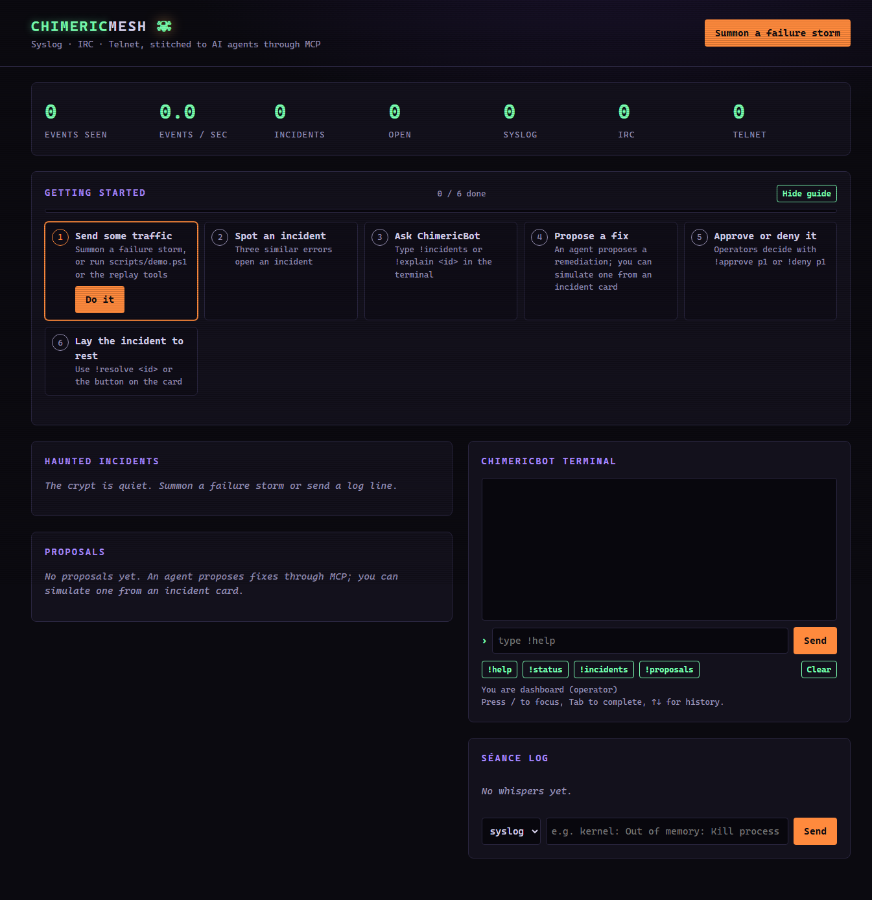
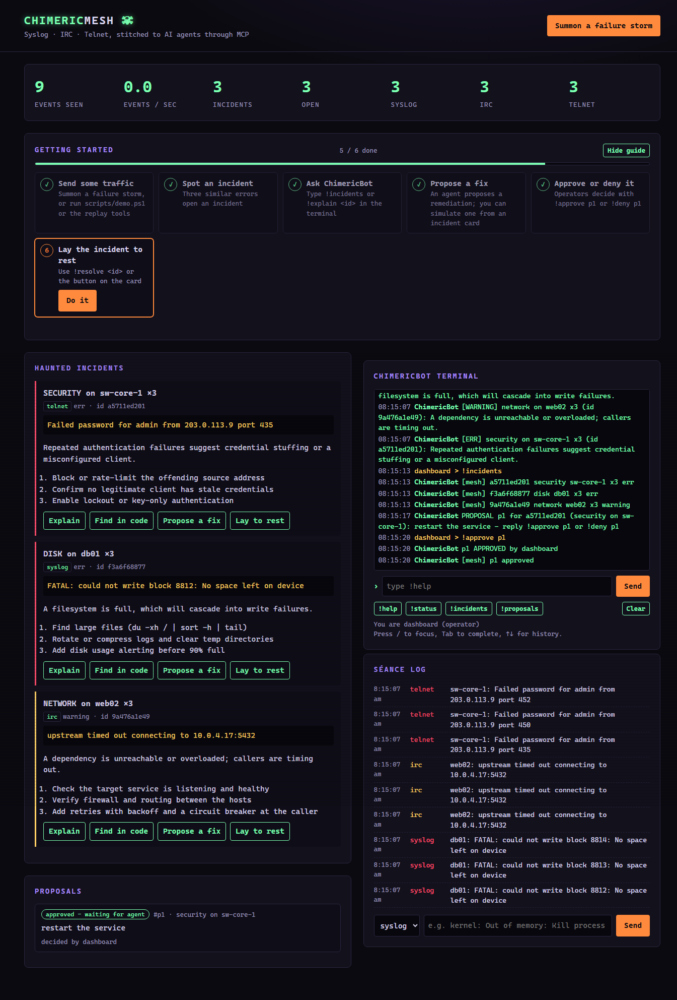

# ChimericMesh

Kiroween 2026, category: **Frankenstein**.

ChimericMesh stitches 1980s infrastructure protocols (Syslog, IRC, Telnet) onto modern AI agent workflows. Legacy systems keep talking the way they always have. Incidents are detected, exposed to Kiro agents through the Model Context Protocol (MCP), and announced back on IRC and via webhooks.

```
Syslog/UDP ─┐
Telnet/TCP ─┼─> parsers ─> Hub ─> incident detection ─┬─> IRC announce
IRC/TCP ────┘                                         └─> webhook
Kiro agent ── MCP (stdio) ──> REST API ──> Hub
```

## Quick start

```powershell
pip install -e ".[dev]"
python -m chimericmesh        # dashboard at http://127.0.0.1:8000
```

Ports (override with env vars): HTTP 8000, Syslog/UDP 5514, IRC 6667, Telnet 2323. Everything binds to 127.0.0.1 by default (`CHIMERICMESH_BIND`).

Try it:

- Run `.\scripts\demo.ps1` to send real Syslog, Telnet and IRC traffic (`-Only syslog|telnet|irc` to send one, `-Count 12` to trigger an `UPDATE` line).
- Click "Summon a failure storm" on the dashboard, or `POST /api/demo/storm`.
- Join IRC (`/server 127.0.0.1 6667`, `/join #ops`) and watch the bot announce incidents.
- Send syslog: `<27>Nov 13 11:10:08 db01 kernel: Out of memory: Kill process 4412`
- Open a Telnet session to port 2323 and type an `ERROR ...` line.

The dashboard's **Events seen** tile is a cumulative counter (`total_events` in `/api/stats`, with `total_by_source` and a 10 second `events_per_second`). The hub only keeps the latest 2000 events in memory for the log view (`events`, `buffer_capacity`), so the log header reads "latest N of TOTAL" once the buffer has wrapped.

## Data and proposal ids

The hub keeps events (bounded), incidents, proposals, an append-only audit log and counters in one local SQLite database, `~/.chimericmesh/chimericmesh.db` by default. The startup log prints its path. Proposal ids are unique per database; deleting the database restarts them at `p1`. Ids look like `p1`, `p2`, `p3` and nothing else.

| Variable | Meaning | Default |
|---|---|---|
| `CHIMERICMESH_DB` | Database file, or `:memory:` for no file | `<home>/chimericmesh.db` |
| `CHIMERICMESH_HOME` | Directory for the database | `~/.chimericmesh` |
| `CHIMERICMESH_MAX_EVENTS` | Most event rows kept (1 to 10,000,000) | 100000 |
| `CHIMERICMESH_EVENT_TTL_DAYS` | Event rows older than this are removed (1 to 3650) | 7 |
| `CHIMERICMESH_REOPEN_AFTER_SECONDS` | A resolved incident reopens when a matching event arrives after this many seconds (0 to 86400) | 300 |

A bad value logs one warning and uses the default. An explicit relative `CHIMERICMESH_DB` is resolved once against the current directory at startup; the defaults never depend on the current directory, so starting the hub from two folders opens the same file.

Things to know:

- One database file supports one running hub process. Two processes serving one file are not supported. A start that fails before serving leaves the crash marker untouched.
- Event ids keep rising across restarts. After a crash a restart skips ahead by a safety margin so clients holding an `after_id` cursor stay valid. After a crash that follows a long storage outage, a restart may reuse event ids a client saw; this is the one known gap.
- A database written by a newer build is refused at startup and is not modified. Refusing a newer-schema database after a crash may still checkpoint its `-wal` file into the database file; the data is not changed.
- The audit log can only be appended to. Log text, secrets and URL credentials never reach it.
- On Windows the owner-only permission step uses `icacls` and is verified by hand; on other systems the directory is `0700` and the file `0600`.
- The decider name of a proposal is display text. These prefixes are reserved for the hub's own rule logic and never make a decision count as the hub's: `rule:`, `rule-`, `withdrawn:`, `expired:`, `expired-`.

## Replaying real logs

Besides the hand-written demo traffic, you can stream real public logs into the mesh over UDP syslog:

```powershell
$env:PYTHONPATH = "src"
python -m chimericmesh.replay --dataset openssh --rate 200   # real SSH brute-force traffic
python -m chimericmesh.replay --dataset linux                # real /var/log/messages
python -m chimericmesh.replay --file my.log --limit 500      # your own file
```

Samples are downloaded on first use into `data/` (git-ignored, never committed). Lines are sent exactly as they appear in the file, with no `<PRI>` header, so the parser infers severity from the text.

**Data credit:** [Loghub](https://github.com/logpai/loghub) by the logpai group. The datasets are free for research and academic use; please cite Zhu et al., "Loghub: A Large Collection of System Log Datasets for AI-driven Log Analytics", ISSRE 2023. Replayed data is real but is not a live production system.

What replaying real data taught us (each now has a regression test): real logs often have no `<PRI>` header, one attacker produces hundreds of near-identical lines that differ only in user and address, one-off errors are noise, and re-analyzing history on every event drops UDP packets. Incidents are now tracked incrementally and the syslog socket has a 4 MB receive buffer.

### Replaying real IRC chat

```powershell
$env:PYTHONPATH = "src"
python -m chimericmesh.replay_irc --dataset ubuntu-server --rate 100
python -m chimericmesh.replay_irc --file chat.txt --channel "#ops" --limit 200   # "[HH:MM] <nick> text" format
```

This replays a real Ubuntu support channel through the mesh's IRC server, with one connection per speaker. The logs come from [irclogs.ubuntu.com](https://irclogs.ubuntu.com/); the Common Pile dataset card describes them as released into the public domain. Nicknames belong to real people, so they are replaced with pseudonyms by default (`--no-mask` disables this). The file is downloaded on first use into `data/` and never committed.

Things the real chat taught us: a chat line is evidence, not proof, so IRC text is capped at error severity and a single message about the OOM killer can no longer open an incident, and the IRC server now ignores any sender prefix a client supplies and uses the registered nickname. Clients must register (`NICK`) before their messages are ingested.

## MCP for Kiro

Run `python -m chimericmesh.mcp_server` (stdio) with `PYTHONPATH=src` and `CHIMERICMESH_URL` pointing at the hub. Add it to `.kiro/settings/mcp.json`:

```json
{
  "mcpServers": {
    "chimericmesh": {
      "command": "python",
      "args": ["-m", "chimericmesh.mcp_server"],
      "env": { "PYTHONPATH": "src", "CHIMERICMESH_URL": "http://127.0.0.1:8000" }
    }
  }
}
```

Tools: `list_incidents`, `get_incident`, `find_code_for_incident`, `recent_events`, `announce_to_irc`, `resolve_incident`.

Optional: set `CHIMERICMESH_WEBHOOK_URL` for webhooks and `CHIMERICMESH_CODE_ROOT` for code lookups.

## How incidents behave

- **Hosts:** Syslog carries a host field. For IRC and Telnet, a leading `hostname:` in the message (for example `web02: upstream timed out` or `ALERT sw-core-1: Failed password`) sets the host. Otherwise the IRC nick or the Telnet peer address is used.
- **Opening:** an incident is announced on IRC (and by webhook) once it has 3 events, or immediately at crit severity or worse.
- **Updates:** follow-up `UPDATE` lines go out when the count passes 10, 50, 100 and 500, so channels do not get flooded.
- **Code lookup:** searches `examples/legacy_app/` by default, a small sample app whose log lines match the demo storm. Point `CHIMERICMESH_CODE_ROOT` at your own source tree to use it for real.

## Screenshots

Captured from the running app in headless Edge.





## Tests

```powershell
python -m pytest -q
```

Includes Hypothesis property tests for parser totality, IRC injection safety, and chunking.

## Kiro usage

- Specs: `.kiro/specs/legacy-mesh/` (requirements, design with correctness properties, tasks)
- Steering: `.kiro/steering/`
- Hooks: `.kiro/hooks/` (tests on save, innerHTML guard)
- MCP: `src/chimericmesh/mcp_server.py`
- Custom agent: `.kiro/agents/mesh-responder.json`
- Power: `powers/chimericmesh-remediation/`

## Kiro agent and power

**Custom agent `mesh-responder`** (`.kiro/agents/mesh-responder.json`) runs the human-approved remediation loop. It defines the `chimericmesh` MCP server inline, loads `.kiro/steering/project.md`, and auto-allows only the read-only MCP tools (`list_incidents`, `get_incident`, `find_code_for_incident`, `recent_events`, `list_proposals`, `get_proposal`). `announce_to_irc`, `propose_remediation`, `complete_proposal`, `resolve_incident`, shell and file writes ask for permission. Select it with the agent picker in Kiro IDE, or `/agent` in Kiro CLI, after trusting the workspace. Start the hub first (`python -m chimericmesh`).

**Power `chimericmesh-remediation`** (`powers/chimericmesh-remediation/`) uses the Agent Plugins layout: `plugin.json`, `mcp.json`, and `skills/` (`getting-started`, `remediation-loop`, `triage`). To install it, open the Powers panel, choose Add Custom Power, then Import power from a folder, and select that directory.

`tests/unit/test_kiro_assets.py` checks both files statically (JSON validity, tool names against the MCP server, consistency with `.kiro/settings/mcp.json`). It does not show that Kiro loads them.
- PBT: `tests/pbt/`

## Security notes

Intended for localhost. Changes that widen what can happen (approving, denying, editing services) need the admin token; see "Access control". Log text is rendered as text only, and outbound IRC is stripped of control characters.

## Access control

`python -m chimericmesh` turns access enforcement on. A test or embedding that passes its own hub to `create_app` gets it off unless it asks for `enforce_access=True`.

- **Admin token.** A random token lives in `~/.chimericmesh/admin.token` (owner-only permissions). Set `CHIMERICMESH_TOKEN_FILE` to use another path. The startup log prints the file's path, never the token. `python -m chimericmesh token --rotate` writes a new token and prints only the path. A running hub keeps its old token, and the new one takes effect at the next hub start. With `CHIMERICMESH_DB=:memory:` the token exists only in memory and no file is written.
- **What needs the token.** Creating, editing or deleting services and log sources (`/api/services...`), `POST /api/proposals/{id}/decide`, and `!approve` / `!deny` in the dashboard terminal. Clients send it in the `X-Admin-Token` header. Reads, ingest, creating or completing proposals, `!resolve` and the demo routes need no token.
- **Reducing operations are open.** Pause, revoke and withdraw need no token and are open to any local caller, including the agent from a shell. The cost is that a local process can stop auto-approvals or withdraw proposals: an annoyance, not escalation. Resume and every other rule change need the user.
- **Honest limit.** The token keeps out web pages and local processes that cannot read your files. It does not stop the agent, which runs as you and can read the token file. Kiro's shell prompt is the real gate for what the agent does.
- **Host check.** Requests to `/api/*` must carry a `Host` of `127.0.0.1`, `localhost` or `[::1]` (any port), which blocks DNS rebinding. `CHIMERICMESH_ALLOWED_HOSTS` (comma-separated) replaces that list. `CHIMERICMESH_BIND` sets the listen address; a non-loopback value logs a warning, because the dashboard is then reachable from other machines.
- **IRC operators.** `CHIMERICMESH_OPERATORS` lists the nicks that may use `!approve`, `!deny` and `!resolve`. With enforcement on, an IRC client must also set the server password to the admin token (`PASS`, for example `/server 127.0.0.1 6667 <token>`). If `CHIMERICMESH_OPERATORS` is unset, operator commands are refused on IRC. The nicks `dashboard` and `ChimericBot` are reserved.
- **Services and incidents.** Two services behind one sender host that log the same error signature share an incident; it belongs to the service of its first tagged event.

## License

MIT

## Talking to the mesh over IRC

IRC is a two-way operator interface. Registered clients can send commands (messages starting with `!`) in a channel the bot is in. Commands are never ingested as log events. Replies are posted to the channel, prefixed `[mesh]`.

| Command | Who | What it does |
| --- | --- | --- |
| `!help` | anyone | List commands |
| `!status` | anyone | Events seen, open incidents, pending proposals |
| `!incidents` | anyone | Up to 5 open incidents: `id category host xCOUNT severity` |
| `!explain <id>` | anyone | Hypothesis and up to 4 remediation steps |
| `!proposals` | anyone | Pending remediation proposals |
| `!resolve <id> [note]` | operator | Resolve an incident |
| `!approve <pid>` / `!deny <pid>` | operator | Decide a proposal |

Operators are set with `CHIMERICMESH_OPERATORS` (comma-separated nicks, case-insensitive) and, with enforcement on (the default for `python -m chimericmesh`), must also send the admin token as the server password; if it is unset or empty, operator commands are refused. Only with enforcement off (an injected hub, as in tests) does an unset list mean any registered nick counts as an operator. See "Access control".

### Human-approved remediation loop

```
agent (MCP)                 ChimericMesh / IRC #ops              human
-----------                 ----------------------               -----
list_incidents, get_incident, find_code_for_incident
propose_remediation  ---->  "PROPOSAL p1 for <id> ... "  ---->  reads it
get_proposal (poll)  <----  status: pending                      !approve p1  (or !deny p1)
get_proposal         <----  status: approved   <-----------------
(agent does the work itself)
complete_proposal    ---->  "p1 DONE: <note>"
resolve_incident     ---->  "RESOLVED <id> ..."
```

REST: `GET/POST /api/proposals`, `GET /api/proposals/{pid}`, `POST /api/proposals/{pid}/decide`, `POST /api/proposals/{pid}/complete`. MCP tools: `propose_remediation`, `get_proposal`, `list_proposals`, `complete_proposal`.

Safety: ChimericMesh never executes a proposed action on any host. It only records the human decision and announces it. The agent performs the real work under its own tool permissions, and must act only when the proposal is `approved`, never while it is `pending` or `denied`. Proposals are kept in the local database (see "Data and proposal ids"); an injected in-memory hub keeps the last 200.

## A real incident, a real fix

`examples/legacy_app` is a runnable service with a real bug (see its README). To fix it through the approval loop:

1. Run the hub: `python -m chimericmesh`.
2. Run the service: `python examples/legacy_app/run.py`. It sends syslog to the hub.
3. Open the dashboard and wait for the `network` incident about the upstream timeout.
4. In Kiro, pick the `mesh-responder` agent and ask it to investigate and propose a fix.
5. Approve with `!approve p1` in the dashboard terminal: it needs the admin token, and the page asks for it once (paste the contents of `~/.chimericmesh/admin.token`). On IRC, set the server password to the admin token and use a nick listed in `CHIMERICMESH_OPERATORS`.
6. The agent edits the code, runs `python -m pytest examples/legacy_app/tests -q`, restarts nothing on its own, and reports the event rate. Restart `run.py` to load the fix and watch the rate fall.
7. Reset the buggy state: `git checkout -- examples/legacy_app` and `git clean -fd examples/legacy_app`.

## The dashboard terminal and guided workflow

The dashboard has a ChimericBot terminal: a transcript of everything the bot says plus an input line that accepts the same `!` commands as IRC (`!help`, `!status`, `!incidents`, `!explain <id>`, `!proposals`, `!approve`, `!deny`, `!resolve`). Dashboard buttons just send these commands, so every action appears in the transcript and one authorization check applies everywhere. Replies are also broadcast to IRC.

Web commands run as the fixed nick `dashboard`; the browser cannot choose a nick. With enforcement on, `!approve` and `!deny` in the terminal need the admin token instead of an operator nick (the page asks for it once and keeps it for the tab), so `CHIMERICMESH_OPERATORS` only governs IRC and `!resolve`.

The guided workflow (`GET /api/workflow`) has six steps:
1. Send some traffic (any event ingested)
2. Spot an incident
3. Ask ChimericBot (run any command)
4. Propose a fix
5. Approve or deny it
6. Lay the incident to rest (resolve)

Endpoints: `GET /api/chat?after=&limit=`, `POST /api/terminal {"text": "!status"}`, `GET /api/workflow`.

Origin check: POST/PUT/PATCH/DELETE requests carrying an `Origin` header that differs from `Host` get 403, which blocks other websites from driving a local instance. Clients that send no Origin (curl, scripts, the MCP server) are unaffected.

Security note: IRC nicks are unauthenticated, so `CHIMERICMESH_OPERATORS` is only a guard on trusted networks, not real authentication.
