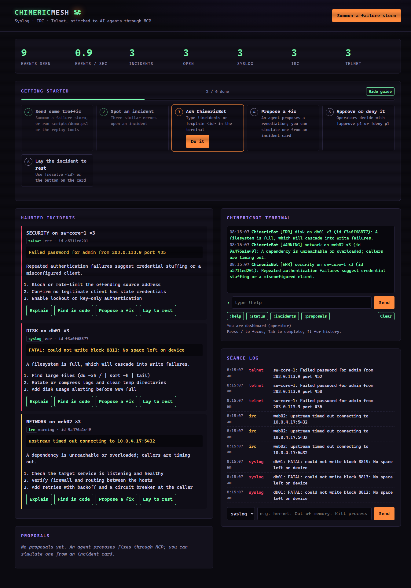

# ChimericMesh

Kiroween 2026, category: **Frankenstein**.

ChimericMesh stitches 1980s infrastructure protocols (Syslog, IRC, Telnet) onto modern AI agent workflows. Legacy systems keep talking the way they always have. Incidents are detected, exposed to Kiro agents through the Model Context Protocol (MCP), and announced back on IRC and via webhooks.

```
Syslog/UDP ─┐
Telnet/TCP ─┼─> parsers ─> Hub ─> incident detection ─┬─> IRC announce
IRC/TCP ────┘                                         └─> webhook
Kiro agent ── MCP (stdio) ──> REST API ──> Hub
```

## Quick start

```powershell
pip install -e ".[dev]"
python -m chimericmesh        # dashboard at http://127.0.0.1:8000
```

Ports (override with env vars): HTTP 8000, Syslog/UDP 5514, IRC 6667, Telnet 2323. Everything binds to 127.0.0.1 by default (`CHIMERICMESH_BIND`).

Try it:

- Run `.\scripts\demo.ps1` to send real Syslog, Telnet and IRC traffic (`-Only syslog|telnet|irc` to send one, `-Count 12` to trigger an `UPDATE` line).
- Click "Summon a failure storm" on the dashboard, or `POST /api/demo/storm`.
- Join IRC (`/server 127.0.0.1 6667`, `/join #ops`) and watch the bot announce incidents.
- Send syslog: `<27>Nov 13 11:10:08 db01 kernel: Out of memory: Kill process 4412`
- Open a Telnet session to port 2323 and type an `ERROR ...` line.

The dashboard's **Events seen** tile is a cumulative counter (`total_events` in `/api/stats`, with `total_by_source` and a 10 second `events_per_second`). The hub only keeps the latest 2000 events in memory for the log view (`events`, `buffer_capacity`), so the log header reads "latest N of TOTAL" once the buffer has wrapped.

## Replaying real logs

Besides the hand-written demo traffic, you can stream real public logs into the mesh over UDP syslog:

```powershell
$env:PYTHONPATH = "src"
python -m chimericmesh.replay --dataset openssh --rate 200   # real SSH brute-force traffic
python -m chimericmesh.replay --dataset linux                # real /var/log/messages
python -m chimericmesh.replay --file my.log --limit 500      # your own file
```

Samples are downloaded on first use into `data/` (git-ignored, never committed). Lines are sent exactly as they appear in the file, with no `<PRI>` header, so the parser infers severity from the text.

**Data credit:** [Loghub](https://github.com/logpai/loghub) by the logpai group. The datasets are free for research and academic use; please cite Zhu et al., "Loghub: A Large Collection of System Log Datasets for AI-driven Log Analytics", ISSRE 2023. Replayed data is real but is not a live production system.

What replaying real data taught us (each now has a regression test): real logs often have no `<PRI>` header, one attacker produces hundreds of near-identical lines that differ only in user and address, one-off errors are noise, and re-analyzing history on every event drops UDP packets. Incidents are now tracked incrementally and the syslog socket has a 4 MB receive buffer.

### Replaying real IRC chat

```powershell
$env:PYTHONPATH = "src"
python -m chimericmesh.replay_irc --dataset ubuntu-server --rate 100
python -m chimericmesh.replay_irc --file chat.txt --channel "#ops" --limit 200   # "[HH:MM] <nick> text" format
```

This replays a real Ubuntu support channel through the mesh's IRC server, with one connection per speaker. The logs come from [irclogs.ubuntu.com](https://irclogs.ubuntu.com/); the Common Pile dataset card describes them as released into the public domain. Nicknames belong to real people, so they are replaced with pseudonyms by default (`--no-mask` disables this). The file is downloaded on first use into `data/` and never committed.

Things the real chat taught us: a chat line is evidence, not proof, so IRC text is capped at error severity and a single message about the OOM killer can no longer open an incident, and the IRC server now ignores any sender prefix a client supplies and uses the registered nickname. Clients must register (`NICK`) before their messages are ingested.

## MCP for Kiro

Run `python -m chimericmesh.mcp_server` (stdio) with `PYTHONPATH=src` and `CHIMERICMESH_URL` pointing at the hub. Add it to `.kiro/settings/mcp.json`:

```json
{
  "mcpServers": {
    "chimericmesh": {
      "command": "python",
      "args": ["-m", "chimericmesh.mcp_server"],
      "env": { "PYTHONPATH": "src", "CHIMERICMESH_URL": "http://127.0.0.1:8000" }
    }
  }
}
```

Tools: `list_incidents`, `get_incident`, `find_code_for_incident`, `recent_events`, `announce_to_irc`, `resolve_incident`.

Optional: set `CHIMERICMESH_WEBHOOK_URL` for webhooks and `CHIMERICMESH_CODE_ROOT` for code lookups.

## How incidents behave

- **Hosts:** Syslog carries a host field. For IRC and Telnet, a leading `hostname:` in the message (for example `web02: upstream timed out` or `ALERT sw-core-1: Failed password`) sets the host. Otherwise the IRC nick or the Telnet peer address is used.
- **Opening:** an incident is announced on IRC (and by webhook) once it has 3 events, or immediately at crit severity or worse.
- **Updates:** follow-up `UPDATE` lines go out when the count passes 10, 50, 100 and 500, so channels do not get flooded.
- **Code lookup:** searches `examples/legacy_app/` by default, a small sample app whose log lines match the demo storm. Point `CHIMERICMESH_CODE_ROOT` at your own source tree to use it for real.

## Screenshots

Captured from the running app in headless Edge.





## Tests

```powershell
python -m pytest -q
```

Includes Hypothesis property tests for parser totality, IRC injection safety, and chunking.

## Kiro usage

- Specs: `.kiro/specs/legacy-mesh/` (requirements, design with correctness properties, tasks)
- Steering: `.kiro/steering/`
- Hooks: `.kiro/hooks/` (tests on save, innerHTML guard)
- MCP: `src/chimericmesh/mcp_server.py`
- PBT: `tests/pbt/`

## Security notes

No authentication; intended for localhost or trusted networks. Log text is rendered as text only, and outbound IRC is stripped of control characters.

## License

MIT

## Talking to the mesh over IRC

IRC is a two-way operator interface. Registered clients can send commands (messages starting with `!`) in a channel the bot is in. Commands are never ingested as log events. Replies are posted to the channel, prefixed `[mesh]`.

| Command | Who | What it does |
| --- | --- | --- |
| `!help` | anyone | List commands |
| `!status` | anyone | Events seen, open incidents, pending proposals |
| `!incidents` | anyone | Up to 5 open incidents: `id category host xCOUNT severity` |
| `!explain <id>` | anyone | Hypothesis and up to 4 remediation steps |
| `!proposals` | anyone | Pending remediation proposals |
| `!resolve <id> [note]` | operator | Resolve an incident |
| `!approve <pid>` / `!deny <pid>` | operator | Decide a proposal |

Operators are set with `CHIMERICMESH_OPERATORS` (comma-separated nicks, case-insensitive). If it is unset or empty, any registered nick counts as an operator. That is only acceptable on localhost or a trusted network, since IRC nicks are not authenticated here.

### Human-approved remediation loop

```
agent (MCP)                 ChimericMesh / IRC #ops              human
-----------                 ----------------------               -----
list_incidents, get_incident, find_code_for_incident
propose_remediation  ---->  "PROPOSAL p1 for <id> ... "  ---->  reads it
get_proposal (poll)  <----  status: pending                      !approve p1  (or !deny p1)
get_proposal         <----  status: approved   <-----------------
(agent does the work itself)
complete_proposal    ---->  "p1 DONE: <note>"
resolve_incident     ---->  "RESOLVED <id> ..."
```

REST: `GET/POST /api/proposals`, `GET /api/proposals/{pid}`, `POST /api/proposals/{pid}/decide`, `POST /api/proposals/{pid}/complete`. MCP tools: `propose_remediation`, `get_proposal`, `list_proposals`, `complete_proposal`.

Safety: ChimericMesh never executes a proposed action on any host. It only records the human decision and announces it. The agent performs the real work under its own tool permissions, and must act only when the proposal is `approved`, never while it is `pending` or `denied`. Proposals live in memory (last 200 kept).

## The dashboard terminal and guided workflow

The dashboard has a ChimericBot terminal: a transcript of everything the bot says plus an input line that accepts the same `!` commands as IRC (`!help`, `!status`, `!incidents`, `!explain <id>`, `!proposals`, `!approve`, `!deny`, `!resolve`). Dashboard buttons just send these commands, so every action appears in the transcript and one authorization check applies everywhere. Replies are also broadcast to IRC.

Web commands run as the fixed nick `dashboard`; the browser cannot choose a nick. To restrict approvals, set `CHIMERICMESH_OPERATORS` (comma-separated). If you restrict it and want the dashboard user to decide, include `dashboard`, for example `CHIMERICMESH_OPERATORS=alice,dashboard`.

The guided workflow (`GET /api/workflow`) has six steps:
1. Send some traffic (any event ingested)
2. Spot an incident
3. Ask ChimericBot (run any command)
4. Propose a fix
5. Approve or deny it
6. Lay the incident to rest (resolve)

Endpoints: `GET /api/chat?after=&limit=`, `POST /api/terminal {"text": "!status"}`, `GET /api/workflow`.

Origin check: POST/PUT/PATCH/DELETE requests carrying an `Origin` header that differs from `Host` get 403, which blocks other websites from driving a local instance. Clients that send no Origin (curl, scripts, the MCP server) are unaffected.

Security note: IRC nicks are unauthenticated, so `CHIMERICMESH_OPERATORS` is only a guard on trusted networks, not real authentication.
